# KwickOS

<p align="center">
  
</p>

**A Linux distribution smaller and faster than Alpine that installs software like Debian, with an optional
desktop that looks like macOS, Windows 11 or a Linux shell at the flip of a switch.**

KwickOS is built from scratch on the latest stable kernel (7.3.x) with a **5.5 MB** base. It runs `apt install` against the
**unmodified Debian 13 "trixie" archive** (about 69,000 packages, glibc included), pulled in only when you install something that needs
them. The same base boots as a container, a microVM, a cloud/VM disk or a live ISO on **amd64, arm64 and riscv64**.

```console
$ docker run --rm -it ghcr.io/metaspartan/kwickos
root@kwick:/# apt update && apt install -y nginx python3
root@kwick:/# systemctl enable --now nginx      # works in containers too
```

`apt install kwick-desktop` turns the same system into a full desktop: KDE Plasma 6 with three unified layouts, Kwick Effects,
a settings app, an icon theme, per-layout fonts, native Steam and automatic GPU driver setup.

| Headless (real boot, serial console) | Desktop (KDE Plasma 6, macOS layout) |
|---|---|
|  |  |

## Contents

* [How it compares](#how-it-compares) and [results](#results)
* [Install](#install)
* [The desktop](#the-desktop): [layouts](#three-layouts-three-desktops), [Kwick Effects](#kwick-effects), [Settings](#kwickos-settings),
  [icons](#icons), [fonts](#fonts), [app names](#files-and-terminal), [Steam](#steam), [GPUs and hardware](#gpus-and-hardware),
  [Darling](#darling-macos-command-line-binaries-optional)
* [Using the base system](#using-the-base-system)
* [Verification](#verification), [building](#building), [limitations](#limitations)

## How it compares


### Results

Measured, details in [docs/BENCHMARKS.md](docs/BENCHMARKS.md).

| | Alpine 3.24.4 | **KwickOS** |
|---|---:|---:|
| container image (uncompressed / gzip) | 8.43 / 3.72 MB | **5.53 / 2.60 MB** |
| memory of a `sh` in a container (anon + page tables) | 88 KiB | **56 KiB** |
| VM boot to shell prompt (QEMU/KVM, live ISO, wall time) | 3.73 s | **1.17 s** |
| guest boot time at shell (`/proc/uptime`) | 3.10 s | **0.75 s** (0.22 s as microVM) |
| memory in use after boot | 69.7 MiB | **38.3 MiB** |
| live ISO | 70 MB | **24 MB** |
| packages available | ~20k (musl) | **~69k (Debian 13, glibc)** |

Real software from the Debian archive passes a 31-package compatibility matrix (PostgreSQL 17, MariaDB 11.8, Docker, OpenJDK 21,
Go, gcc, Node.js, Python, PHP, Ruby, Redis, nginx, Apache, OpenSSH and others): [docs/COMPATIBILITY.md](docs/COMPATIBILITY.md).

### Why it is different

| | Alpine | Debian/Ubuntu | **KwickOS** |
|---|---|---|---|
| base userland | BusyBox + musl `.so` | GNU coreutils + glibc | BusyBox + **static** kinit/kpkg (no libc `.so` at all) |
| package manager | apk (Alpine packages, musl) | apt/dpkg | **kpkg**: `apt`/`dpkg`-compatible, uses Debian's own repos |
| software compatibility | musl rebuilds | everything | everything in Debian (glibc arrives on demand) |
| init | OpenRC | systemd | **kinit**: 120 KB PID 1 that runs systemd unit files |
| boot chain | bootloader + initramfs | GRUB + initramfs-tools | **none**: the kernel is a UEFI app with a 120 KB embedded root finder |
| kernel updates | apk | apt + update-grub + initramfs rebuild | `apt upgrade` copies one EFI file (and keeps the previous one for rollback) |

* **Essential set provided virtually.** The base declares the Debian Essential packages (`coreutils`, `bash`, `dpkg`, ...) as satisfied
  by BusyBox, so real Debian packages install unmodified on a 5 MB system.
* **Self-healing compatibility.** If a maintainer script trips over a BusyBox difference, kpkg installs the GNU tool from Debian and
  retries. GNU tools exist only where software needs them.
* **systemd compatibility without systemd.** `.service` units, `deb-systemd-helper`, `systemd-sysusers` and `systemd-tmpfiles` are
  handled by kinit, so `apt install nginx` gets you a running, enabled, supervised service.
* **One file boots everything.** The EFI-stub kernel embeds kinit, which finds a `kwick-root` partition, a `KWICKOS` live medium
  (erofs + overlay), `root=`, virtiofs/9p, or a whole-OS initramfs. No GRUB, no dracut, nothing to regenerate.
* **Multiarch.** kpkg handles foreign architectures (`dpkg --add-architecture i386`), which is what native Steam uses.

Details: [docs/ARCHITECTURE.md](docs/ARCHITECTURE.md).

## Install

| file | what |
|---|---|
| `kwickos-amd64-desktop.iso` | KDE Plasma 6 desktop live ISO, boots in **UEFI and BIOS** (also `arm64`, UEFI) |
| `kwickos-amd64.iso` | headless live ISO (UEFI, generic kernel, broad hardware), runs from RAM |
| `kwickos-amd64.qcow2` / `.img.zst` | VM/cloud disk: ESP (kernel) + ext4 root, 1 GiB |
| `kwickos-amd64.efi` | the kernel itself (virt flavor), a UEFI app and `-kernel` image for QEMU/Firecracker |
| `kwickos-amd64-initramfs.cpio.zst` | the whole OS as an initramfs (microVMs, CI sandboxes) |
| `kwickos-rootfs-amd64.tar.gz` | rootfs tarball (containers, chroots, WSL) |
| `ghcr.io/metaspartan/kwickos` | multi-arch container image |

Replace `amd64` with `arm64` or `riscv64` where published. CI builds and publishes them for every release.

**Desktop, two ways**

1. Boot `kwickos-amd64-desktop.iso` (UEFI or BIOS) and you land in Plasma.
2. Upgrade any headless install in place:

```sh
apt update && apt install kwick-desktop      # resolves to about 1,330 packages
reboot
```

The reboot into the upgraded desktop, the BIOS and UEFI ISO boots and a clean install are covered in
[docs/VERIFICATION.md](docs/VERIFICATION.md).

| Desktop ISO, UEFI | Desktop ISO, BIOS (SeaBIOS) | After `apt install kwick-desktop` on a headless image |
|---|---|---|
| 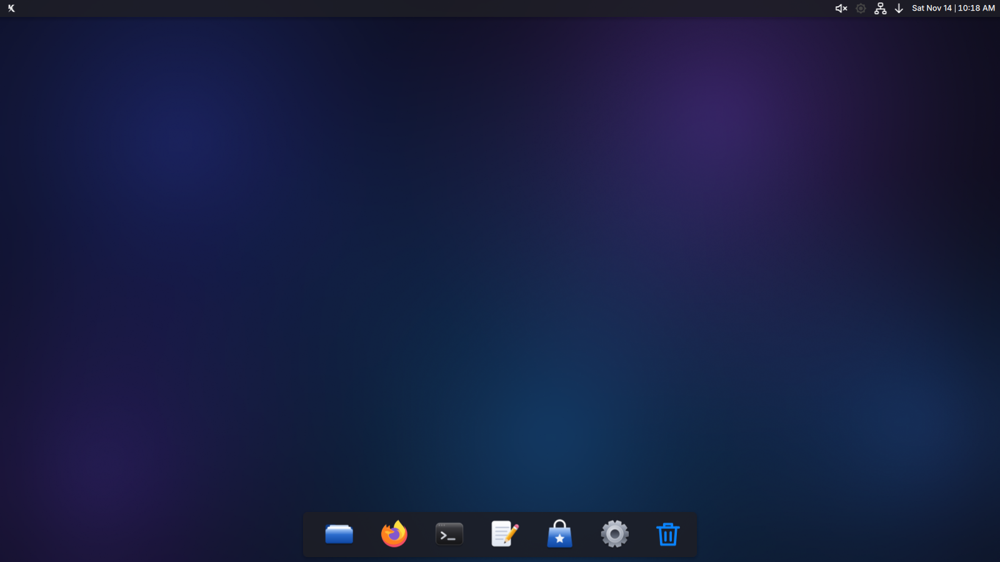 | 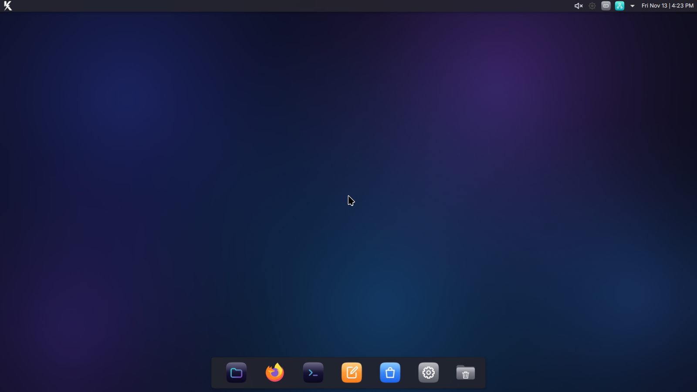 | 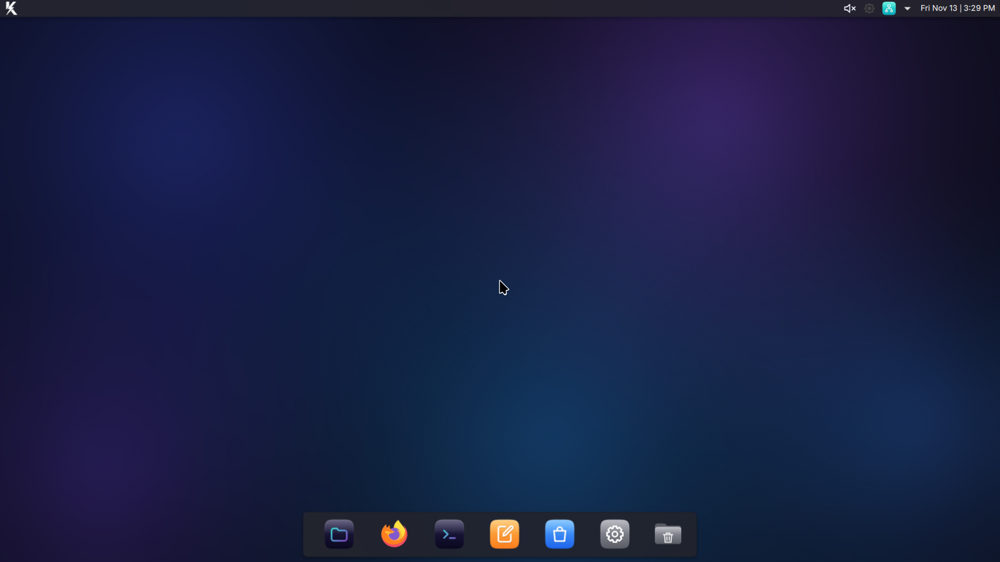 |

**Headless examples**

```sh
qemu-system-x86_64 -M q35,accel=kvm -cpu host -m 512 -bios /usr/share/OVMF/OVMF_CODE.fd \
  -drive file=kwickos-amd64.qcow2,if=virtio -nic user,model=virtio-net-pci -nographic

qemu-system-x86_64 -M microvm,accel=kvm -cpu host -m 256 -nodefaults -nographic -serial stdio \
  -kernel kwickos-amd64.efi -initrd kwickos-amd64-initramfs.cpio.zst -append "console=ttyS0"

  ... -append "console=ttyS0 kwick.run=apt+update;apt+install+-y+jq"
```

Apple Silicon: use the arm64 qcow2 or ISO with UTM, Lima, Parallels or any Virtualization.framework VM, or see
[docs/HARDWARE.md](docs/HARDWARE.md) for bare-metal Asahi support.

## The desktop

### Three layouts, three desktops

`kwick-layout macos|windows|linux` switches the whole look at once: window buttons, panel or dock position, fonts, icons, wallpaper
and Files sidebar. It applies to **KDE Plasma** (default), **GNOME** and **Hyprland** (the `kwick-hyprland` package), and every
layout is dark.

* **macOS** (default): full-width menu bar flush to the screen edges with a white KwickOS mark and a compact clock, a floating dock
  with 48 px icons, traffic-light buttons at the top left of every window.
* **Windows 11**: 48 px centered taskbar with the KwickOS start icon, small padded clock, Fluent
  caption buttons on the right.
* **Linux**: thin top bar (launcher, centered clock, tray) with a floating dock on the left.

| macOS | Windows | Linux |
|---|---|---|
|  |  |  |

The same three layouts on GNOME (GNOME Text Editor open in each):

| macOS | Windows | Linux |
|---|---|---|
| 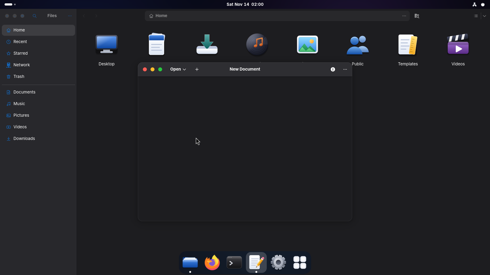 | 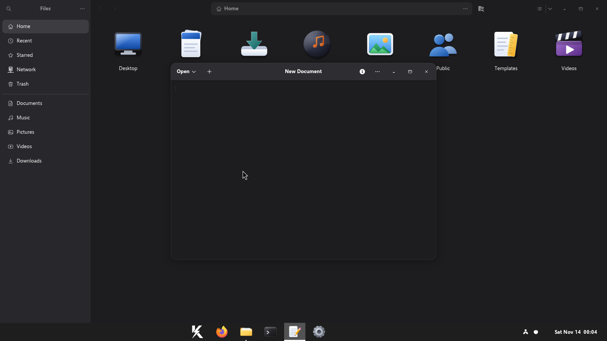 | 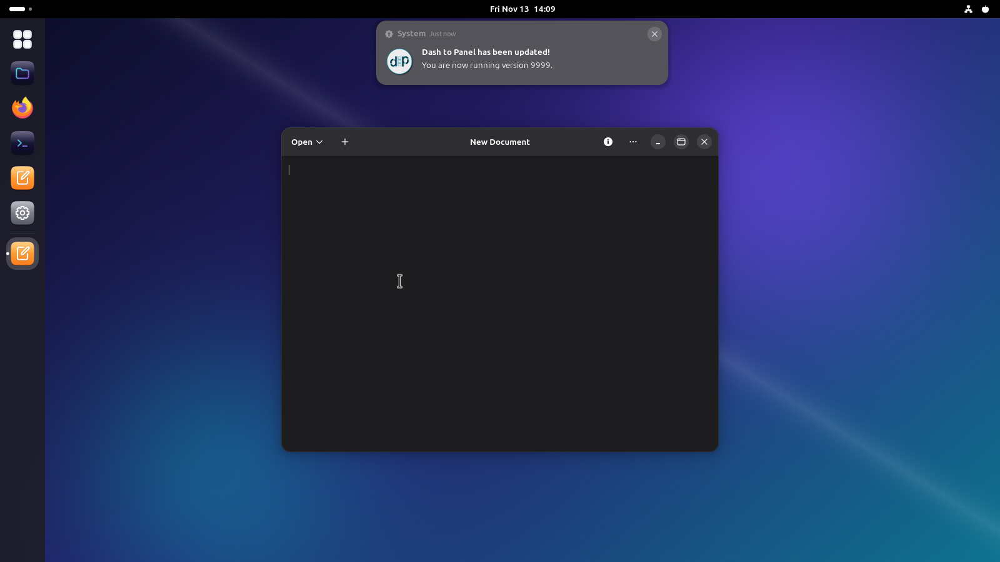 |

And on Hyprland, with a waybar per layout:

| macOS | Windows | Linux |
|---|---|---|
| 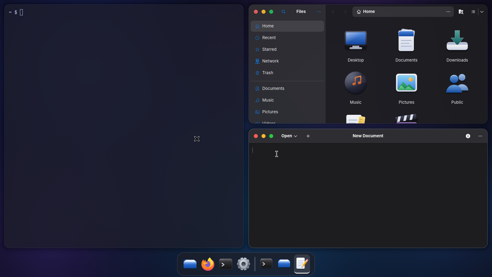 | 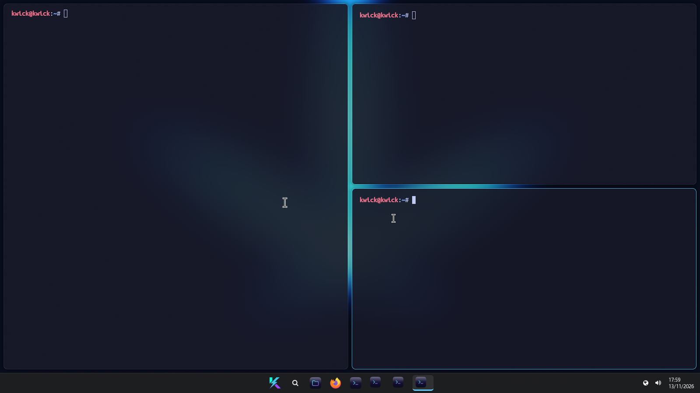 | 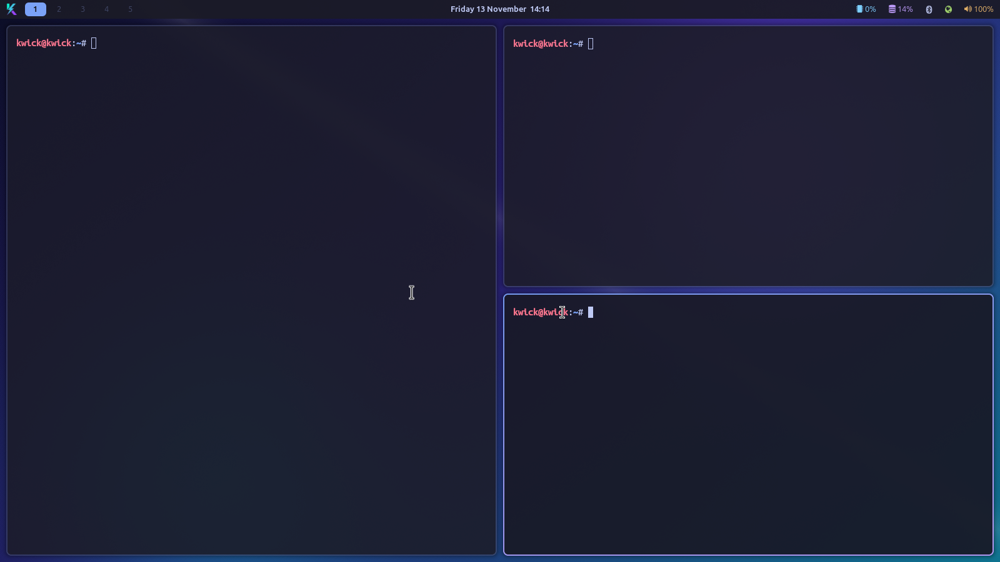 |

The dock is configured with `kwick-dock` (position, icon size, autohide, floating, pinned apps) and the same options are in the
Settings app. Window decorations (KwickGlass, KwickFluent), three color schemes, wallpapers and the Terminal glass profile are
generated by `desktop/gen-theme.py`. Other desktops can be installed with `kwick-desktop install xfce|cinnamon|mate|lxqt` and chosen
with `kwick-desktop switch`.

### Kwick Effects

Native effects, with `kwick-effects off|subtle|fluid|full` presets or one toggle at a time (`kwick-effects set wobbly on`). They run
as KWin effects on KDE, GNOME Shell extensions on GNOME and Hyprland animations on Hyprland, and need a GPU compositor (on a software
compositor `kwick-effects` writes the config and tells you so).

| preset | what you get |
|---|---|
| off | no animations |
| subtle | fades, blur, sliding popups, magic lamp |
| fluid | plus curvy wobbly windows, sheets and the 3D flip open/close |
| full | plus flame open/close, translucency, dimmed inactive windows, the lit 3D desktop cube and Cover Flow Alt+Tab |

Effects you can switch one by one (`kwick-effects set NAME on|off`, or the toggles on the Effects page of Settings):

| name | what it does |
|---|---|
| `wobbly` | windows stretch like jelly while you drag them |
| `lamp` | magic lamp minimize into the dock |
| `flame` | windows ignite and burn away, with flames that rise past the window edges |
| `flip` | windows swing in and out in 3D perspective with lighting (styles flip, door, tilt) |
| `dissolve` | closing windows crumble into glowing dust |
| `glide`, `fallapart` | the stock Glide and Fall Apart open/close effects |
| `cube` | Meta+C shows the desktops as a cube; the desktop switch animation can be a cube too (`kwick-effects switch cube`, Meta+Ctrl+Left/Right) |
| `blur`, `transparency`, `sheet`, `dim`, `overview` | frosted glass, translucency, dropping dialogs, dimmed inactive windows, overview |

Only one open/close effect is active at a time (`flame`, `flip`, `dissolve`, `glide`, `fallapart` replace each other).

Options:

* `kwick-effects wobbly AMOUNT SWAY` takes two numbers from 1 to 10 (`kwick-effects param wobbly` prints them). Amount is how far the window
  stretches, sway is how curvy and fluid it is (softer springs and a finer mesh). The defaults are 6 and 7. In Settings they are the
  "Wobble" and "Sway" sliders.
* `kwick-effects flame-style classic|inferno|ember|blue` and `kwick-effects flame-height 50-200`: Classic is tall orange fire rising above
  the window, Inferno is wide and flares out at the sides, Ember is a subtle burn edge with drifting sparks, Blue is a hot gas flame.
* `kwick-effects param flip flip|door|tilt` picks the 3D open/close style.
* `kwick-effects switch slide|fade|cube|none` and `kwick-effects tabbox windows|cover|flip|grid` set the desktop switch animation and the
  Alt+Tab style.

| Wobbly windows (6/7) | Dissolve close | 3D desktop cube |
|---|---|---|
| 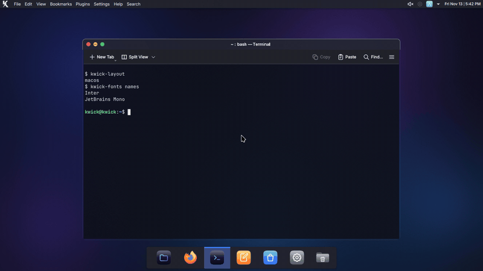 |  | 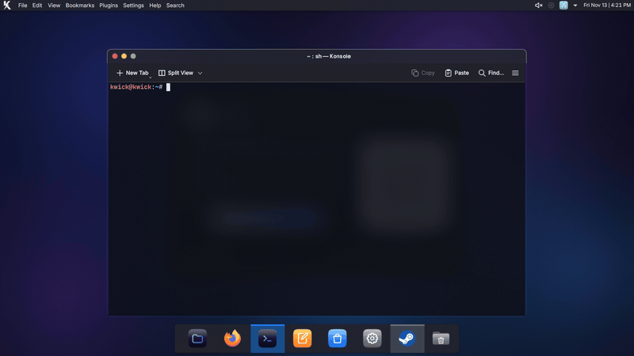 |

| 3D open/close: flip | door | tilt |
|---|---|---|
|  |  |  |

| Flame: classic | Flame: inferno | Flame: ember | Flame: blue |
|---|---|---|---|
| 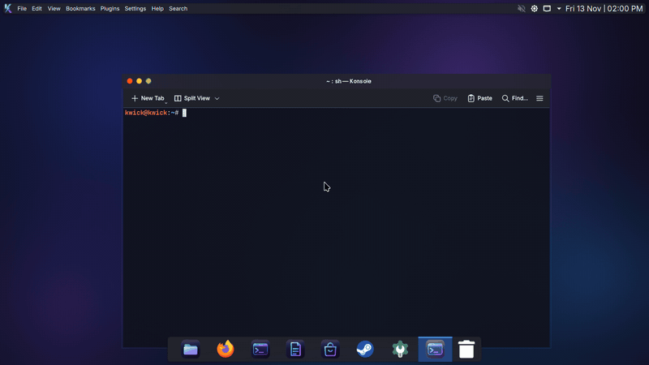 |  |  |  |

| Magic lamp |
|---|
| 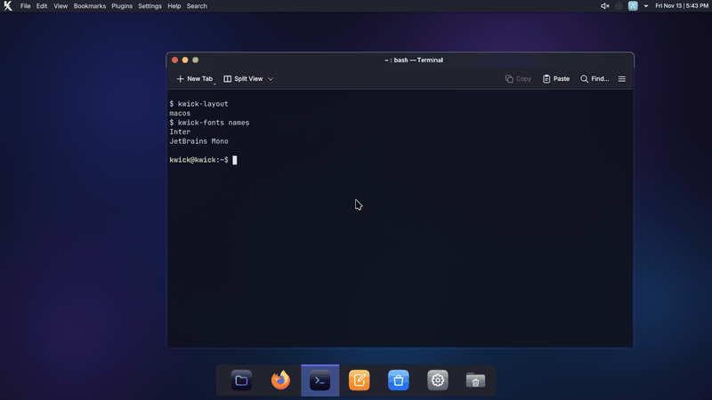 |

These were captured in a KVM guest with a virgl GPU (KWin on OpenGL), see [docs/VERIFICATION.md](docs/VERIFICATION.md). The capture
path drops frames, so the GIFs are jumpier than the real thing; frame sheets are next to them in `docs/img` (`effects-*-frames.png`). The
magic lamp GIF is from an earlier capture round. On GNOME the presets drive the extensions that are installed (wobbly, lamp, burn, cube,
blur, and the wobble sliders map to the wobbly extension); on Hyprland they write bezier-curve animations (an overshoot curve for wobbly,
a 3D-ish pop-in and fading slide for flip and the cube setting), blur and dimming.

### KwickOS Settings

`kwick-settings` is a QML app with pages for Appearance (layout and accent color), Dock, Effects, Fonts, Desktop Session, GPU and
Gaming. It tells you when no GPU compositor is running and offers to install `kwick-gpu`.

| Appearance | Dock | Effects |
|---|---|---|
| 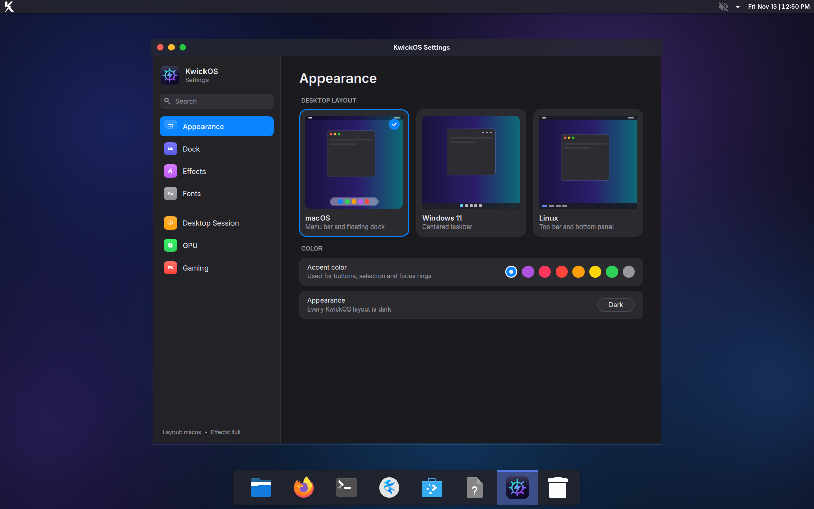 | 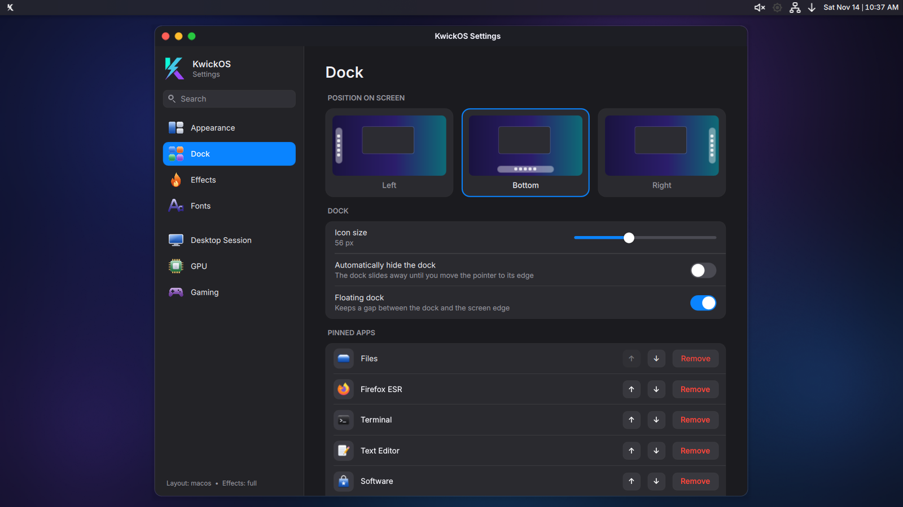 | 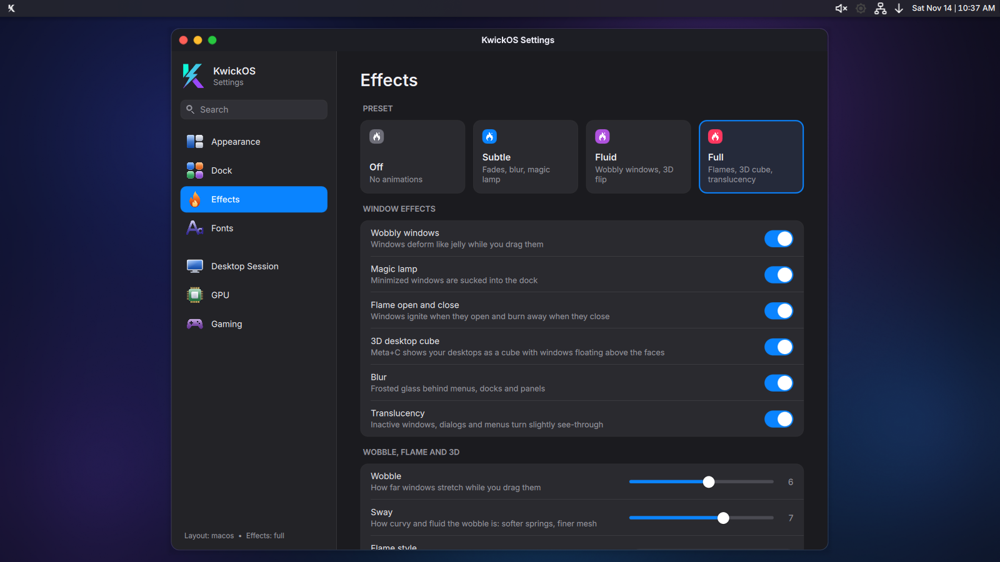 |

KDE System Settings uses the same KwickOS object icons:

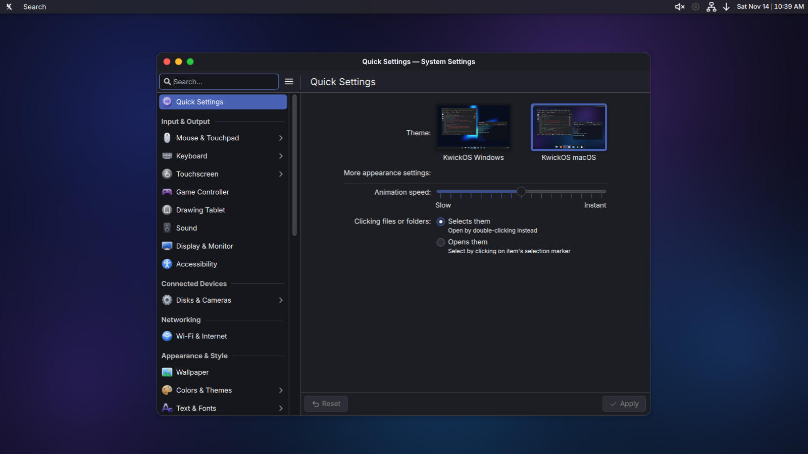

### Icons

Each layout has its own icon theme, all generated as SVG by `tools/icons/gen-icons.py` and set by `kwick-layout` for Plasma, GNOME and
Hyprland: `KwickOS` (macOS layout: squircle apps with layered gradients, light-blue folders with embossed glyphs, accent-blue sidebar glyphs),
`KwickOS-Fluent` (Windows layout: white line icons for places, folders, actions, status and file types, flat Fluent app tiles) and
`KwickOS-Linux` (Linux layout: Tokyo Night squircles). Left to right below: macOS, Windows, Linux.

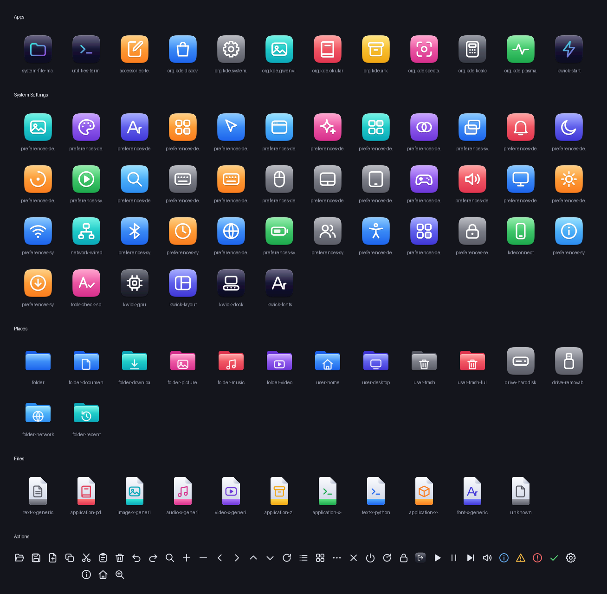

### Fonts

Each layout has its own UI and monospace fonts, applied by `kwick-layout`:

| layout | UI | monospace |
|---|---|---|
| macOS | Inter / Inter Display | JetBrains Mono |
| Windows | Selawik | Cascadia Code |
| Linux | Ubuntu Sans | Ubuntu Sans Mono |

Fontconfig aliases map the familiar names (Segoe UI, Calibri, Consolas, SF Pro, Helvetica Neue, Ubuntu) to these. `kwick-fonts
msfonts` fetches the real Microsoft core fonts after you accept the EULA.

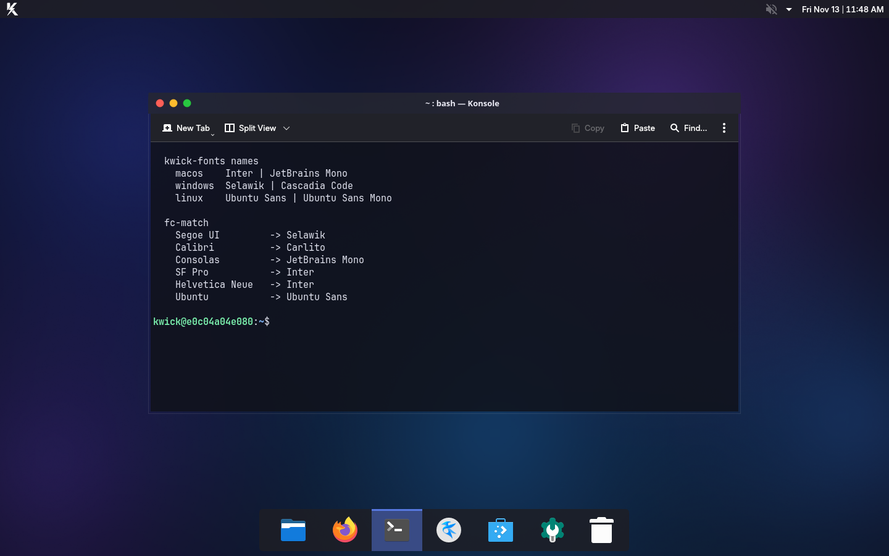

### Files and Terminal

Apps show neutral names: **Files** (Dolphin), **Terminal** (Konsole), **Text Editor** and **Software** (Discover), through a private
`en_KW` message catalog generated by `desktop/gen-files-l10n.py`. The Files sidebar is titled per layout ("Favorites" on macOS,
"Quick access" on Windows).

| macOS | Windows | Linux |
|---|---|---|
| 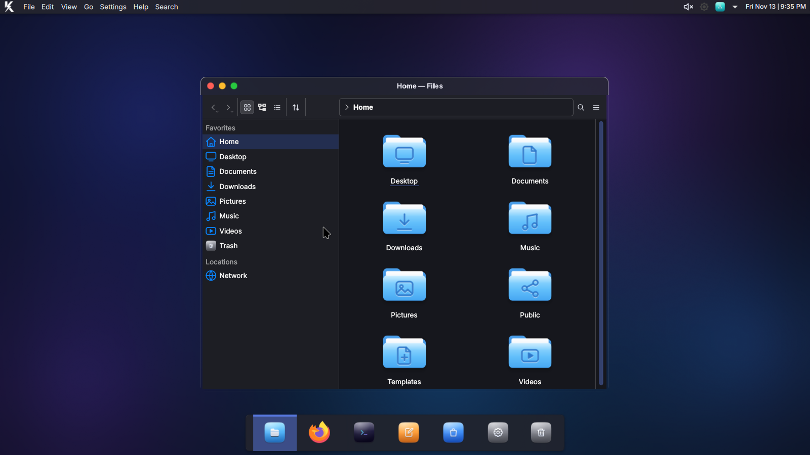 | 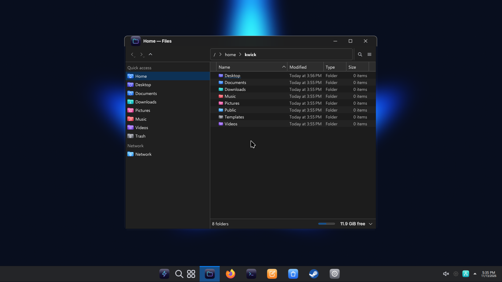 | 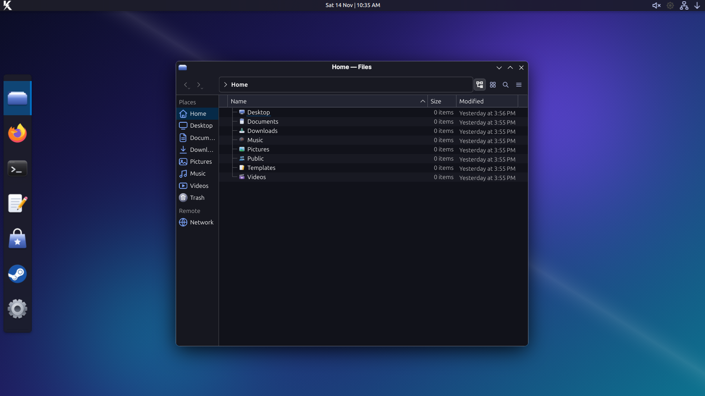 |


### Steam

Native Steam: `steam` enables the i386 architecture through kpkg multiarch, installs Debian's `steam-installer`, downloads the
client and runs it (the kernel has IA32 emulation). `kwick-gaming` adds Proton-GE, Heroic, Lutris, GameMode and MangoHud from
Flathub, with a gaming sysctl preset. If the native install fails, `steam` falls back to the Flathub build.

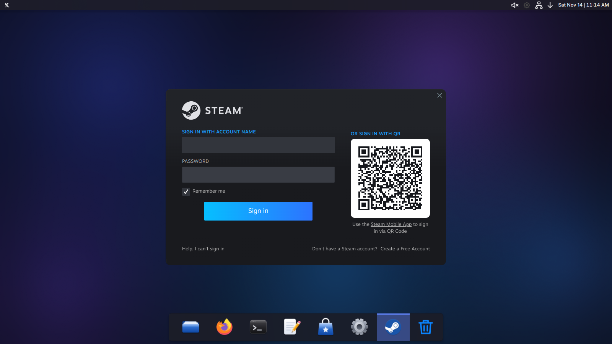

### GPUs and hardware

`apt install kwick-gpu` (or `kwick-gpu install`; it also runs after `apt install kwick-desktop`) detects the GPUs and installs the
matching drivers and firmware; `kwick-gpu` alone shows the plan.

| hardware | driver path |
|---|---|
| AMD, Intel | in-kernel amdgpu / i915 / xe with Mesa (RADV, radeonsi, iris, ANV) and firmware |
| NVIDIA Turing and newer | NVIDIA open kernel modules (pinned release) plus userspace from NVIDIA's Debian 13 repository |
| NVIDIA older | nouveau with Mesa NVK |
| Apple Silicon | Asahi kernel variant (`kwick-kernel-asahi`), Mesa asahi and honeykrisp |
| NVIDIA DGX Spark (GB10) | `gb10` kernel flavor with NVIDIA open modules for arm64 |
| virtio, QXL, Bochs, VMware, Hyper-V | in-tree DRM drivers with Mesa virgl or llvmpipe |

What was run on real or virtual hardware and what was only built is spelled out per entry in [docs/HARDWARE.md](docs/HARDWARE.md),
including Apple Silicon (Asahi) and the DGX Spark (GB10). Every kernel flavor ships a matching headers package for DKMS.

### Darling: macOS command-line binaries (optional)

`apt install kwick-darling` adds [Darling](https://github.com/darlinghq/darling), which runs macOS command-line programs on Linux.
It is optional, amd64 only, aimed at CLI tools (GUI support is limited), and does not run arm64 Mach-O binaries. Usage, limits and
what was verified: [docs/DARLING.md](docs/DARLING.md).

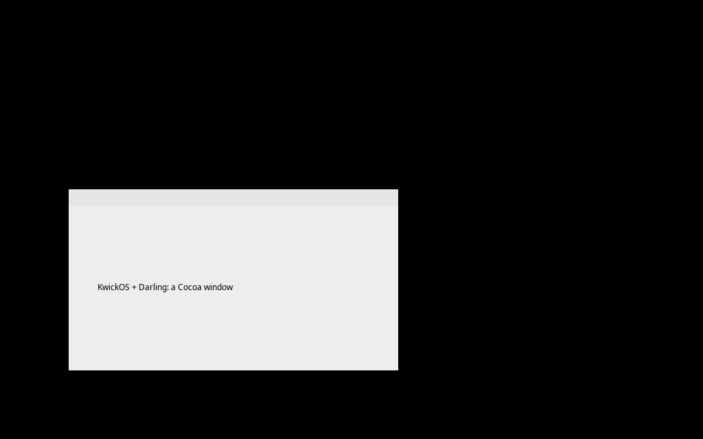

## Using the base system

```sh
apt update; apt install postgresql        # real Debian packages
apt search redis; apt show nginx; apt list --installed; apt autoremove; apt full-upgrade
dpkg -l; dpkg -L nginx; dpkg -S /usr/sbin/nginx
systemctl status nginx; systemctl restart nginx; journalctl -u nginx -f
service ssh restart
vi /etc/network/interfaces                 # ifupdown syntax (DHCP on eth0 by default)
```

* Recommends are not installed by default (`/etc/kpkg.conf`); use `--install-recommends`.
* The console logs in as root automatically on VM/live images. `rm /etc/kinit/autologin` and `passwd` for a password prompt.
  Install `openssh-server` for remote access.
* `kwick-kernel-install --list | --rollback` manages kernels.
* `apk add <pkg>` works next to `apt`: Alpine (musl) and Debian (glibc) packages coexist, and the apk bootstrap is signature-verified.
  `tests/ecosystems.sh` checks that `apk add nodejs`, `apt install python3` and the official Bun installer work side by side.

## Verification

Everything in the desktop sections was run in KVM virtual machines with a GPU-accelerated display on an AMD Radeon 8060S host. The
log, the lab setup (`tools/vmlab/`), the bugs found and fixed, and the list of things that were not verified are in
[docs/VERIFICATION.md](docs/VERIFICATION.md).

## Releases and security

Every push to `main` that changes the product, and every kernel bump found by `kernel-watch` (kernel.org is polled every 6 hours),
triggers the `release` workflow. It builds and boot-tests all architectures, then publishes `v<version>-k<kernel>` with ISOs, disk
images, the multi-arch container on ghcr.io and the signed apt repo. `.github/workflows/security.yml` runs on every push and nightly:
kernel freshness, `govulncheck` for kpkg, OSV advisories and a grype scan of the built image.

## Building

Requirements: Linux with Docker (and KVM for fast boot tests). For non-native arches register binfmt once:
`docker run --privileged --rm tonistiigi/binfmt --install all`.

```sh
make builder                       # build container with cross toolchains + QEMU
make ARCH=amd64                    # busybox, kinit, kpkg, kernels (virt+generic), rootfs, images
make boot-test ARCH=amd64          # boots microvm, ram, disk, UEFI disk, UEFI ISO
make container compat ARCH=amd64   # real-world Debian package compatibility matrix
bash bench/container.sh kwickos:0.1.0-amd64   # container benchmarks vs Alpine/Debian/Ubuntu
```

The kernel version is pinned in [`KERNEL_VERSION`](KERNEL_VERSION); the build verifies the tarball checksum against kernel.org.

| path | contents |
|---|---|
| `src/kinit/` | init system (C) |
| `src/kpkg/` | package manager (Go) |
| `config/kernel/` | kernel config fragments (common, per-arch, `virt`/`generic`/`apple`/`gb10`) |
| `config/busybox/` | BusyBox config + GNU-compatibility patches |
| `rootfs/` | files copied into the base system |
| `desktop/` | desktop image, theme and catalog generators, the files shipped by `kwick-desktop` |
| `scripts/` | build steps (userland, kernel, rootfs, images, packages, apt repo) |
| `tools/` | icon generator and the KVM/GPU verification lab (`tools/vmlab/`) |
| `tests/` | boot matrix, VM functional test, package compatibility matrix, desktop screenshot script |
| `bench/` | benchmarks against Alpine/Debian/Ubuntu |
| `.github/workflows/` | CI build and test for 3 arches, releases, kernel watch |

## Limitations

* The headless ISO and disk images boot through UEFI only; the desktop ISO also boots in BIOS mode on amd64. Direct `-kernel` boot
  works everywhere.
* kpkg implements the commonly used apt/dpkg surface and multiarch; pinning, holds and source packages are not implemented.
* kinit implements the commonly used subset of systemd units: no socket activation, timers or D-Bus, and units start in parallel
  with only the ordering described in the docs.
* No SELinux/AppArmor policy. Lockdown, Landlock, Yama and seccomp are enabled.
* riscv64 is tested under QEMU emulation only.
* Desktop effects need a GPU compositor. GPU, Apple Silicon and GB10 specifics are in [docs/HARDWARE.md](docs/HARDWARE.md).

## License

KwickOS sources are MIT-licensed. Images also contain GPL-2.0 software (Linux, BusyBox) and others; see [LICENSE](LICENSE).
