# KwickOS

<p align="center">
  
</p>

**A Linux distribution smaller and faster than Alpine that installs software
like Debian.**

KwickOS is a headless/server/container Linux built from scratch on the **latest
stable kernel** (7.3.x), with a **5.5 MB** base. It runs `apt install` against
the **unmodified Debian 13 "trixie" archive**: about 69,000 packages, glibc
included, pulled in only when you install something that needs them. The
same base boots as a container, a microVM, a cloud/VM disk, or a live ISO on
**amd64, arm64 and riscv64**.

```console
$ docker run --rm -it ghcr.io/metaspartan/kwickos
root@kwick:/# apt update && apt install -y nginx python3
root@kwick:/# systemctl enable --now nginx      # works in containers too
```

## Screenshots

| Headless (real boot, serial console) | Desktop (KDE Plasma 6) |
|---|---|
| 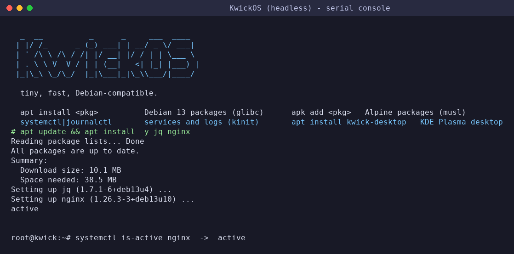 | 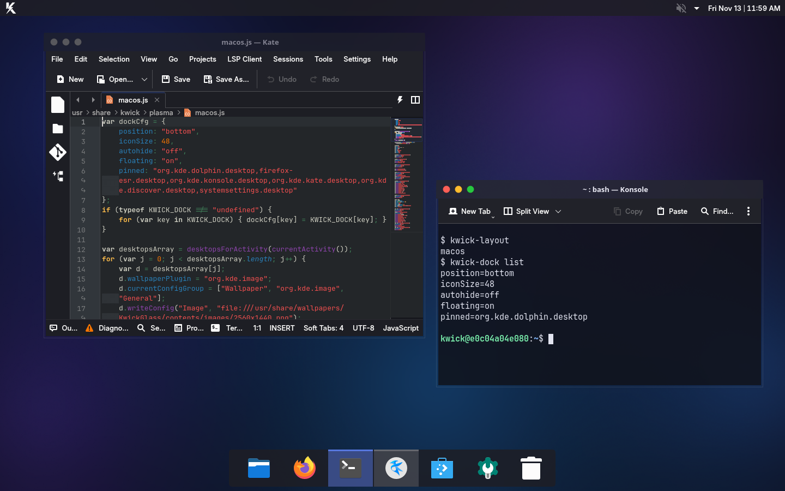 |

Every layout is fully dark. `kwick-layout macos` (default) is a liquid-glass look: translucent blurred menu bar and floating dock, traffic-light buttons. `windows` is Windows 11: centered taskbar, Fluent caption buttons on the right. `linux` is a top panel with a left dock. Screenshots are real Plasma sessions (software-rendered):

| macOS style | Windows style | Linux style |
|---|---|---|
| 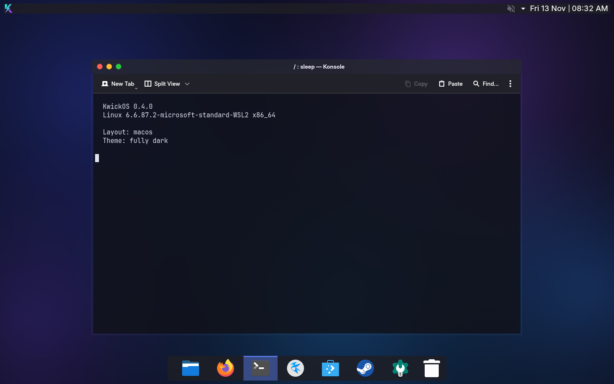 | 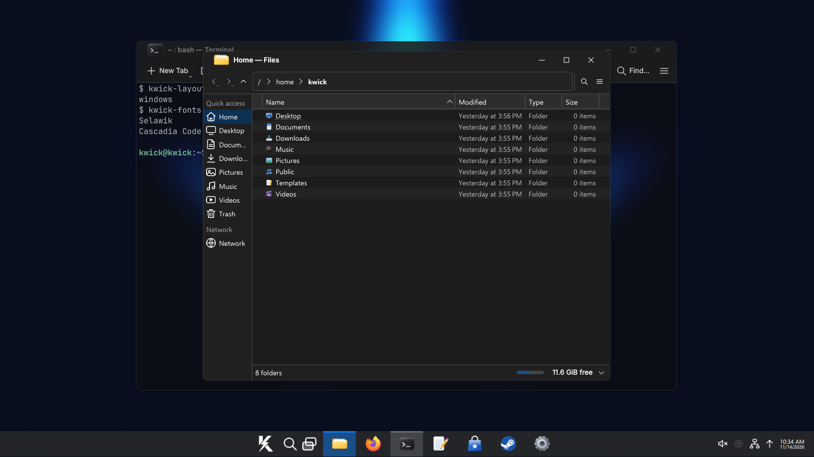 | 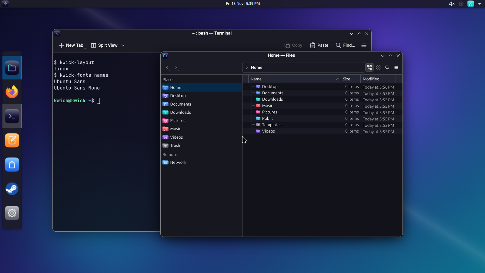 |

| Terminal tools (`kwick-gpu`, `kwick-layout`, `kwick-desktop list`) | System Settings |
|---|---|
| 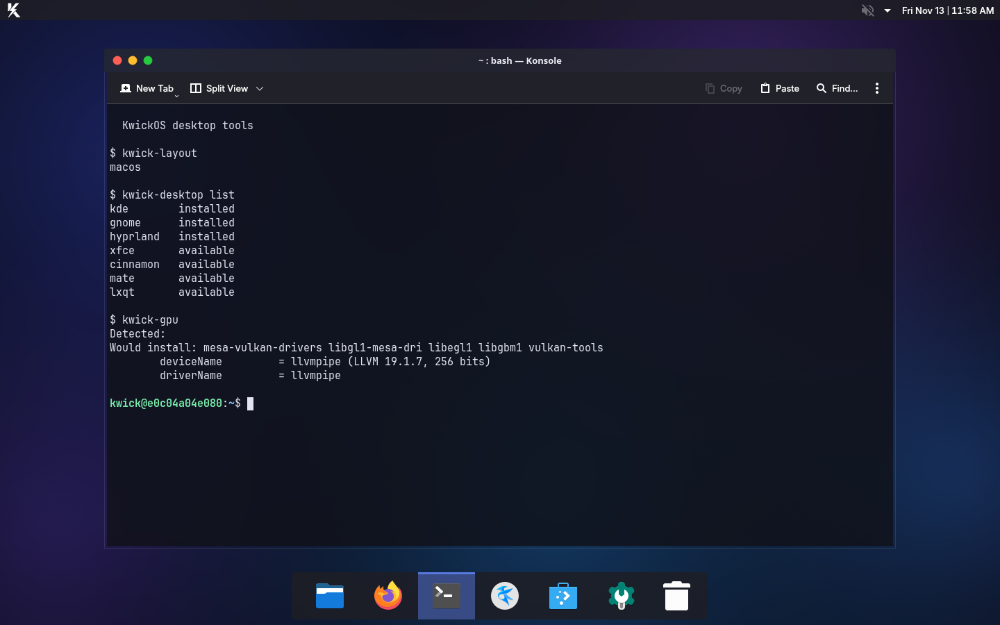 | 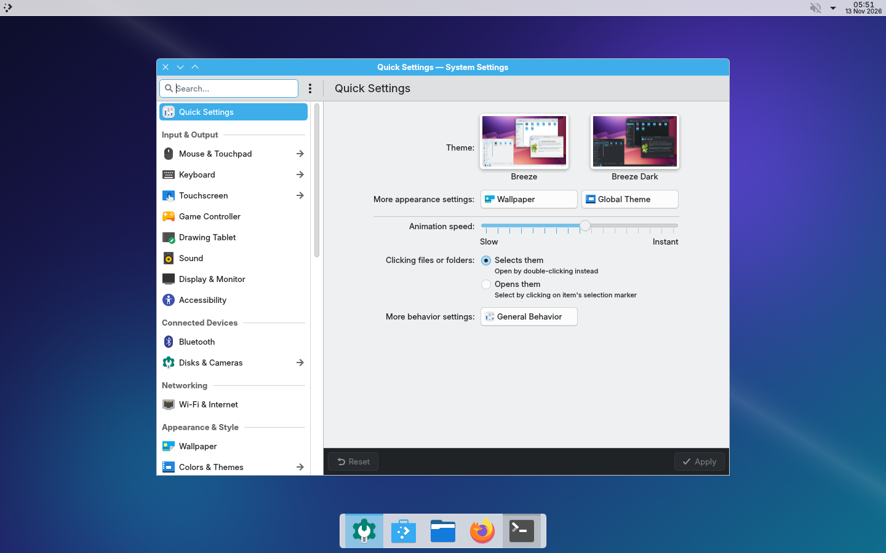 |

| Dolphin, Windows style | Firefox, macOS style | Discover, Linux style |
|---|---|---|
| 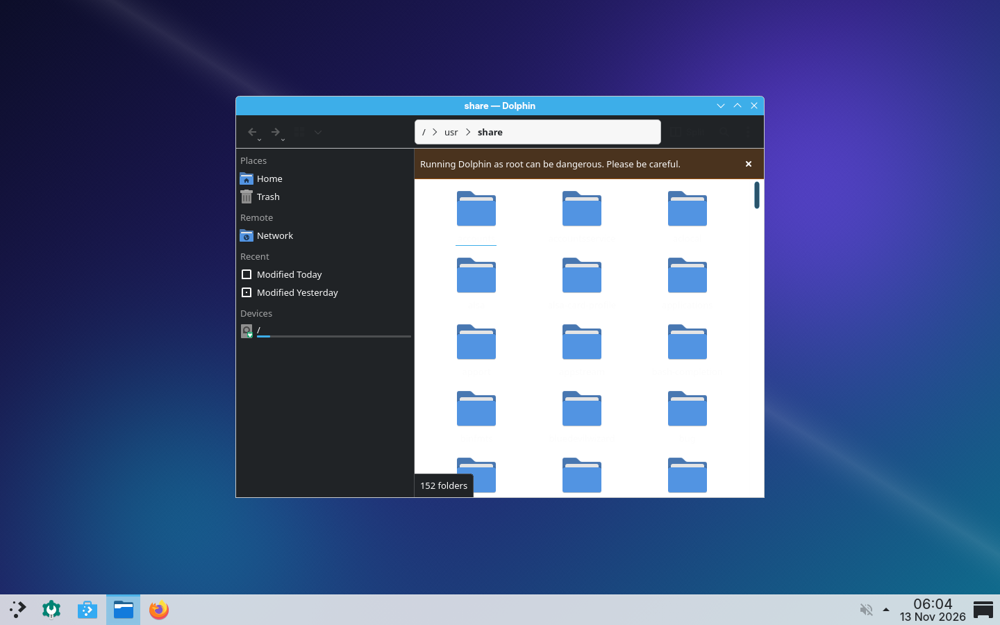 | 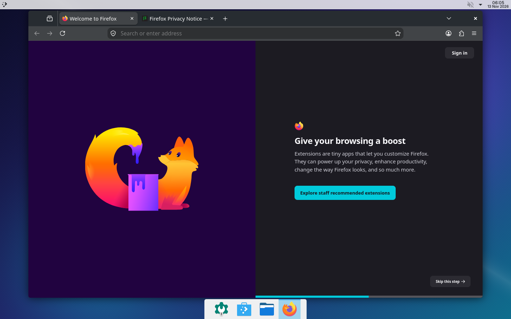 | 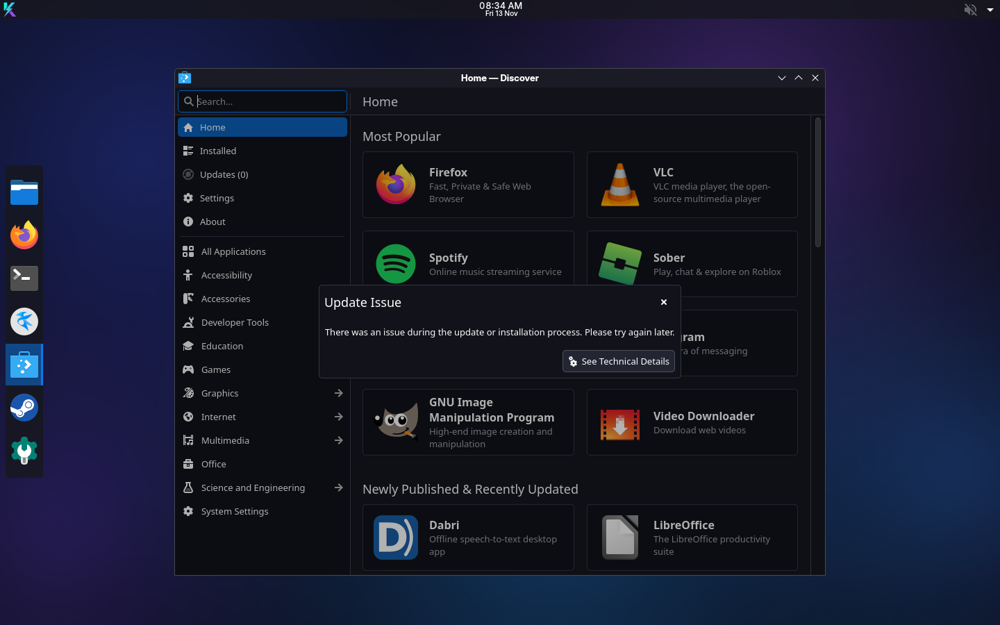 |

Window decorations (KwickGlass, KwickFluent), three dark color schemes, wallpapers and the Konsole glass profile are generated by `desktop/gen-theme.py`. The blur and translucency are KWin effects and were not visible in these software-rendered shots; they need a GL compositor on real hardware and have not been verified.

Known issue: Discover shows an "Update Issue" dialog in the screenshot environment (no network or Flathub remote there); system packages are managed with `apt`, not Discover.

## How it compares

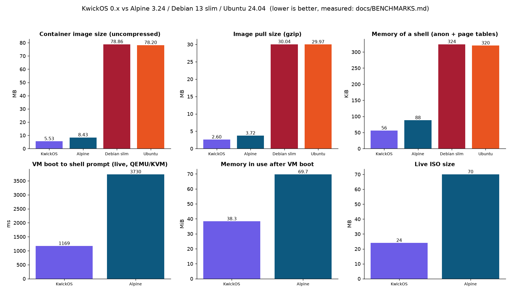

## Results (measured, see [docs/BENCHMARKS.md](docs/BENCHMARKS.md))

| | Alpine 3.24.4 | **KwickOS 0.1** |
|---|---:|---:|
| container image (uncompressed / gzip) | 8.43 / 3.72 MB | **5.53 / 2.60 MB** |
| memory of a `sh` in a container (anon + page tables) | 88 KiB | **56 KiB** |
| VM boot to shell prompt (QEMU/KVM, live ISO, wall time) | 3.73 s | **1.17 s** |
| guest boot time at shell (`/proc/uptime`) | 3.10 s | **0.75 s** (0.22 s as microVM) |
| memory in use after boot | 69.7 MiB | **38.3 MiB** |
| live ISO | 70 MB | **24 MB** |
| packages available | ~20k (musl) | **~69k (Debian 13, glibc)** |

Real software from the Debian archive passes a 31-package compatibility matrix:
PostgreSQL 17, MariaDB 11.8, Docker, OpenJDK 21, Go, gcc, Node.js, Python+pip, PHP, Ruby,
Redis, nginx, Apache, OpenSSH, and others ([docs/COMPATIBILITY.md](docs/COMPATIBILITY.md)).

## Why it's different

| | Alpine | Debian/Ubuntu | **KwickOS** |
|---|---|---|---|
| base userland | BusyBox + musl `.so` | GNU coreutils + glibc | BusyBox + **static** kinit/kpkg (no libc `.so` at all) |
| package manager | apk (Alpine packages, musl) | apt/dpkg | **kpkg**: `apt`/`dpkg`-compatible, uses Debian's own repos |
| software compatibility | musl rebuilds | everything | everything in Debian (glibc arrives on demand) |
| init | OpenRC | systemd | **kinit**: 120 KB PID 1 that runs systemd unit files |
| boot chain | bootloader + initramfs | GRUB + initramfs-tools | **none**: the kernel is a UEFI app with a 120 KB embedded root finder |
| kernel updates | apk | apt + update-grub + initramfs rebuild | `apt upgrade` copies one EFI file (and keeps the previous one for rollback) |

Key ideas (details in [docs/ARCHITECTURE.md](docs/ARCHITECTURE.md)):

* **Essential set provided virtually.** The base declares the Debian Essential packages
  (`coreutils`, `bash`, `dpkg`, ...) as satisfied by BusyBox, so real Debian packages
  install unmodified on a 5 MB system.
* **Self-healing compatibility.** If a Debian maintainer script trips over a BusyBox
  difference (`pgrep -u`, `ln -r`, a perl helper), kpkg detects it, installs the GNU
  tool from Debian and retries. GNU tools exist only where software needs them.
* **systemd compatibility without systemd.** Debian's `.service` units,
  `deb-systemd-helper`, `systemd-sysusers` and `systemd-tmpfiles` are handled by kinit,
  so `apt install nginx` gets you a running, enabled, supervised service.
* **One file boots everything.** The EFI-stub kernel embeds kinit, which finds a
  `kwick-root` partition, a `KWICKOS` live medium (erofs + overlay), `root=`, virtiofs/9p,
  or a whole-OS initramfs. There is no GRUB, no dracut, and nothing to regenerate.
* **Built for agent sandboxes.** A full KwickOS microVM boots to a shell in about 0.2 s of
  guest time, and its RAM image is a 2.2 MB file.

## Download / run

Release artifacts (built by CI for each tag) are listed below; replace `amd64` with `arm64` or `riscv64`.

| file | what |
|---|---|
| `kwickos-amd64-desktop.iso` | KDE Plasma 6 desktop live ISO (also `arm64`, ~1.5 GB) |
| `kwickos-amd64.iso` | UEFI live ISO (generic kernel, broad hardware); runs from RAM (erofs + overlay) |
| `kwickos-amd64.qcow2` / `.img.zst` | VM/cloud disk: ESP (kernel) + ext4 root, 1 GiB |
| `kwickos-amd64.efi` | the kernel itself (virt flavor): a UEFI app, `-kernel` for QEMU/Firecracker |
| `kwickos-amd64-initramfs.cpio.zst` | the whole OS as an initramfs (microVMs, CI sandboxes) |
| `kwickos-rootfs-amd64.tar.gz` | rootfs tarball (containers, chroots, WSL) |
| `ghcr.io/metaspartan/kwickos` | multi-arch container image |

```sh
# VM with persistent disk (UEFI)
qemu-system-x86_64 -M q35,accel=kvm -cpu host -m 512 -bios /usr/share/OVMF/OVMF_CODE.fd \
  -drive file=kwickos-amd64.qcow2,if=virtio -nic user,model=virtio-net-pci -nographic

# microVM, whole OS in RAM: boots in a fraction of a second
qemu-system-x86_64 -M microvm,accel=kvm -cpu host -m 256 -nodefaults -nographic -serial stdio \
  -kernel kwickos-amd64.efi -initrd kwickos-amd64-initramfs.cpio.zst -append "console=ttyS0"

# run one command and power off (CI / agents)
  ... -append "console=ttyS0 kwick.run=apt+update;apt+install+-y+jq"
```

**Apple Silicon:** use the arm64 qcow2 or ISO with UTM, Lima, Parallels or any
Virtualization.framework VM (virtio devices, UEFI). Bare-metal M-series Macs need
Asahi Linux's kernel patches and are not a target yet.

## Using it

It feels like Debian:

```sh
apt update; apt install postgresql        # real Debian packages
apt search redis; apt show nginx; apt list --installed; apt autoremove; apt full-upgrade
dpkg -l; dpkg -L nginx; dpkg -S /usr/sbin/nginx
systemctl status nginx; systemctl restart nginx; journalctl -u nginx -f
service ssh restart
vi /etc/network/interfaces                 # ifupdown syntax (DHCP on eth0 by default)
```

* Recommends are not installed by default (`/etc/kpkg.conf`); use `--install-recommends`.
* The console logs in as root automatically on VM/live images. `rm /etc/kinit/autologin`
  and `passwd` for a password prompt. Install `openssh-server` for remote access.
* `kwick-kernel-install --list | --rollback` manages kernels.

## Alpine packages, Bun, and other ecosystems

`apk add <pkg>` works next to `apt`: Alpine (musl) and Debian (glibc) packages coexist, and
the apk bootstrap is signature-verified (an untrusted key is refused). `tests/ecosystems.sh`
verifies on every change that `apk add nodejs` and `apt install python3` work side by side
and that the latest Bun installs with the official installer and runs.

## Desktop edition (preview)

`kwickos-<arch>-desktop.iso` (amd64, arm64; the desktop is allowed to be big, the headless base is not) is a live session with
**KDE Plasma 6** (default), **GNOME** and a **tiling session** selectable at the login screen: Hyprland where
packaged, otherwise sway with the same waybar/wofi setup (Debian 13 does not ship Hyprland). Plus SDDM, elogind,
PipeWire, NetworkManager, Bluetooth, Flatpak, Firefox, Mesa for AMD/Intel/NVIDIA(nouveau, NVK)/virtio and vendor firmware.

Upgrade a headless install in place: `apt update && apt install kwick-desktop`, then reboot. Tested against a local signed repo: it resolves to 1,330 packages (about 0.9 GB download, 3.6 GB installed), and the non-free firmware and GPU drivers are installed right after apt finishes by `kwick-gpu`. The full reboot into the upgraded desktop has not been tested.

| tool | what it does |
|---|---|
| `kwick-layout linux\|windows\|macos` | window buttons, panel/dock position and UI fonts in the Linux, Windows or macOS style; works on KDE and GNOME, tiling gaps/bar on Hyprland/sway |
| `kwick-effects off\|subtle\|wobbly\|compiz` | Compiz-style effects: wobbly windows, magic lamp, glide, fall-apart close, blur, burn-away (GNOME extensions / KWin effects / Hyprland animations) |
| `kwick-fonts windows\|macos\|msfonts` | Segoe-like (Open Sans), Calibri/Cambria metrics (Carlito/Caladea), Helvetica/SF-like (Inter); `msfonts` fetches the real Microsoft core fonts after you accept the EULA. Windows/macOS font names are aliased by fontconfig |
| `kwick-desktop list\|install\|switch` | install and select another desktop (kde, gnome, hyprland, xfce, cinnamon, mate, lxqt) |
| `steam`, `kwick-gaming` | Steam (Flathub build with Proton and the 32-bit runtime, installed on first launch), Proton-GE, Heroic, Lutris, GameMode, MangoHud; gaming sysctls preset |

### GPU drivers (headless too)

`apt install kwick-gpu` (or `kwick-gpu install`) detects NVIDIA, AMD, Intel, Apple Silicon and virtio GPUs and installs the
matching Mesa/Vulkan drivers and firmware. `kwick-gpu` alone shows what it found. Status by vendor: AMD and Intel use the in-kernel
amdgpu/i915/xe drivers with Mesa; NVIDIA uses nouveau with the NVK Vulkan driver (the proprietary driver is not packaged yet);
Apple Silicon needs Asahi's kernel, which the stock KwickOS kernel does not include yet; DGX Spark (GB10) is untested.

Verified: the KDE session, `kwick-layout` (all three styles, screenshots above), `kwick-desktop list`, `kwick-gpu`. Not verified: the animated
effects (KWin needs a GPU/GL compositor; the screenshot environment is software-only), GNOME and tiling sessions, the Steam first-launch install,
and fonts after `kwick-fonts`.
## Releases

Every push to `main` that changes the product, and every kernel bump found by `kernel-watch`
(kernel.org is polled every 6 hours), triggers the `release` workflow. It builds and boot-tests
all architectures, then publishes `v<version>-k<kernel>` with ISOs, disk images, the multi-arch
container on ghcr.io and the signed apt repo for kernel updates. Bump `VERSION` for a new release
at the same kernel.
## Security

`.github/workflows/security.yml` runs on every push and nightly: kernel freshness against
kernel.org, `govulncheck` for kpkg, OSV advisories and a grype scan of the built image.
`kernel-watch` opens a PR for each new stable kernel.

## Building

Requirements: Linux with Docker (and KVM for fast boot tests). For non-native arches,
register binfmt once: `docker run --privileged --rm tonistiigi/binfmt --install all`.

```sh
make builder                       # build container with cross toolchains + QEMU
make ARCH=amd64                    # busybox, kinit, kpkg, kernels (virt+generic), rootfs, images
make boot-test ARCH=amd64          # boots microvm, ram, disk, UEFI disk, UEFI ISO
make container compat ARCH=amd64   # real-world Debian package compatibility matrix
bash bench/container.sh kwickos:0.1.0-amd64   # container benchmarks vs Alpine/Debian/Ubuntu
```

Kernel version is pinned in [`KERNEL_VERSION`](KERNEL_VERSION). The `kernel-watch` workflow
opens a PR whenever kernel.org publishes a new stable release, and the build verifies the
tarball checksum against kernel.org and fails if required config options are lost.

| path | contents |
|---|---|
| `src/kinit/` | init system (C) |
| `src/kpkg/` | package manager (Go) |
| `config/kernel/` | kernel config fragments (common, per-arch, `virt`/`generic`) |
| `config/busybox/` | BusyBox config + GNU-compatibility patches |
| `rootfs/` | files copied into the base system |
| `scripts/` | build steps (userland, kernel, rootfs, images, kernel packages, apt repo) |
| `tests/` | boot matrix, VM functional test, package compatibility matrix |
| `bench/` | benchmarks against Alpine/Debian/Ubuntu |
| `.github/workflows/` | CI build+test for 3 arches, releases (ISO/images/GHCR/apt repo), kernel watch |

## Status and limitations

KwickOS 0.1 is an early release. Known gaps:

* UEFI only: there is no legacy BIOS boot for the ISO/disk (direct `-kernel` boot works everywhere).
* kpkg implements the commonly used apt/dpkg surface. Pinning, holds, foreign multiarch
  architectures, and source packages are not implemented.
* kinit implements the commonly used subset of systemd units. There is no socket
  activation, timers, dependency ordering beyond "start everything in parallel", or D-Bus.
* No SELinux/AppArmor policy. Lockdown, Landlock, Yama and seccomp are enabled.
* riscv64 is tested under QEMU emulation only. The riscv64 generic flavor builds only in release CI.
* The desktop edition is a preview (see above).

## License

KwickOS sources are MIT-licensed. Images also contain GPL-2.0 software (Linux,
BusyBox) and others; see [LICENSE](LICENSE).
