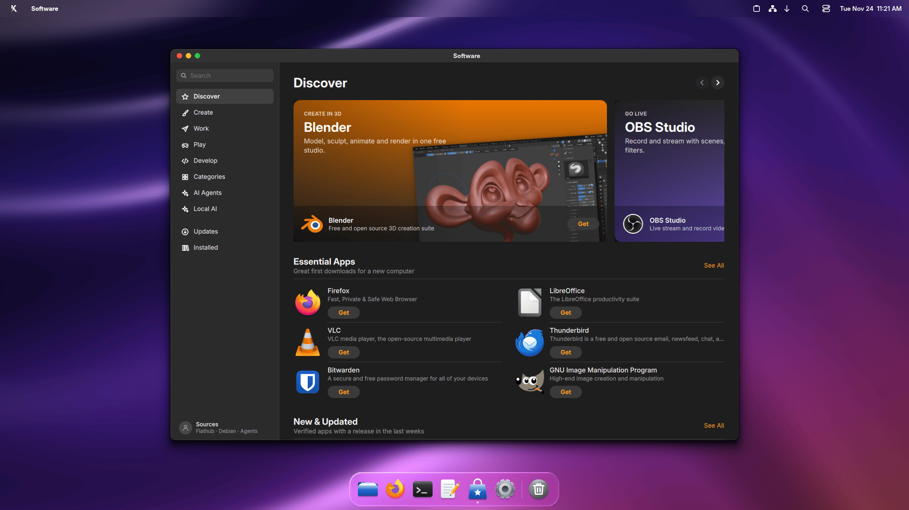
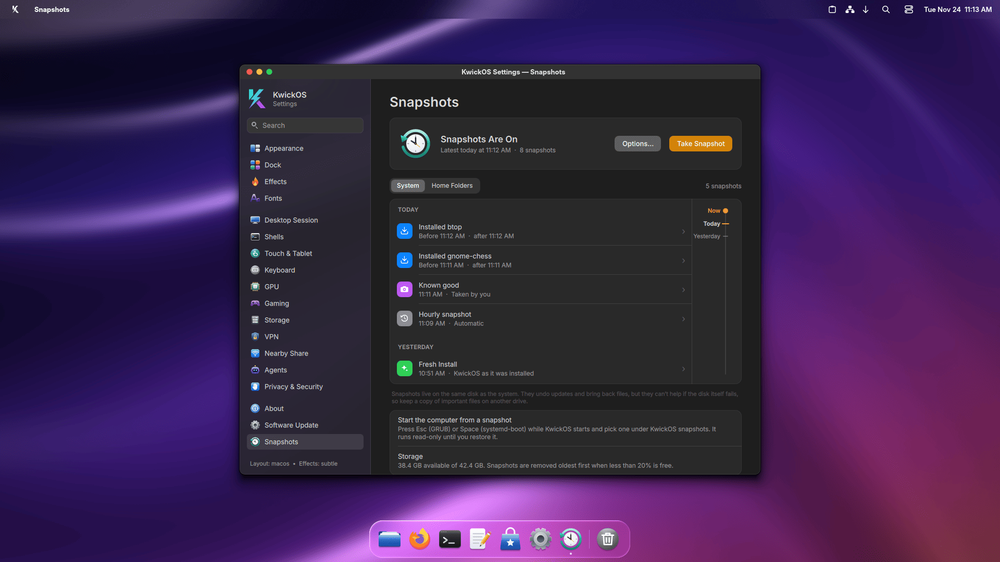
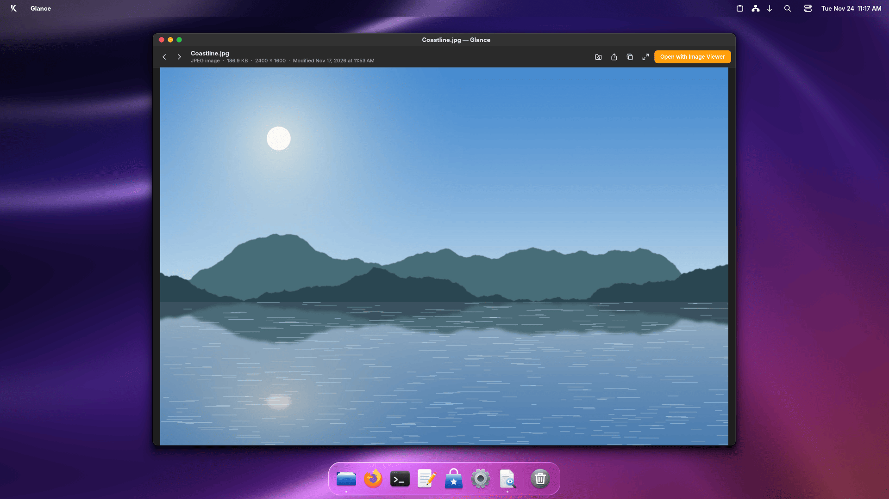
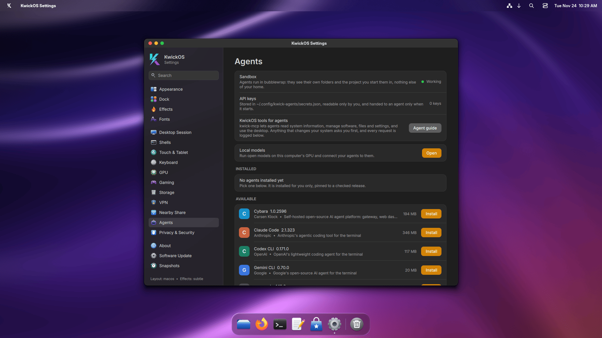
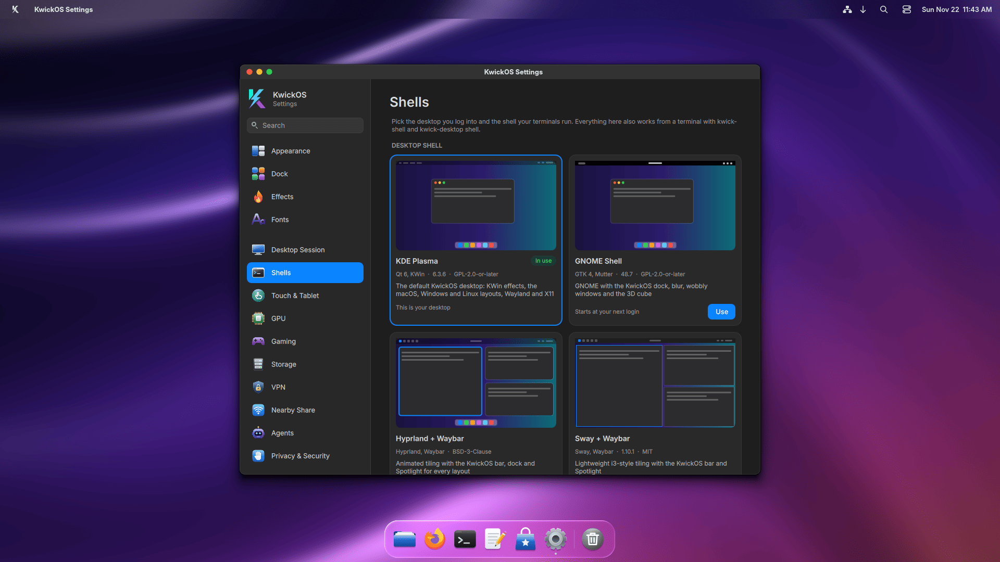
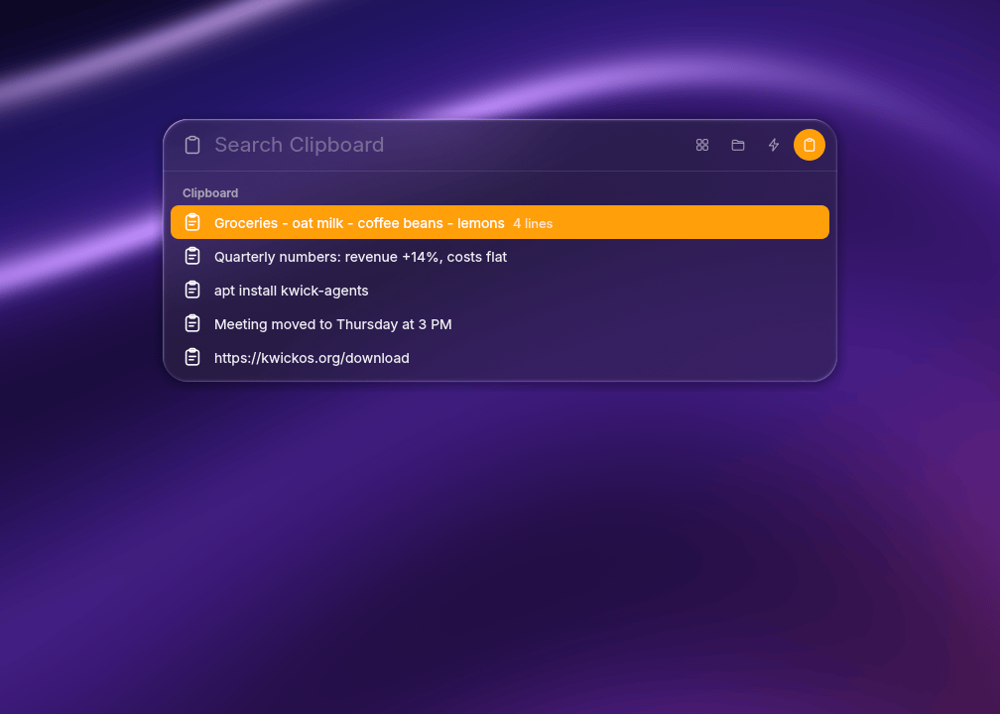
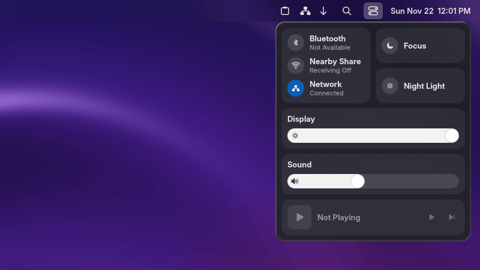
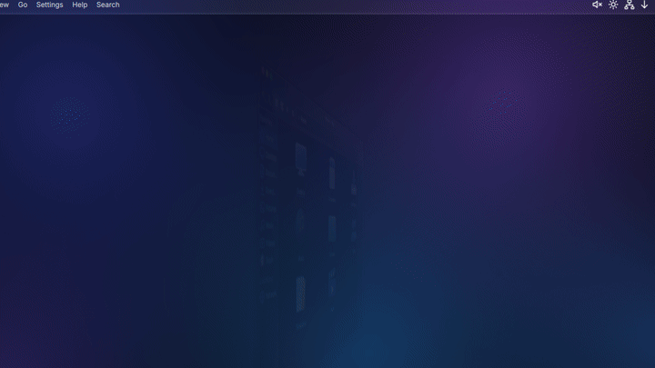

<p align="center">
  
</p>

<h1 align="center">KwickOS</h1>

<p align="center"><b>A smaller base than Alpine. Installs like Debian.</b></p>

<p align="center">
  <a href="https://github.com/metaspartan/kwickos/releases/latest">Download</a> ·
  <a href="docs/INSTALL.md">Install</a> ·
  <a href="docs/SCREENSHOTS.md">Screenshots</a> ·
  <a href="docs/ARCHITECTURE.md">Architecture</a> ·
  <a href="docs/BENCHMARKS.md">Benchmarks</a>
</p>

<p align="center">
  
</p>

## Contents

* [What is KwickOS](#what-is-kwickos)
* [Quick start](#quick-start)
* [Size and speed](#size-and-speed)
* [The desktop](#the-desktop), [Built-in apps](#built-in-apps) and [Kwick Effects](#kwick-effects)
* [Optional packages](#optional-packages)
* [Installing](#installing)
* [kfetch](#kfetch)
* [Hardware support](#hardware-support)
* [Building from source](#building-from-source)
* [Documentation](#documentation)
* [License](#license)

## What is KwickOS

* **A tiny base.** A 6.6 MB container image, built from scratch on the latest stable kernel (7.3.x). BusyBox, a 130 KB init
  (kinit) and an apt-compatible package manager (kpkg), all static.
* **Debian's packages, Alpine's too.** `apt install` uses the unmodified Debian 13 "trixie" archive (about 69,000 packages for
  amd64), so glibc software runs as is: vendor binaries, CUDA, Steam, Electron apps, and the systemd units Debian packages ship.
  glibc arrives only when something needs it. `apk add` works alongside it.
* **Every architecture.** The same base boots as a container, a microVM, a VM or cloud disk, or a live ISO on amd64, arm64 and
  riscv64.
* **An optional desktop.** `apt install kwick-desktop` adds KDE Plasma 6 with macOS, Windows 11 and Linux layouts. The same
  layouts work on GNOME and Hyprland.
* **Real installers.** A graphical installer, a text installer and a scriptable `kwick-install`, with GRUB, systemd-boot or
  the EFI stub, LUKS and ZFS root.

## Quick start

**Try it in a container:**

```console
$ docker run --rm -it ghcr.io/metaspartan/kwickos
root@kwick:/# apt update && apt install -y nginx python3
root@kwick:/# systemctl enable --now nginx      # works in containers too
```

**Download an image** from the [latest release](https://github.com/metaspartan/kwickos/releases/latest):

| image | use |
|---|---|
| [`kwickos-amd64-desktop.iso`](https://github.com/metaspartan/kwickos/releases/latest/download/kwickos-amd64-desktop.iso) | KDE Plasma 6 live and installer ISO, UEFI and BIOS (also [arm64](https://github.com/metaspartan/kwickos/releases/latest/download/kwickos-arm64-desktop.iso), UEFI) |
| [`kwickos-amd64.iso`](https://github.com/metaspartan/kwickos/releases/latest/download/kwickos-amd64.iso) | headless live ISO, runs from RAM |
| [`kwickos-amd64.qcow2`](https://github.com/metaspartan/kwickos/releases/latest/download/kwickos-amd64.qcow2) | VM and cloud disk |
| [`SHA256SUMS`](https://github.com/metaspartan/kwickos/releases/latest/download/SHA256SUMS) | checksums |

Replace `amd64` with `arm64` or `riscv64`. Raw disks, the kernel as a UEFI app, an initramfs and a rootfs tarball are listed in
[docs/INSTALL.md](docs/INSTALL.md#downloads).

**Install from the ISO:** write it to a USB stick, boot it, and run **Install KwickOS** from the desktop (or `kwick-installer` on
the headless ISO).

**Turn any install into a desktop:**

```sh
apt update && apt install kwick-desktop
reboot
```

**Add the apt repository by hand** (it is preconfigured on KwickOS images):

```sh
wget -qO /usr/share/keyrings/kwickos-archive-keyring.asc https://metaspartan.github.io/kwickos/kwickos-archive-keyring.asc
printf 'Types: deb\nURIs: https://metaspartan.github.io/kwickos\nSuites: stable\nComponents: main\nSigned-By: /usr/share/keyrings/kwickos-archive-keyring.asc\n' > /etc/apt/sources.list.d/kwickos.sources
```

Daily use of the base system (apt, services, networking, what is in the base and what is one `apt install` away) is in
[docs/BASE.md](docs/BASE.md).

## Size and speed

Measured on amd64 with QEMU/KVM and Docker on one machine; the conditions and the raw output of every number are in
[docs/BENCHMARKS.md](docs/BENCHMARKS.md).

<!-- bench:summary -->
| | Alpine 3.24.4 | KwickOS 0.7.0 |
|---|---:|---:|
| container image, uncompressed / gzip | 8.43 / 3.72 MB | **6.63 / 3.06 MB** |
| live ISO boot to shell prompt | 4.0 s (3.6-6.4) | **1.7 s (1.5-2.4)** |
| guest boot time at the shell prompt | 3.4 s (3.1-5.4) | **1.3 s (1.0-1.7)** |
| microVM boot (`virt` kernel, whole OS in RAM) | no microVM image | 0.32 s guest, 0.67 s wall |
| memory in use after boot (live ISO) | 62-71 MiB | **50-52 MiB** |
| packages available (amd64) | 28,661 (musl) | **68,946 (Debian 13, glibc)** |
| installed size with curl | **14 MB** | 67 MB (Debian slim: 97 MB) |
| installed size with python3 | **52 MB** | 93 MB (Debian slim: 120 MB) |
| live ISO download, amd64 / arm64 / riscv64 | 70.3 / 93.5 / 58.3 MB | 69.0 / 125.9 / 85.6 MB |

The better result of each row is in bold. Measured 2026-11-23.
<!-- /bench:summary -->

KwickOS leads on the base: a smaller image, a live ISO that reaches a shell in less than half Alpine's time, a microVM mode
Alpine has no equivalent for, less memory after boot (mostly because Alpine's live ISO keeps its root in RAM), and the whole
Debian archive with glibc, so vendor binaries, CUDA, Steam and Electron apps run unmodified.

Where Alpine is still ahead:

* **Installed footprint.** The base is smaller, but Debian's packages are built with more features than Alpine's (Debian's
  curl also links Kerberos, LDAP and RTMP libraries), so once software is installed Alpine is about 2 to 5 times smaller (the
  "installed size" rows). With the same packages KwickOS still ends up 23 to 31% smaller than Debian slim.
* **ISO size off amd64.** The amd64 live ISOs are about the same size; on arm64 and riscv64 Alpine's are smaller.
* **TLS in the base.** Alpine's image includes OpenSSL and a CA bundle, which is part of its size. The KwickOS base has no TLS
  library and no CA bundle: kpkg checks packages by their signatures, and BusyBox has only its small built-in TLS client.
  `apt install ca-certificates curl` adds both.
* **Security maintenance of the base.** Alpine's base has a dedicated security team. KwickOS's Debian packages get Debian's
  security updates, but its own base (kernel, BusyBox, kinit, kpkg) is maintained by this project; every release waits for a
  security check of the kernel, the Go modules and the container image, and BusyBox's open CVEs are reported.
* **Real hardware.** KwickOS is VM- and container-first and has been tested on little physical hardware so far
  ([Hardware support](#hardware-support)).

The Debian and Ubuntu container comparison is in [docs/BENCHMARKS.md](docs/BENCHMARKS.md). Real Debian software
(PostgreSQL, MariaDB, Docker, OpenJDK, Node.js and more) passes a 31-package matrix: [docs/COMPATIBILITY.md](docs/COMPATIBILITY.md).
How it gets this small: [docs/ARCHITECTURE.md](docs/ARCHITECTURE.md).

## The desktop

`kwick-layout macos|windows|linux` switches the whole look at once: window buttons, panel or dock, fonts, icons, wallpaper and the
Files sidebar.

| macOS | Windows 11 | Linux |
|---|---|---|
|  |  |  |

* **KDE Plasma 6** is the default, with the KwickOS Settings app, a dock, an icon theme and fonts per layout.
* **GNOME** gets the same three layouts.
* **Hyprland** (`kwick-hyprland`) gets the same three layouts, each with its own waybar.

`kwick-gpu` installs the right GPU drivers, and `steam` installs native Steam. More: [docs/DESKTOP.md](docs/DESKTOP.md) and the
[screenshot gallery](docs/SCREENSHOTS.md).

## Built-in apps

The everyday tools are part of the desktop. They follow the layout, the accent color and the light or dark appearance.

| App Store | Software Update |
|---|---|
|  |  |
| **Snapshots** | **Quick Look** |
|  |  |
| **Nearby Share** | **Capture** |
|  |  |
| **Settings: Agents** | **Settings: Shells** |
|  |  |
| **Settings: Privacy & Security** | **Clipboard history and Control Center** |
|  |   |

* **App Store** (`kwick-store`) finds and installs apps from Flathub and Debian, AI agents, and Arch and the AUR once they are
  turned on, with Updates and Installed views.
* **Software Update** checks KwickOS, apps and kernels, and lists the installed kernels with try-once and roll back.
* **Snapshots** keeps Btrfs snapshots before and after every software change and every hour. Browse one, bring back a file, or
  start the computer from it. [docs/SNAPSHOTS.md](docs/SNAPSHOTS.md)
* **Quick Look** previews the selected file in Files with Space. **Capture** (Meta+Shift+S) takes screenshots and recordings and
  copies text from the screen.
* **Nearby Share** sends files to phones and computers nearby and works with LocalSend on Android, iPhone, Windows, macOS and
  Linux. It is in Files, Quick Look, Capture, Settings and the Control Center.
* **Clipboard history** opens with Meta+V. The **Control Center** in the menu bar has Bluetooth, Nearby Share, network, Focus,
  Night Light, display, sound and media.
* **Settings** has new pages for Agents (sandboxed coding agents, a keystore and the kwick-mcp server), Shells (the desktop shell,
  the terminal shell and its prompt) and Privacy & Security (what uses the camera, microphone and screen, and app permissions).

## Kwick Effects

Native effects with presets (`kwick-effects off|subtle|fluid|full`) or one toggle at a time (`kwick-effects set wobbly on`). They
run on KDE, GNOME and Hyprland and need a GPU compositor.

| 3D desktop cube | Flame |
|---|---|
|  |  |
| **3D open/close** | **Wobbly windows** |
|  |  |

Also: magic lamp, dissolve, door and tilt open/close, five flame styles, every
[Burn My Windows](https://github.com/Schneegans/Burn-My-Windows) open/close effect on KDE and GNOME (`kwick-effects open-close`,
or the Animation menu in Settings), blur, translucency, dimmed inactive windows and Cover Flow Alt+Tab. All options and GIFs:
[docs/EFFECTS.md](docs/EFFECTS.md).

## Optional packages

Nothing below is in the base image. Each one is a small package or command that installs its pieces on demand.

| package | what it does | install | docs |
|---|---|---|---|
| `kwick-essentials` | common tools in one step: curl, jq, sudo, dnsutils, net-tools, build-essential and similar | `apt install kwick-essentials` | [BASE](docs/BASE.md) |
| `kwick-gaming` | Bazzite-style gaming modules: Steam, SteamOS-style Gaming Mode, Proton-GE, launchers, overlays, handhelds, streaming | `apt install kwick-gaming` (included with the desktop) | [GAMING](docs/GAMING.md) |
| `kwick-pen` | Kali-style security toolkit from Debian and pinned upstream sources, for authorized testing | `apt install kwick-pen` | [PEN](docs/PEN.md) |
| `kwick-agents` | AI agents (Claude Code, Codex, Gemini CLI, opencode, oh-my-pi, OpenClaw, Hermes, Aider, Goose, Cybara, Ollama, llama.cpp), pinned and verified, in bubblewrap sandboxes, with a keystore and the kwick-mcp MCP server | `apt install kwick-agents` | [AGENTS](docs/AGENTS.md) |
| `kwick-storage`, `kwick-zfs` | NAS modules: prebuilt OpenZFS, RAID, SnapRAID arrays, SMB and NFS shares, Cockpit | `apt install kwick-storage`, then `kwick-storage install zfs` | [STORAGE](docs/STORAGE.md) |
| `kwick-vpn` | import WireGuard and OpenVPN profiles, add Tailscale, Mullvad, Proton, ZeroTier or NetBird | in the base: `kwick-vpn install tailscale` | [VPN](docs/VPN.md) |
| `kwick-brew` | Homebrew (Linuxbrew) with the official installer, amd64 and arm64 | in the base: `kwick-brew install` | [BASE](docs/BASE.md#homebrew) |
| `kwick-shell` | switches the login shell (zsh, bash, fish, ash, Nushell, Elvish, xonsh, PowerShell) and the prompt preset in every shell; `kwick-desktop shell` switches the desktop shell (Plasma, GNOME, Hyprland, Sway, Dux Shell, Noctalia) | in the base: `kwick-shell fish`, Settings > Shells | [SHELLS](docs/SHELLS.md) |
| `kwick-gpu` | detects GPUs and installs AMD, Intel or NVIDIA drivers and firmware | `apt install kwick-gpu` (included with the desktop) | [HARDWARE](docs/HARDWARE.md) |
| `kwick-darling` | runs macOS command-line programs with Darling (amd64) | `apt install kwick-darling` | [DARLING](docs/DARLING.md) |
| `kwick-arch` | Arch Linux repositories (core, extra, multilib) and the AUR in a managed Arch environment, CVE-gated and with AUR review (x86_64) | `apt install kwick-arch`, then `kwick-arch enable` | [ARCH](docs/ARCH.md) |

Most of them share one interface: `list`, `status`, `install <module...>`, `remove <module...>` and `all`.

## Installing

The live desktop opens **Install KwickOS** at login: one decision per screen, keyboard-only friendly, with a `--dry-run` mode.

| Select a disk | Installing |
|---|---|
|  |  |

* **Text installer.** `kwick-installer` opens a plain-terminal installer outside a desktop session, for example on the headless ISO.
* **Scriptable.** Both front ends call `kwick-install`, which takes every choice as a flag and reads secrets only from files.
* **Boot loaders.** The EFI stub (the kernel is the boot entry), GRUB (UEFI and BIOS, any file system, LUKS2) or systemd-boot.
* **File systems.** ext4, btrfs, xfs or a ZFS root (`kwick-install --fs zfs`), optionally encrypted with LUKS.

Details, flags and all downloads: [docs/INSTALL.md](docs/INSTALL.md).

## kfetch

`kfetch` is a 10 KB shell script that prints a system summary in about 15 ms, with `--small` and `--json` modes.
[More](docs/BASE.md#kfetch).


## Hardware support

| target | status |
|---|---|
| amd64 and arm64 VMs (QEMU/KVM, UTM, Lima, Parallels), containers | verified |
| riscv64 QEMU virt (OpenSBI, UEFI) | verified in CI under emulation |
| AMD, Intel and older NVIDIA GPUs | mainline drivers, not tested on real cards by the project |
| NVIDIA Turing and newer | built, not run on a GPU |
| Apple Silicon M1 and M2 (Asahi kernel) | built, not yet booted on a Mac |
| NVIDIA DGX Spark (GB10 kernel flavor) | built, not yet booted |
| Banana Pi BPI-F3 (SpacemiT K1, riscv64) | verified on one board: eMMC install, both Ethernet ports, NVMe, USB (mainline 7.3.4 and vendor 6.1.15 kernels) |

KwickOS is VM- and container-first. Apart from that one BPI-F3, the project has no hardware lab, so "built" means it compiles and
passes static checks only. Per-device detail:
[docs/HARDWARE.md](docs/HARDWARE.md).

## Building from source

Needs Linux with Docker, and KVM for fast boot tests.

```sh
make builder                       # build container with cross toolchains and QEMU
make ARCH=amd64                    # busybox, kinit, kpkg, kernels, rootfs, images
make boot-test ARCH=amd64          # boot matrix: microvm, RAM, disk, UEFI disk, UEFI ISO
```

Cross builds, the source tree, releases and CI: [docs/BUILDING.md](docs/BUILDING.md).

## Documentation

| doc | contents |
|---|---|
| [INSTALL](docs/INSTALL.md) | downloads, installers, boot loaders, apt repository |
| [BASE](docs/BASE.md) | using the base system, what is included, kfetch, Homebrew |
| [DESKTOP](docs/DESKTOP.md) | layouts, Settings, icons, fonts, gaming, GPUs, Darling |
| [EFFECTS](docs/EFFECTS.md) | every effect, option and GIF |
| [SCREENSHOTS](docs/SCREENSHOTS.md) | the full screenshot gallery |
| [ARCHITECTURE](docs/ARCHITECTURE.md) | kinit, kpkg, the boot path, limitations |
| [BENCHMARKS](docs/BENCHMARKS.md) and [COMPATIBILITY](docs/COMPATIBILITY.md) | measurements and the package matrix |
| [HARDWARE](docs/HARDWARE.md) | kernel flavors, GPUs, Apple Silicon, GB10, riscv64 boards |
| [KERNELS](docs/KERNELS.md) | `kwick-kernel`: install, switch, try once and roll back kernels |
| [UPDATES](docs/UPDATES.md) | `kwick-update` and the Software Update page: checks, updates, automatic updates, notifications |
| [SNAPSHOTS](docs/SNAPSHOTS.md) | `kwick-snapshot` and the Snapshots page: Btrfs snapshots around every update and every hour, file restore, rollback, starting a snapshot from the boot menu |
| [NEARBY](docs/NEARBY.md) | Nearby Share: sending files to phones and computers nearby, LocalSend compatible |
| [SHELLS](docs/SHELLS.md) | `kwick-shell` and `kwick-desktop shell`: terminal shells, prompt presets and desktop shells |
| [GAMING](docs/GAMING.md), [PEN](docs/PEN.md), [AGENTS](docs/AGENTS.md), [STORAGE](docs/STORAGE.md), [VPN](docs/VPN.md), [DARLING](docs/DARLING.md), [ARCH](docs/ARCH.md) | optional packages |
| [BUILDING](docs/BUILDING.md) and [VERIFICATION](docs/VERIFICATION.md) | building from source, CI, and what was tested |

## License

KwickOS sources are MIT-licensed. Images also contain GPL-2.0 software (Linux, BusyBox) and others; see [LICENSE](LICENSE).

* The native KWin effect plugins link against KWin (GPL-2.0-or-later). The Flip plugin's source in `src/kwin-flip` is MIT, and its
  compiled `kwick_flip.so` (like the third-party KDE-Rounded-Corners plugin) is distributed under the GPL-2.0-or-later, with a note
  in `/usr/share/doc/kwick-flip/copyright`.
* The Burn My Windows effects (KWin scripts and the GNOME extension) are GPL-3.0-or-later by Simon Schneegans. They are fetched
  unmodified apart from two small changes listed in [docs/EFFECTS.md](docs/EFFECTS.md#open-and-close), with the license in
  `/usr/share/licenses/burn-my-windows/LICENSE` (and in the GNOME extension's own folder).
* OpenZFS is CDDL. It is never built into the kernel. The modules ship only in the separate `kwick-zfs-modules-*` packages with the
  CDDL text, and nothing ZFS-related is installed unless you install it. See [docs/STORAGE.md](docs/STORAGE.md#licensing).
