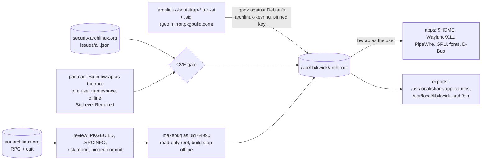

# kwick-arch: Arch Linux repositories and the AUR, security-gated

`kwick-arch` gives KwickOS the Arch Linux repositories (`core`, `extra`, `multilib`) and the AUR without mixing Arch binaries
into the Debian-compatible system. Arch packages are linked against Arch's glibc and libraries, so installing them into the
host root would break it. Instead they live in an Arch environment that KwickOS manages under `/var/lib/kwick/arch/root`,
and the programs installed there run with bubblewrap as you, on your desktop, with your files. Apps show up in the menu,
in Search/KRunner and on `PATH` like native ones.

Nothing about this is automatic: the package is optional (`apt install kwick-arch`) and the environment only exists after
`kwick-arch enable`. It is built by `scripts/mkarchpkg.sh`. x86_64 only (see [Architectures](#architectures)).

```
kwick-arch status [--json]
kwick-arch enable
kwick-arch disable [--purge]
kwick-arch search QUERY [--aur] [--json]
kwick-arch info PKG [--aur] [--commit SHA] [--json]
kwick-arch install PKG... [--aur] [--yes] [--allow-vulnerable] [--commit SHA] [--build-network] [--json]
kwick-arch remove PKG... [--json]
kwick-arch upgrade [--check] [--yes] [--allow-vulnerable] [--json]
kwick-arch list [--all] [--json]
kwick-arch run [--] COMMAND [ARGS...]
kwick-arch shell
```

## How it works



**Bootstrap.** `enable` reads `sha256sums.txt` from the Arch release directory, downloads the dated
`archlinux-bootstrap-YYYY.MM.DD-x86_64.tar.zst` and its `.sig`, and checks the signature with `gpgv` against the keyring of
Debian's `archlinux-keyring` package (installed through apt, so it arrives through Debian's signed archive). The valid signature
must come from a key listed in `RELEASE_KEYS` in `/etc/kwick/arch.conf` (default: the Arch release signing key
`3E80CA1A8B89F69CBA57D98A76A5EF9054449A5C`, Pierre Schmitz). The sha256 must also match `sha256sums.txt`. A tampered tarball
("BAD signature") or a signature by any other key stops `enable` before anything is unpacked. The tarball is unpacked with
Python's tarfile `tar` filter (no absolute paths, nothing outside the target directory). Then `pacman-key --init`,
`pacman-key --populate archlinux`, `archlinux-keyring` first, a full `-Su`, and the integration packages from `ENABLE_PACKAGES`
(default `mesa`, so apps render on the host GPU).

**Package signatures stay on.** Before every pacman call kwick-arch reads the environment's `pacman.conf` and refuses to run if
any `SigLevel` or `RemoteFileSigLevel` contains `Never`, `Optional` or `TrustAll` (Arch's default `Required DatabaseOptional`
passes). `LocalFileSigLevel = Optional` is left alone because locally built AUR packages are unsigned. Installs are always
`pacman -Su` plus the targets, so the environment never ends up in a partial upgrade.

**Root operations** (`pacman`, `pacman-key`, `locale-gen`, `useradd`) run inside `bwrap` in a user namespace of their own: ids
0-65535 of the environment are host ids 2147352576-2147418111 (systemd's foreign UID range; no host user has them), and the Arch
root is owned by those ids on the host. Root inside the environment is therefore not root on the host. kwick-arch creates the
namespace and writes the mapping itself (`kwickarch/nsexec.py`, before it starts `bwrap`), and moves an environment created by an
older version onto these ids the first time it runs. In the namespace `bwrap` binds the Arch root read-write at `/` and nothing else
of the host but `/etc/resolv.conf` read-only and the per-call directories named below; `/dev` is a private tmpfs with only `null`,
`zero`, `full`, `random`, `urandom` and `tty`, `/proc` is a new instance for a new PID namespace (its `sys` and other kernel knobs
read-only), `/sys` is not mounted, `/tmp` and `/run` are private, and IPC, UTS and cgroup namespaces are separate. The process keeps
only `CAP_CHOWN`, `CAP_DAC_OVERRIDE`, `CAP_FOWNER`, `CAP_FSETID`, `CAP_SETUID`, `CAP_SETGID` and `CAP_SYS_CHROOT` (pacman runs
scriptlets through `chroot`), all of them valid only inside the namespace, with `no_new_privs`, so a scriptlet cannot mount,
create device nodes, load modules, change sysctls or gain capabilities through setuid or file capabilities, and a setuid file it
creates belongs to an unprivileged host id. Every transaction that runs hooks or install scripts (`-S`, `-Su`, `-U`, `-R`) is done
in two steps: `--downloadonly` with network, then the transaction itself in a network namespace of its own, so scriptlets have no
network either. pacman 7's download sandbox (`DownloadUser = alpm`, Landlock) stays enabled. Nested user namespaces are
refused inside: before it starts `bwrap`, `nsexec.py` sets `user.max_user_namespaces` to 1 in the outer namespace and then enters
a second one for the sandbox, so a scriptlet's `unshare -U -r` fails with `ENOSPC` instead of handing it capabilities in a fresh
namespace (a kernel attack surface). Everything the host does as root with paths the sandbox controls (`/build/out`, the files
under the root such as `etc/pacman.d/mirrorlist`) goes through `safefs.py`: directory file descriptors opened one component at a
time with `O_NOFOLLOW`, regular files only, written to a temporary name and renamed into place, so a symlink planted by a scriptlet
or a PKGBUILD can neither leak a host file into the environment nor make root truncate or `chmod` one.

**Running apps.** `kwick-arch run -- CMD` starts `bwrap` as the calling user (an unprivileged user namespace, no setuid helper):
the Arch `/usr`, `/etc`, `/var` and `/opt` read-only, the host `/dev` (GPU render nodes, input, sound), `/sys` read-only, `/tmp`
(X11 sockets), `$XDG_RUNTIME_DIR` (Wayland, PipeWire, the session bus), `/run/dbus` (the system bus), `$HOME`, `/media`, `/mnt`.
Host fonts, icons and themes are mounted at `/usr/local/share/{fonts,icons,themes}`, which Arch's fontconfig and the XDG data
dirs search. `/etc/passwd` and `/etc/group` get your user added. The environment is cleared and only display, session, locale
and scaling variables pass through, so host library paths such as `QT_PLUGIN_PATH` or `LD_LIBRARY_PATH` never leak into Arch
programs. `xdg-open` inside the environment opens links and files through the desktop portal, so the host browser and file
handlers are used. This is the distrobox model: the Arch environment is an integration layer, not a security sandbox. Programs
started through it have your user's rights over your home directory, exactly as host programs do.

**Exports.** After an install, every `.desktop` file a requested package ships in `/usr/share/applications` is copied to
`/usr/local/share/applications` with `Exec=` rewritten to `/usr/bin/kwick-arch run -- ...`, `TryExec` and `DBusActivatable`
dropped, the icon resolved to the file inside the Arch root, and `X-KwickOS-Arch-Package` added. KDE's KService database (menu,
KRunner, Search) and GNOME pick it up from there. If the host already has a desktop file with the same name, the export is named
`kwick-arch-<name>.desktop` and its `Name=` gets " (Arch)". Each `/usr/bin` program of a requested package gets a wrapper in
`/usr/local/lib/kwick-arch/bin`, which `/etc/profile.d/30-kwick-arch.sh` appends to the end of `PATH`, so host commands always win.
Dependencies and the bootstrap's own packages are not exported. `remove`, `disable` and package removal take the exports away.

## Security gates

### Arch Security Tracker (repository packages)

kwick-arch downloads `https://security.archlinux.org/issues/all.json` (cached in `/var/lib/kwick/arch/cache/tracker.json`, at
most `TRACKER_MAX_AGE` seconds old, default 6 hours). An advisory group (AVG) applies to a package version when its status is
not "Not affected" and either it has no fixed version or the version is older than the fixed one. Packages are matched by name and
by pkgbase. If the tracker cannot be reached and there is no cached copy, installs and upgrades stop: there is no "no data, go
ahead".

Every transaction is planned first (`pacman -Su --needed --print`) and every package in it is checked:

| Package in the transaction | Refused when it has an open AVG of severity | Otherwise |
|---|---|---|
| a package you asked for | `CVE_BLOCK_TARGET` and above (default `low`, i.e. any) | |
| a new dependency | `CVE_BLOCK_DEPS` and above (default `high`) | listed as a warning with its CVEs |
| an upgrade of an installed package | an AVG the installed version does not already have, at the same thresholds (explicit packages use the target threshold) | upgrades that keep or fix existing issues go ahead and report them |

`Unknown` severity counts as `medium`. A refusal prints the package, the AVG, its severity and type and the CVE IDs, and exits
with status 4; `--allow-vulnerable` installs anyway. Upgrades are never refused for issues the installed version already has,
because refusing them would keep you on the older, equally or more vulnerable build.

Why dependencies have a separate threshold: the Arch tracker keeps a number of long-open Medium and Low entries against base
libraries (for example `libtiff`, `giflib`, `xdg-utils`, `openssl`, `systemd`, `pam`, `coreutils`), and most GTK and Qt apps pull
some of them in. Refusing on those would refuse nearly every desktop app while not making anything safer, since the same
libraries are in every Arch install. They are reported on every install and in the periodic check instead. Set `CVE_BLOCK_DEPS=low`
in `/etc/kwick/arch.conf` for the strict behaviour.

The check is only as good as the tracker. It does not know about issues that Arch has not filed, and its pkgbase matching can
over-report split packages (for example `systemd-libs` for an AVG filed against `systemd`).

### Periodic re-check and Software Update

`kwick-arch upgrade --check` refreshes the sync databases into a temporary directory (as root inside the root bwrap; as a normal
user inside a user-namespace bwrap with pacman's download sandbox disabled for that temporary copy), compares them with the
installed packages and reports: available updates with the CVEs they fix or still have and whether they would be refused, AUR
packages with a newer version (they need a new review, see below), and every installed package with open advisories. As root the
result is saved in `/var/lib/kwick/arch/check.json`; a normal user gets that saved result if it is less than an hour old.

`kwick-update check` (and so the scheduled check and the Software Update page) runs it when the environment is enabled. Arch updates
appear in `kwick-update status --json` as `updates` entries of `"kind":"arch"` (`"security":true` when the update fixes an
advisory), the status JSON gains an `"arch"` object with the check summary and the vulnerable packages, and
`kwick-update upgrade arch` (or `upgrade all`) runs `kwick-arch upgrade --yes`. A refused Arch upgrade is logged as "held back"
and does not fail an `upgrade all`.

### AUR

AUR packages are scripts written by anyone, and the AUR has carried real malware (in 2018 orphaned packages were adopted and
changed to download a script with `curl` and run it; in 2025 newly uploaded browser packages installed a remote access trojan).
kwick-arch never installs from the AUR without a review:

1. The package is looked up with the AUR RPC (`/rpc/v5/info`): votes, popularity, maintainer, submitter, first submission, last
   change, out-of-date flag.
2. The git history comes from `cgit/aur.git/atom/?h=<pkgbase>`; the reviewed commit is the head unless `--commit` is given.
3. The tree of that commit is downloaded as a snapshot and verified: kwick-arch computes the git tree hash of the snapshot and
   compares it with the tree ID of the commit (`cgit/aur.git/commit/?id=`). A snapshot that does not hash to the commit's tree is
   rejected, so the files that are shown, analysed and built are exactly that commit.
4. `PKGBUILD`, `.SRCINFO`, install scripts and every other text file are analysed (below), and the review is shown: risk level,
   findings with file and line, the full `PKGBUILD` and install scripts.
5. Confirmation: interactive `y`, or typing the pkgbase name when the risk is high. Without a terminal, `--yes` is required
   (exit status 3 with the review in the JSON otherwise). The Store shows `info --aur --json` and then passes `--yes --commit <sha>`
   from that review, so the build uses the commit the user saw even if the AUR changed in between.
6. Dependencies: repository dependencies go through the CVE gate and are installed with `--asdeps`; AUR dependencies are reviewed
   the same way (each with its own risk report) and built first. `base-devel` (and `git` for git sources) are installed on first use.
7. Build: `makepkg` runs as the unprivileged user `kwickbuild` (uid 64990, host uid 2147417566) inside the Arch root mounted read-only, with no
   capabilities and `no_new_privs`, in a per-build directory under `/var/lib/kwick/arch/build` (mode 0700, so no host user can
   reach into it). Step one (`makepkg --nobuild`, with network) downloads, checks sha256/b2 sums and PGP signatures against
   `validpgpkeys` (keys are fetched from keyserver.ubuntu.com by full fingerprint), extracts and runs `prepare()`. Step two
   (`makepkg --noextract --holdver`) runs `build()`, `check()` and `package()` in a network namespace with no network at all. A
   build that needs the network fails there; `--build-network` (or `AUR_NETWORK_BUILD=1`) allows it after you have looked at why.
8. The package is installed with `pacman -U` in the root sandbox above, so its install script runs offline as the environment's
   root, not the host's. Make dependencies that were installed only for the build are removed again
   (`base-devel` and `git` stay). The pin (pkgbase, commit, digest of the reviewed files, risk, number of findings) is stored in
   `/var/lib/kwick/arch/state.json` and shown by `list --json` and `info --aur`.

AUR packages are never upgraded automatically. `upgrade --check` lists them with `needs_review: true`; upgrading is
`kwick-arch install PKG --aur` again, which reviews the new head.

Risk report checks:

| Finding | Severity |
|---|---|
| `curl`/`wget` piped into a shell, `eval "$(curl ...)"`, base64-decoded data piped into a shell | high |
| inline `python -c`/`perl -e` with exec, sockets, decoding or HTTP; long `\x` escape strings; encoded blobs of 120+ characters | high |
| reverse-shell constructs (`/dev/tcp`, `nc -e`, `socat exec:`) | high |
| writes to shell startup files, cron, sudoers, `authorized_keys`, `ld.so.preload` (medium when it only packages files into `$pkgdir`) | high |
| install script that runs `curl`, `wget`, `systemctl enable`, `useradd`, `usermod`, `chsh`, `passwd` or `setcap` as root | high |
| non-VCS download with `SKIP` checksum and no PGP signature | high |
| download over plain HTTP or FTP | high without checksum, medium otherwise |
| source on a paste, file-sharing or URL-shortener host, or a raw IP address | high |
| first submitted less than 14 days ago with fewer than 5 votes | high |
| network commands in `build()`, `check()` or `package()` (`curl`, `wget`, `git clone`, `pip install`, `npm install`, `cargo install` ...) | medium (low in `prepare()`/`pkgver()`) |
| source from a domain that is neither the upstream URL's nor a well-known forge or project host | medium |
| orphaned package, no votes, first submitted less than 60 days ago, latest commit by an author not seen in earlier history | medium |
| base64 decoding, `eval` on dynamic content, setuid bits (no effect through kwick-arch), `chmod 777`, broad `rm -rf` | medium |
| binary files in the AUR repository (except PGP keys in `keys/pgp/`), symlinks pointing outside the repository | medium |
| `SKIP` checksum replaced by a PGP signature, md5/sha1-only checksums, few votes, out-of-date flag, changed in the last 3 days, maintainer differs from submitter | low |
| install script present, PGP-verified sources, unpinned VCS source, `-bin` package | info |

The risk is the highest severity found. Search results (`search --aur`) carry a risk from the metadata only
(`"risk_basis": "metadata"`); `info --aur` adds the file analysis. The analysis is a set of heuristics, not a proof: a clean report
does not mean a package is safe, so read the `PKGBUILD`.

On a sample of popular packages: `yay`, `zoom`, `ttf-ms-fonts`, `downgrade` low; `paru` low (network in `prepare()`);
`google-chrome` medium (packages a cron job); `brave-bin` medium (setuid sandbox helper); `spotify` high (Debian repository index
files fetched over plain HTTP with `SKIP`, only partly covered by a PGP signature).

## CLI contract

Every command takes `--json`: one JSON object on stdout, progress and pacman/makepkg output on stderr. Errors are
`{"ok": false, "error": CODE, "message": TEXT, ...}` with a non-zero exit status.

| Exit | `error` | Meaning |
|---|---|---|
| 0 | | success (`"ok": true`) |
| 1 | `network`, `command-failed`, `build-failed`, `bad-signature`, `untrusted-signer`, `bad-snapshot`, `tracker-unavailable`, `insecure-pacman-conf`, `busy`, `internal` ... | failure |
| 2 | `usage` | bad arguments |
| 3 | `confirm` | confirmation required: pass `--yes` (the JSON carries the planned `transaction` or the AUR `review`) |
| 4 | `vulnerable` | refused by the CVE gate (`blocked` and `transaction` list the packages and advisories); `--allow-vulnerable` overrides |
| 6 | `disabled` | the environment is not enabled |
| 7 | `unsupported` | not x86_64 |
| 8 | `not-found`, `not-installed`, `missing-dependency` | no such package |

`status --json`: `version`, `arch`, `supported`, `reason`, `enabled`, `present`, `root`, `bootstrap` (`file`, `sha256`, `signer`,
`date`), `userns`, `bwrap`, `packages`, `explicit`, `aur` (names), `exports` (per package: `desktop` paths, `bin` names),
`disk_bytes`, `tracker_fetched`, `last_check` (`checked`, `summary`).

`search QUERY --json`: `results[]` with `name`, `version`, `repo` (`core`/`extra`/`multilib`/`aur`), `description`, `url`,
`installed`, `cve` (CVE IDs), `risk` (`low`/`medium`/`high`); repository results add `advisories[]` (`avg`, `cves`, `severity`,
`type`, `status`, `affected`, `fixed`, `url`), `size`, `installed_size`; AUR results add `votes`, `popularity`, `maintainer`,
`out_of_date`, `first_submitted`, `last_modified`, `risk_basis`, `findings`.

`info PKG --json`: the search fields plus `base`, `licenses`, `depends`, `optdepends`, `provides`, `conflicts`, `groups`,
`packager`, `builddate`, `exports`. With `--aur`: `package` (AUR metadata), `pkgbase`, `commit`, `head`, `srcinfo_version`,
`risk`, `findings[]` (`severity`, `id`, `message`, `file`, `line`, `excerpt`), `sources[]` (`url`, `domain`, `checksum`, `vcs`,
`pgp_signed`), `history[]`, `files[]`, `digest`, `pkgbuild`, `srcinfo`, `install_scripts`, `pinned`.

`install --json`: `installed`, `transaction[]` and `warnings[]` (`name`, `version`, `from`, `repo`, `role`
`target`/`dependency`/`upgrade`, `cve`, `fixes`, `advisories`, `risk`, `blocked`), `exports`; with `--aur` also `aur[]` (`pkgbase`,
`packages`, `commit`, `risk`, `findings`, `version`) and `repo_dependencies`.

`remove --json`: `removed`. `upgrade --json`: `upgraded`, `warnings`, `aur_updates`, `vulnerable`.

`upgrade --check --json`: `checked`, `tracker_fetched`, `updates[]` (`name`, `from`, `to`, `repo`, `size`, `description`, `cve`,
`fixes`, `security`, `blocked`, `advisories`), `aur_updates[]` (`name`, `from`, `to`, `votes`, `maintainer`, `out_of_date`,
`pinned_commit`, `needs_review`), `vulnerable[]` (`name`, `version`, `explicit`, `cve`, `risk`, `advisories`, `fixed_by_update`),
`summary` (`updates`, `security_updates`, `blocked`, `aur_updates`, `vulnerable`, `vulnerable_high`), `cached` when served from
the saved result.

`list --json`: `packages[]` with `name`, `version`, `repo` (`aur` for AUR builds, `local` for foreign ones), `explicit`,
`description`, `installed_size`, `installdate`, `cve`, `advisories`, `risk`, `exports`, `aur` (the pin). `--all` includes
dependencies.

`enable --json`: `enabled`, `bootstrap`, `root`. `disable --json`: `enabled`, `purged`. Mutating commands re-run themselves
through `pkexec` (no terminal) or `sudo` (terminal) when not started as root.

## Configuration

`/etc/kwick/arch.conf` (a conffile):

| Key | Default | |
|---|---|---|
| `MIRRORS` | geo.mirror.pkgbuild.com, mirror.rackspace.com, mirrors.kernel.org | written to the environment's mirrorlist |
| `REPOS` | `core extra multilib` | |
| `RELEASE_KEYS` | `3E80CA1A8B89F69CBA57D98A76A5EF9054449A5C` | fingerprints allowed to sign the bootstrap |
| `ENABLE_PACKAGES` | `mesa` | installed by `enable` |
| `CVE_BLOCK_TARGET` / `CVE_BLOCK_DEPS` | `low` / `high` | thresholds, `low`, `medium`, `high`, `critical` |
| `TRACKER_MAX_AGE` | `21600` | seconds |
| `KEEP_CACHE` | `0` | `1` keeps downloaded packages and the bootstrap |
| `AUR_NETWORK_BUILD` | `0` | `1` gives `build()` network access |

## Host packages: Debian security tracker

`kwick-update check` also runs `/usr/lib/kwick/debsec` (shipped in the base and in the `kwick-update` package). It fetches the
Debian security tracker's per-release feed (`security-tracker.debian.org/tracker/debsecan/release/1/<codename>`, the data
`debsecan` uses) with `curl` over verified TLS, and evaluates it against `dpkg-query` with BusyBox `awk`, including a Debian
version comparison. The result is `/var/lib/kwick/update/cve.json` (`fixable`: CVEs an available update fixes; `open` counts
by urgency for CVEs without a fix; `packages[]` with `source`, `version`, `fixable` CVE IDs, `fixed_in`, `open` high/medium CVE
IDs) and `cve.tsv`. `kwick-update status --json` carries it as `"cve"`, the text status prints a summary line, and
`kwick-update cve [--json] [refresh]` lists it together with the Arch environment's findings. On a Debian trixie container the CVE
set matched `debsecan --suite trixie` exactly (186 of 186). Without `curl` (the headless base has only BusyBox `wget`, which refuses
`https://` without `openssl`) the check records an error instead of trusting unverified data.

## Architectures

| Arch | Status |
|---|---|
| amd64 (x86_64) | supported |
| arm64 (aarch64) | not supported. Arch Linux ARM is a separate project: its bootstrap is signed by its own build key, which Debian's `archlinux-keyring` does not carry, and the Arch Security Tracker does not cover its packages, so neither gate could work. `status` says so and `enable` exits with status 7. |
| riscv64 | not supported, Arch has no official port |

The package is `Architecture: all` so `status --json` can report this on every machine.

## Limits

* NVIDIA's proprietary driver needs a matching `nvidia-utils` inside the environment; this is not set up. Mesa drivers (AMD,
  Intel, virtio/virgl, nouveau) work through `mesa`.
* Programs that need setuid helpers, system services or their own D-Bus system services (for example CUPS backends, VPN
  daemons) do not work from the environment; it runs apps, not services.
* Inside `kwick-arch run` the environment's files show as owned by `nobody`, because their host ids (see Root operations) are not
  mapped into the user's namespace. Programs that insist on root-owned system files (for example `sudo`) do not work there.
* Install scripts run without network. One that downloads something at install time fails at that step.
* The tracker gate covers repository packages; AUR packages are not in the Arch tracker, so for them the review is the gate.
* The dock or task manager may show the host's icon for an Arch app whose Wayland app ID equals a host desktop file.
