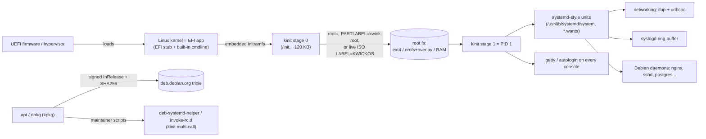

# KwickOS architecture

KwickOS is built from three small programs plus the upstream Linux kernel:

| component | language | size (amd64, static) | role |
|---|---|---|---|
| **BusyBox 1.38** (+ KwickOS patches) | C / musl | ~1.1 MB | 340+ POSIX/Linux commands, shell (`sh`, `bash`→ash), networking (`ip`, `udhcpc`, `ifup`), syslog, cron, ntpd |
| **kinit** | C / musl | ~120 KB | initramfs root finder, PID 1, service manager, `systemctl`/`service`/`journalctl`, Debian helpers, `systemd-sysusers`/`systemd-tmpfiles` |
| **kpkg** | Go | ~4.2 MB | `apt`, `apt-get`, `apt-cache`, `apt-mark`, `dpkg`, `dpkg-query`, `dpkg-deb`, `update-alternatives`, ... on real Debian repositories |
| **Linux 7.3.x** | C | 6.4 MB (virt, EFI) | `virt` (monolithic, module-free) and `generic` (defconfig + modules) flavors |

Nothing in the base image is dynamically linked, so the base contains no libc
`.so` at all. glibc arrives only when you install a Debian package that needs it.

## 1. No bootloader: the kernel is the boot loader

Every KwickOS kernel is built with `CONFIG_EFI_STUB`, which makes the kernel image a
valid UEFI application, and with an **embedded initramfs** that contains only
`kinit` (about 120 KB). The resulting single file boots on:

* UEFI firmware, from the ESP removable path `EFI/BOOT/BOOTX64.EFI`
  (`BOOTAA64.EFI`, `BOOTRISCV64.EFI` on the other architectures);
* QEMU/Firecracker/cloud-hypervisor `-kernel` direct boot (PVH on x86);
* the live ISO, as an El Torito EFI image.

kinit stage 0 finds the root without any kernel command line:

1. `root=` if given (`/dev/x`, `PARTLABEL=`, `LABEL=`, `UUID=`, `virtiofs:tag`, 9p);
2. otherwise the GPT partition named `kwick-root`;
3. otherwise a volume labelled `KWICKOS` (the live ISO or USB stick). Its
   `kwick/root.erofs` image is mounted read-only (LZ4HC) under a tmpfs overlay. A
   partition named `kwick-persist` makes the overlay persistent, and `kwick.toram`
   copies the image to RAM first.
4. If the whole OS was loaded as an initramfs (`/etc/kwick-release` exists), it
   simply continues. This is the fastest mode, used for microVMs and agent sandboxes.

Labels are read straight from the superblocks, so no blkid is needed. There is
no GRUB, no initramfs generator, and nothing to regenerate on kernel updates.

## 2. kinit: PID 1, service manager, systemd compatibility

* Mounts the API filesystems, cgroup2 (`nsdelegate`), applies `sysctl.d`, runs
  `systemd-tmpfiles --create`, coldplugs modules (generic flavor) and hotplugs
  them from kernel uevents (netlink, no udev daemon).
* Service definitions use **the systemd unit format**. Units shipped by Debian
  packages (`/usr/lib/systemd/system/*.service`) work unmodified. Supported:
  `Type=simple|exec|notify|forking|oneshot`, `ExecStart/Pre/Post/Stop/Reload`,
  `Restart=` (with backoff), `User/Group/DynamicUser`, `Environment(File)`,
  `WorkingDirectory`, `PIDFile`, `RemainAfterExit`, `Runtime/State/Logs/CacheDirectory`,
  drop-ins (`*.service.d/*.conf`), template units (`foo@bar.service`) and
  `%i %n %p %t ...` specifiers.
* Services start **in parallel** as soon as PID 1 is up. Boot "ordering" is
  whatever finishes first: daemons that need the network retry, as on systemd.
* `systemctl start|stop|restart|reload|status|enable|disable|mask|is-active|is-enabled|cat|daemon-reload|list-units`,
  `service`, `journalctl -u UNIT [-f]` (per-unit log files in `/var/log/kinit/`),
  `poweroff|reboot|halt`.
* **Containers:** `systemctl start nginx` inside a container transparently starts
  `kinit --supervisor`, a non-PID-1 service manager. Agents can therefore use the
  same commands everywhere.
* Debian integration: `deb-systemd-helper`, `deb-systemd-invoke`, `invoke-rc.d`
  (honours `policy-rc.d`) and `update-rc.d`. kinit also creates `/run/systemd/system`,
  so maintainer scripts take the systemd code path and enable and start services
  exactly as on Debian.
* `systemd-sysusers` and `systemd-tmpfiles` are implemented natively, so packages
  that declare `systemd | systemd-sysusers` don't pull in systemd.
* Shutdown signals all services in parallel, waits until no process is left
  (`ECHILD`), unmounts, and remounts `/` read-only.

## 3. kpkg: apt/dpkg on real Debian repositories

The KwickOS base **virtually provides Debian's Essential set** (coreutils, bash,
dpkg, util-linux, ...), as versioned `Provides:` of the single `kwick-base`
status entry. So `apt install nginx` resolves against the unmodified Debian 13
archive and pulls in only what nginx really needs (libc6, libssl, pcre2, ...).

* **Security model** is Debian's. `InRelease` is verified with the Debian
  archive keys (RSA-4096 and Ed25519, using kpkg's own minimal OpenPGP
  implementation); index files and every `.deb` are checked by SHA256;
  `Valid-Until` is enforced; `by-hash` downloads avoid mirror races. Because
  integrity doesn't depend on TLS, kpkg ships a 300-line HTTP/1.1 client
  instead of `net/http`+`crypto/tls`, which saves about 3.5 MB. `https://` sources
  go through curl or wget.
* **Compact indexes:** `Packages.xz` is stream-parsed into a field-filtered,
  gzip'd index (~11 MB for all of Debian main) without ever being fully loaded.
* **dpkg-compatible database:** `/var/lib/dpkg/status`, `info/*.list`,
  maintainer scripts, conffiles (locally modified ones are kept and the new
  version is saved as `.dpkg-dist`), triggers (explicit and file triggers, e.g.
  `ldconfig`), `update-alternatives`, `/var/lib/apt/extended_states` (autoremove).
* **Solver:** alternatives, versioned and virtual Provides,
  Conflicts/Breaks/Replaces with removals, Pre-Depends, and Tarjan SCC ordering.
  Cycles are unpacked fully, then configured Essential-first.
* **Essential on demand:** perl (debconf), libc-bin (ldconfig/getent) and a real
  bash are installed only when a transaction needs them.
* **Self-healing compatibility.** If a maintainer script fails because a BusyBox
  applet lacks a GNU option (`pgrep -u`, `find -uid`, `ln -r` ...), or a script
  needs an interpreter that isn't present, kpkg installs the real Debian package
  (procps, findutils, coreutils, perl-base ...) and retries the script. The base
  stays tiny, and GNU tools appear only on systems whose software needs them.
* Recommends are **off by default** (`/etc/kpkg.conf`), as in Debian container
  images. Use `--install-recommends` per call.

## 4. Kernel flavors and updates

| flavor | base | modules | used for |
|---|---|---|---|
| `virt` | `tinyconfig` + fragments | none | disk images, microVMs, cloud (virtio, NVMe, ENA, gVNIC, e1000) |
| `generic` | arch `defconfig` + fragments | zstd-compressed, coldplugged by kinit | live ISO, bare metal, Hyper-V |

`config/kernel/*.config` are fragments merged by `merge_config.sh`. The build
**fails if any required option was dropped** by kconfig, and lists every
non-applied option.

Kernel updates are packages (`linux-image-kwick-virt`, `linux-image-kwick-generic`)
in the KwickOS apt repository published by CI to GitHub Pages. Their postinst runs
`kwick-kernel-install`, which copies the new EFI image to the ESP and keeps the
previous one for `kwick-kernel-install --rollback`. The `kernel-watch` workflow polls
kernel.org every 6 hours and opens a PR for each new stable release, which the full
build and boot matrix then tests.

## 5. Layout and security defaults

* Merged `/usr` (`/bin`, `/sbin`, `/lib` → `/usr/...`), as Debian 13 expects.
* Root account locked (`*`). The console autologins as root on VM and live
  images (`/etc/kinit/autologin`); remove that file to get a login prompt.
* The build fails if anything in the rootfs is world-writable (except sticky
  tmp dirs).
* Kernel: stack protector, `STRICT_KERNEL_RWX`, KASLR, hardened usercopy,
  `INIT_STACK_ALL_ZERO`, list hardening, Landlock, Yama, lockdown, BPF LSM, seccomp,
  `dmesg_restrict`, `kptr_restrict`, protected links/fifos.
* Networking defaults: BBR + fq, TCP Fast Open, nftables (with an iptables-legacy
  fallback), WireGuard, VXLAN, bridges, veth, cgroup v2 and all namespaces, so
  Docker/containerd/podman installed via `apt` work.
