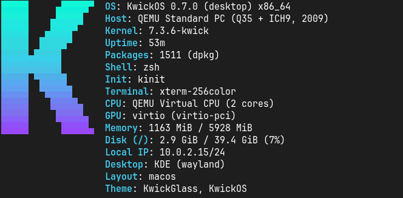

# Using the base system

The headless base is BusyBox, kinit and kpkg on the latest stable kernel. Everything else comes from Debian 13 with `apt`, or from
Alpine with `apk`. How the pieces work is in [ARCHITECTURE.md](ARCHITECTURE.md).

## Everyday commands

```sh
apt update; apt install postgresql        # real Debian packages
apt search redis; apt show nginx; apt list --installed; apt autoremove; apt full-upgrade
dpkg -l; dpkg -L nginx; dpkg -S /usr/sbin/nginx
systemctl status nginx; systemctl restart nginx; journalctl -u nginx -f
service ssh restart
vi /etc/network/interfaces                 # ifupdown syntax (DHCP on eth0 by default)
```

* Recommends are not installed by default (`/etc/kpkg.conf`). Use `--install-recommends`.
* Packages install without their documentation, like Debian's slim container images. `/etc/dpkg/dpkg.cfg.d/excludes` skips
  `/usr/share/doc` (copyright files stay), `/usr/share/doc-base`, man and info pages, groff and lintian data, and translations
  other than English and C. kpkg drops debconf question translations for the same excluded languages when it installs a
  package's `templates`, so `tzdata` and friends store English prompts only. To turn it off, delete the file (or comment out a line in it) and reinstall the packages whose files you want back, for example
  `rm /etc/dpkg/dpkg.cfg.d/excludes; apt install man-db; apt install --reinstall nginx`. The desktop edition does not have the
  file.
* The KwickOS apt repository carries a lean rebuild of Debian's `curl` source (`curl`, `libcurl4t64`, `libcurl3t64-gnutls`
  and their `-dev` packages), versioned `<Debian version>+kwick1`. It is Debian's source and patches built without LDAP,
  RTMP, GSSAPI/Kerberos and SCP/SFTP, so Debian's `curl` (`apt install --no-lean curl`) and the Debian packages that use
  libcurl, such as Debian's `git`, do not pull in OpenLDAP, SASL, Berkeley DB, Kerberos,
  librtmp, GnuTLS (for RTMP) and libssh2. Every other protocol and feature works as in Debian (HTTP/1.1, HTTP/2 and HTTP/3,
  FTP(S), SMTP(S), IMAP(S), POP3(S), SMB, MQTT, TFTP, DICT, telnet, gopher, WebSockets, brotli, zstd, IDN, PSL). Alpine's
  curl leaves out the same four. When Debian
  publishes a newer curl (a security update), its version sorts above the lean build and apt installs Debian's until the
  next KwickOS release rebuilds it. To keep Debian's full build, install it by version, for example
  `apt install curl=8.14.1-2+deb13u7 libcurl4t64=8.14.1-2+deb13u7`, and hold it with `apt-mark hold`.
* On a headless system `apt install curl`, `python3`, `nginx`, `openssh-server` and `git` install the KwickOS lean musl
  builds of these tools; see [Lean builds](#lean-builds) below.
* The console logs in as root automatically on VM and live images. Run `rm /etc/kinit/autologin` and `passwd` for a password
  prompt. Install `openssh-server` for remote access.
* `kwick-kernel-install --list | --rollback` manages kernels.
* `apk add <pkg>` works next to `apt`. Alpine (musl) and Debian (glibc) packages coexist, and the apk bootstrap is
  signature-verified. `tests/ecosystems.sh` checks that `apk add nodejs`, `apt install python3` and the official Bun installer work
  side by side.
* Real software from the Debian archive passes a 31-package compatibility matrix: [COMPATIBILITY.md](COMPATIBILITY.md).

## Out of the box

What the base can do before you install anything, and what is one `apt install` away. Sizes in the last column were measured on a
fresh base and include the dependencies it lacks. The first Debian package pulls in glibc, about 16 MB, which every later package
then shares. `apt install kwick-essentials` installs a common set of these tools (curl, jq, sudo, dnsutils, net-tools,
build-essential and similar) in one step.

| need | in the base | with apt |
|---|---|---|
| network | DHCP and static IPv4 (`/etc/network/interfaces`, `ip`, `ifconfig`, `route`), IPv6 SLAAC and `udhcpc6`, DNS (`nslookup`, `/etc/resolv.conf`), `ping`, `ping6`, `traceroute`, `nc`, `telnet`, `netstat`, `brctl`, `rfkill`, NTP client (`ntpd`, `systemctl enable --now ntpd`) | `dnsutils` (`dig`, 44 MB), `iproute2` (`ss`), `tcpdump` (54 MB) |
| Wi-Fi | `cfg80211`, `mac80211` and `iwlwifi` modules in the generic kernel, `rfkill` | `wpasupplicant` or `iwd` (20 MB), plus the card's firmware package (Debian's `non-free-firmware` component, which is not enabled by default) |
| HTTPS downloads | none: `wget` refuses `https://` until it can verify certificates (see below) | `curl` (lean build, 1.8 MB with its CA bundle), or `ca-certificates` and `openssl` so `wget` verifies |
| remote access | `nc`, `telnet`, `ssl_client` | `openssh-client` (61 MB), `openssh-server` (lean build, 4.1 MB), `rsync` (28 MB) |
| time zones and keymaps | `TZ=` with POSIX rules (`TZ=CET-1CEST,M3.5.0,M10.5.0/3`), clock via `hwclock` | `tzdata` (31 MB), `kbd` (18 MB) for `loadkeys` |
| editors, pager, shell | `vi`, `less`, `ash` (history, line editing, coloured `user@host:dir$` prompt), `watch`, `kwick-shell` | `nano` (21 MB), `bash` (fetched when something needs it) and `bash-completion`, `zsh` (about 19 MB installed, 5 MB download), `fish` |
| users and privilege | `adduser`, `addgroup`, `passwd`, `su`, `chpasswd` | `sudo` (51 MB) |
| scheduling and logs | `crond`, `crontab`, systemd `.timer` units (`systemctl list-timers`), `syslogd`, `logread`, `dmesg` | `rsyslog`, `logrotate` (runs daily from `logrotate.timer`) |
| disks | `fdisk`, `mkfs.ext2`, `mkfs.vfat`, `mkswap`, `mount` (loop, CIFS; vfat, ext4, `ntfs3` and `exfat` in the kernel), `lsblk`, `blkid`, `losetup`, `fsck` | `e2fsprogs` (19 MB), `parted` (21 MB), `exfatprogs` (17 MB), `ntfs-3g` (57 MB), `xfsprogs`, `btrfs-progs` |
| archives | `tar`, `gzip`, `bzip2`, `xz`, `unzip`, `cpio` | `zstd` (23 MB), `p7zip` |
| hardware and processes | `lspci`, `lsusb`, `lsmod`, `modprobe`, `top`, `ps`, `free`, `lsof`, `kfetch` | `htop` (18 MB), `pciutils`, `usbutils`, `strace` |
| containers | `unshare`, `nsenter`, `chroot` and a kernel with namespaces and cgroups | `podman` (197 MB), `docker.io` (see the compatibility matrix) |
| installer | `kwick-install`, `kwick-installer` | fetches `fdisk`, `e2fsprogs`, GRUB and so on when needed |

BusyBox `wget` in the base cannot verify TLS certificates on its own (the base carries no TLS library and no CA bundle), so it
refuses `https://` URLs and says what to install: `apt install curl`, or `apt install ca-certificates openssl`, after which `wget`
hands the connection to `openssl s_client` with certificate and host name verification against
`/etc/ssl/certs/ca-certificates.crt` (or `$SSL_CERT_FILE`). `--no-check-certificate` fetches without verification when you ask
for it. `apt` itself is unaffected: kpkg checks the repository signatures and hashes, so it fetches `https://` sources
with `--no-check-certificate` when `curl` is missing. The base has no `sudo`: log in as root or install it. Enabling anything
at boot is left to you, so the base starts only `networking` and `syslog`.

## Lean builds

On a headless system five common tools come from KwickOS's own musl builds rather than from Debian. `apt install curl` prints
`Note, selecting 'kwick-curl' (KwickOS lean build) for 'curl'` and installs it; the same goes for `python3`, `nginx`,
`openssh-server` and `git`. Each is built from the upstream release in `alpine:3.22` by `scripts/build-musl-lean.sh` and
published, signed, in the KwickOS repository ([UPDATES](UPDATES.md#lean-musl-builds) has the security process).

| package | what it is | installed (KiB) | left out, compared with Alpine's package |
|---|---|---:|---|
| `kwick-curl` | curl 8.23.0, static, mbedTLS 4.1.2 (TLS 1.2/1.3), nghttp2 (HTTP/2), zlib, threaded resolver | 1,624 | IDN, PSL, brotli and zstd decoding; no shared `libcurl` for other programs (Debian's `libcurl4t64` serves those). Neither build has NTLM |
| `kwick-python3` | CPython 3.14.10, stdlib in `/usr/lib/python314.zip` (source and bytecode), `ssl`/`hashlib` built in with OpenSSL 3.5.9, sqlite3, ctypes, curses, readline, lzma, bz2, decimal, pip/venv/ensurepip | 26,656 | `dbm.gnu`/`dbm.ndbm` (gdbm), `tkinter`/IDLE (no Tk, as in Alpine's split); tests are the `kwick-python3-tests` extra |
| `kwick-nginx` | nginx 1.30.7, static, LibreSSL 4.4.1 (TLS 1.3 with X25519MLKEM768, HTTP/2, HTTP/3), PCRE2 with JIT, zlib, Debian's `/etc/nginx` layout | 3,724 | dynamic modules (Alpine ships `stream`, `mail` and others as `nginx-mod-*`); `ssl_conf_command` and TLS 1.3 early data (LibreSSL) |
| `kwick-openssh-server` | OpenSSH 10.6p2 `sshd`, `sftp-server`, `ssh-keygen` with LibreSSL 4.4.1 `libcrypto` kept in `/usr/lib/openssh` | 3,480 | PAM, Kerberos and the `moduli` file, like Alpine's `openssh-server`; DH group exchange uses OpenSSH's built-in groups |
| `kwick-git` | git 2.56.1, static, HTTPS through libcurl/mbedTLS, PCRE2, expat; `git-remote-http`, `git-http-fetch` and `git-http-push` are one binary | 10,240 | like Alpine's `git`: no Perl, Tcl/Tk or Python parts; `git-daemon`, `http-backend`, `imap-send`, `scalar` and the Rust parts are left out |
| `kwick-ca-bundle` | Mozilla CA bundle (curl.se `cacert-2026-11-05.pem`), linked as `/etc/ssl/certs/ca-certificates.crt` and `/etc/ssl/cert.pem` when those are missing | 212 | |
| `kwick-musl` | musl libc at `/usr/lib/kwick/musl`, for Python and OpenSSH | 668 | |

How they live next to Debian's packages:

* The swap happens only when you name the package yourself. Dependencies always resolve to Debian, so Debian packages that need
  `libcurl4t64`, `libssl3t64` or Python modules get Debian's libraries.
* `kwick-curl`, `kwick-git`, `kwick-nginx` and `kwick-openssh-server` `Provide` the command package they replace, so a Debian
  package that needs the `curl` or `git` command is satisfied by them.
* `kwick-python3` provides nothing to Debian and conflicts with Debian's `python3`: installing a Debian module such as
  `python3-yaml` replaces it with Debian's Python 3.13 in the same transaction. Packages installed with `pip` into the lean
  Python's own directories go with it (use a virtual environment).
* A Debian nginx module (`libnginx-mod-*`) depends on Debian's `nginx-abi-*`, so installing one switches to Debian's nginx.
* Debian's build is one flag away: `apt install --no-lean curl` installs Debian's package and removes the lean one. To turn
  the swap off for good, delete `lean-builds = true` from `/etc/kpkg.conf` (`-o KwickOS::Lean-Builds=false` for one command).
  The desktop edition does not have the setting.
* Python from PyPI: binary wheels are `musllinux` wheels, which work with the lean Python. A package that has only a source
  distribution with C code needs a musl compiler, which KwickOS does not have; use Debian's Python for those.
* The builds use Alpine's optimisation level (`-Os` from abuild's defaults; Python at `-O2` with a 1 MiB thread stack, as in
  Alpine's APKBUILD), with
  `-fstack-protector-strong`, `-fstack-clash-protection`, `_FORTIFY_SOURCE=2`, full RELRO and PIE (static-PIE for the
  static ones).

## Shells

The headless base keeps BusyBox `ash` as the login shell, so it carries no shell package. Debian's `zsh` and `zsh-common` need about
19 MB installed, three times the base, which would end the size lead over Alpine. The desktop edition ships zsh as the default, like
macOS, and either edition can switch with `kwick-shell`.

```
kwick-shell                       current shell, the default for new users, the prompt preset and what is installed
kwick-shell NAME                  change your login shell, installing it first when it is missing
kwick-shell --user NAME zsh       change another user's shell (root)
kwick-shell --default zsh         change the shell given to users created from now on (root)
kwick-shell prompt NAME           kwick, minimal, powerline or starship prompt in every shell
```

Shells: `zsh`, `bash`, `fish`, `ash`, `nushell`, `elvish`, `xonsh`, `powershell`. [SHELLS](SHELLS.md) lists their sources and
versions, the prompt presets and the desktop shells.

* `kwick-shell` is a POSIX script. It installs with `apt` (Nushell and PowerShell from their official releases, checked against a
  pinned SHA-256), adds the shell to `/etc/shells`, and changes the login shell with `chsh` or `usermod`, or edits `/etc/passwd` itself
  when the base has neither. As a normal user it goes through `pkexec /usr/lib/kwick/shell-helper` (no password for your own shell in
  the active session) or `sudo`. `--default` writes `SHELL=` to `/etc/default/useradd` (what `useradd` reads) and `DSHELL` in
  `/etc/adduser.conf` when that exists.
* A change applies at the next login. `exec zsh` switches the current terminal at once.
* The desktop picks zsh for the live user, for `useradd` and `adduser` defaults and for the account `kwick-install` creates.
  `kwick-install --shell zsh|bash|ash|fish` overrides that. The Settings app has the same choice under Shells.
* The zsh setup is one file, `/usr/share/kwick/zsh/kwick.zsh`, loaded from `/etc/zsh/zshrc` and from `~/.zshrc` in `/etc/skel`. It
  gives a Terminal-style `user@host dir %` prompt whose directory colour follows the layout (blue for macOS, Fluent blue for
  Windows, indigo for Linux), history shared between sessions, `compinit` with a cached dump and a selectable completion menu,
  Home, End, Delete, Ctrl and Alt arrow keys, `ls` colours, and Debian's `zsh-autosuggestions` and `zsh-syntax-highlighting`. There is
  no framework, and `zsh -i -c exit` takes about 30 ms.
* `ash` reads `/etc/profile` as a login shell and `/etc/ashrc` (set as `ENV`) in nested shells, so the prompt and aliases (`ls`, `ll`,
  `la`, `grep`, `..`, `df -h`) are the same either way. The prompt is the same `user@host dir $` as in the other shells
  (`/usr/share/kwick/shell/prompt.sh`), red for root, and plain without a colour terminal or with `NO_COLOR`.

## kfetch

`kfetch` prints a system summary with a bold K in the cyan-to-violet brand gradient, on both editions: OS and edition, kernel, host
or board model, uptime, package counts (dpkg and apk), shell, init, terminal, CPU, GPU, memory, disk, local IP and, on the desktop,
the session, layout and theme.

* It is a 10 KB POSIX shell script that runs under BusyBox `ash`, takes about 15 ms, reads `/proc` and `/sys` directly and skips
  whatever a machine does not have.
* `kfetch --small` is a compact version, `kfetch --json` prints one JSON object and `--no-logo` drops the logo.
* Colour is off when `NO_COLOR` is set, and the logo is dropped when stdout is not a terminal.
* No `neofetch` or `fastfetch` symlinks are installed, because both names belong to Debian packages with different options.



## Homebrew

`kwick-brew install` sets up [Homebrew](https://brew.sh) (Linuxbrew) at `/home/linuxbrew/.linuxbrew` using the official installer.

* Nothing is preinstalled, so it costs about 0 bytes in the image.
* It first installs the Debian build dependencies it needs (`build-essential`, `procps`, `curl`, `file`, `git`) if they are missing.
* After install Homebrew itself takes about 220 MB, plus roughly 460 MB of build tools on a minimal system.
* `kwick-brew status`, `kwick-brew uninstall` (the official uninstall script) and `kwick-brew shellenv` cover the rest. The desktop
  also has an "Install Homebrew" launcher.
* Supported on x86_64 and arm64 only. Other architectures exit with status 3.
* Once installed, login shells add brew to the end of `PATH` (`/etc/profile.d/20-kwick-brew.sh`), so system tools in `/usr/bin`
  always win.
