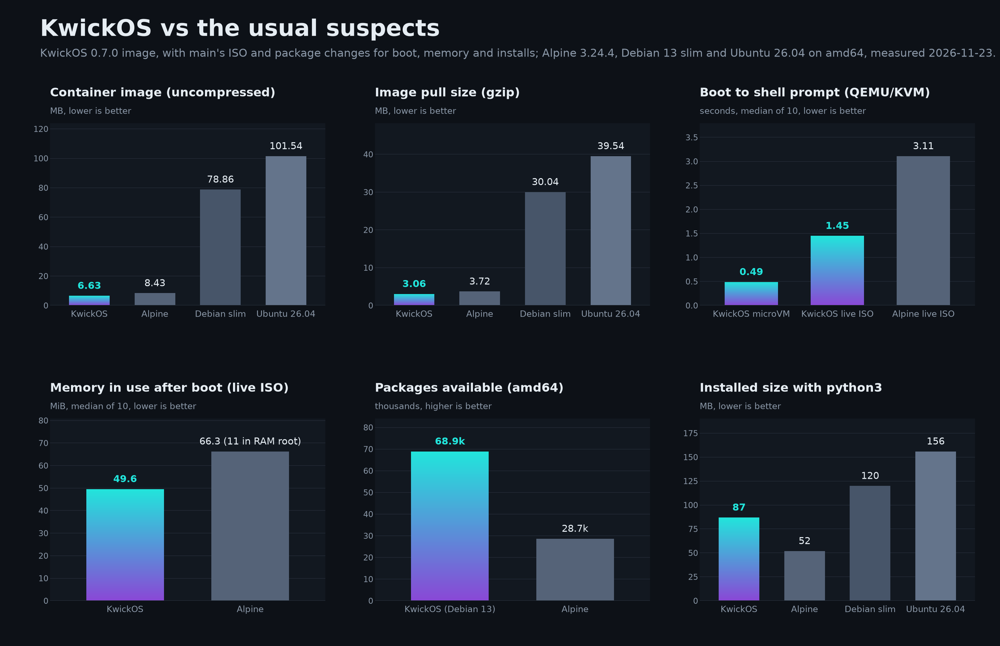

# Benchmarks



Every figure on this page, in the README and on the website comes from one file,
[`bench/results/summary.json`](../bench/results/summary.json). Each figure there names the raw output file in
[`bench/results/`](../bench/results) it was read from, and those files are the unedited output of the scripts in `bench/`.

## Summary

KwickOS 0.7.0 (release `v0.7.0-k7.3.5`, kernel 7.3.5) against Alpine 3.24.4, measured on 2026-11-23. The better result of each
row is in bold.

<!-- bench:summary -->
| | Alpine 3.24.4 | KwickOS 0.7.0 | conditions | raw output |
|---|---:|---:|---|---|
| container image, uncompressed / gzip | 8.43 / 3.72 MB | **6.63 / 3.06 MB** | `docker image inspect` and `docker save \| gzip`, amd64. Alpine's image includes OpenSSL and a CA bundle; the KwickOS base has neither | [2026-11-23-container.txt](../bench/results/2026-11-23-container.txt) |
| live ISO boot to shell prompt | 3.1 s (2.9-4.9) | **1.4 s (1.3-1.6)** | median (range) of 10 runs, wall time from QEMU start; QEMU/KVM q35, 2 vCPU, 512 MiB; each ISO with its own kernel (KwickOS `generic`, Alpine `virt`). KwickOS: the amd64 headless ISO built from main after 0.7.0 (see the raw file) | [2026-11-23-vm-3.txt](../bench/results/2026-11-23-vm-3.txt) |
| guest boot time at the shell prompt | 2.7 s (2.6-4.6) | **1.1 s (1.0-1.2)** | `/proc/uptime` at the prompt, same runs | [2026-11-23-vm-3.txt](../bench/results/2026-11-23-vm-3.txt) |
| microVM boot (`virt` kernel, whole OS in RAM) | no microVM image | 0.27 s guest, 0.49 s wall | QEMU `microvm`, release `kwickos-amd64.efi` and initramfs, median of 10 (guest 0.19-0.69 s, wall 0.40-1.15 s) | [2026-11-23-vm-3.txt](../bench/results/2026-11-23-vm-3.txt) |
| memory in use after boot (live ISO) | 63-74 MiB | **47-51 MiB** | `MemTotal - MemAvailable` at the prompt, range of 10 runs (medians 66.3 and 49.6). Alpine keeps its root file system in RAM: 11 MiB of its 15 MiB shmem (the other 4 MiB is the QEMU display's framebuffer, which KwickOS has too). Without the RAM root Alpine is about 55 MiB, so KwickOS still uses about 5 MiB less like for like. The live root's LZMA dictionary is 64 KiB: with main's earlier automatic dictionary the kernel held 4 MiB of decompression buffers per CPU and KwickOS measured 53-59 MiB here (2026-11-23-vm-3-before.txt) | [2026-11-23-vm-3.txt](../bench/results/2026-11-23-vm-3.txt), [2026-11-23-vm-3-before.txt](../bench/results/2026-11-23-vm-3-before.txt) |
| packages available (amd64) | 28,661 (musl) | **68,946 (Debian 13, glibc)** | unique package names in Alpine main + community and in Debian trixie, trixie-updates and trixie-security main, the sources KwickOS's apt uses | [2026-11-23-container.txt](../bench/results/2026-11-23-container.txt) |
| installed size with curl | **14 MB** | 50 MB (Debian slim: 97 MB) | `du -smx /` after installing, package indexes and caches removed. KwickOS 0.7.0 with kpkg, the documentation excludes and the lean rebuild of Debian's curl from main, not yet in a release (no LDAP, RTMP, GSSAPI or libssh2; Alpine's curl has none of these either). Most of the rest is glibc (13 MB, 8 MB of it iconv modules), perl-base for debconf (13 MB, needed by ca-certificates) and OpenSSL (8.7 MB, already part of Alpine's base image). Per-lever numbers: 2026-11-23-footprint-levers.txt | [2026-11-23-container-2.txt](../bench/results/2026-11-23-container-2.txt), [2026-11-23-footprint-levers.txt](../bench/results/2026-11-23-footprint-levers.txt) |
| installed size with python3 | **52 MB** | 87 MB (Debian slim: 120 MB) | same. Both install the standard library's compiled bytecode (Alpine pulls in python3-pyc, 12.8 MB; Debian's postinst compiles 12.6 MB). KwickOS adds glibc, perl-base for debconf (tzdata), OpenSSL, tzdata and Berkeley DB | [2026-11-23-container-2.txt](../bench/results/2026-11-23-container-2.txt), [2026-11-23-footprint-levers.txt](../bench/results/2026-11-23-footprint-levers.txt) |
| installed size with nginx / openssh-server / git | **11 / 11 / 22 MB** | 45 / 73 / 146 MB (Debian slim: 93 / 113 / 184 MB) | same. Debian's packages bring glibc, perl-base for debconf, OpenSSL, PAM and coreutils (openssh-server) and Perl with its modules (git, 52 MB); Alpine splits git-perl out | [2026-11-23-container-2.txt](../bench/results/2026-11-23-container-2.txt), [2026-11-23-footprint-levers.txt](../bench/results/2026-11-23-footprint-levers.txt) |
| live ISO download, amd64 / arm64 / riscv64 | 70.3 / 93.5 / 58.3 MB | 69.0 / 125.9 / 85.6 MB | release file sizes. Alpine `virt` ISOs; riscv64 has only the `standard` ISO. KwickOS ISOs carry the `generic` kernel and its modules | [2026-11-23-artifacts.txt](../bench/results/2026-11-23-artifacts.txt) |
| memory of a `sh` in a container | 84-92 KiB | **56 KiB** | anon + page tables from the container's `memory.stat`, 5 runs. A real but trivial difference | [2026-11-23-container.txt](../bench/results/2026-11-23-container.txt) |
<!-- /bench:summary -->

## Reading it honestly

Where KwickOS is ahead:

* **The smallest base image.** 21% smaller than Alpine uncompressed and 18% smaller as a pull. Part of that is that the KwickOS
  base has no TLS library and no CA bundle (kpkg checks packages by their signatures; BusyBox has a small built-in TLS client),
  while Alpine's image includes OpenSSL and `ca-certificates`. kpkg itself is 4.9 MB of the 6.6 MB.
* **Faster boot.** The live ISO reaches a shell about 2.3 times sooner than Alpine's `virt` ISO in the same VM. As a microVM
  (QEMU `microvm`, module-free `virt` kernel, whole OS in RAM) the guest is at a shell in about 0.3 s. Alpine has no microVM
  image, so that row has no Alpine number.
* **Less memory after boot, mostly for one reason.** 15 MiB of Alpine's figure is its root file system, which Alpine's live
  ISO keeps in RAM. Leave shmem out and the two are about even.
* **The whole Debian archive with glibc.** About 2.4 times as many packages as Alpine main + community, and they are Debian's
  own binaries: vendor software built for glibc, CUDA, Steam and Electron apps run, and the systemd units Debian packages ship
  are started by kinit. Alpine's `apk` also works on KwickOS, but its packages are not counted here.

Where Alpine is ahead:

* **Installed footprint.** Debian's packages are built with more features than Alpine's (Debian's curl also links
  Kerberos, LDAP and RTMP libraries), so with the same software installed Alpine is 1.8 times (python3) to 4.8 times (curl)
  smaller. KwickOS stays 23 to 31% smaller than Debian slim with the same packages.
* **ISO size off amd64.** The amd64 ISOs are about the same size; on arm64 and riscv64 Alpine's are 26% and 32% smaller.
  KwickOS ISOs carry the `generic` kernel and its modules for real hardware.
* **Security maintenance of the base.** Alpine's base has a dedicated security team. KwickOS's Debian packages get Debian's
  security updates, but the base (kernel, BusyBox, kinit, kpkg) is maintained by this project. A release is published only after
  its security check passes: the kernel must be the newest release of its stable branch, `govulncheck` must find nothing
  reachable in the Go modules, and `grype` must find no fixable High or Critical CVE in the container image. BusyBox's open CVEs
  are reported, not blocked.
* **Real hardware.** KwickOS is VM- and container-first. Physical hardware tested so far is one Banana Pi BPI-F3 (riscv64);
  see [HARDWARE.md](HARDWARE.md).

Not measured: Debian and Ubuntu were compared as containers only, never booted. `docker run` start latency is dominated by
Docker on this machine and is not claimed. Boot times on real hardware are not claimed.

## Setup

One machine: Windows 11 host, Docker Desktop 29.9 on WSL2 (kernel 6.6), 32 threads, QEMU 10.0.13 with KVM inside the
`kwick-builder` container. Containers were limited to 6 CPUs, the QEMU processes ran under `nice -n 19`, and only one VM ran at a
time. Other work was running on the host at the same time, which shows in the spread of the boot times (one Alpine run took
6.4 s); the medians and ranges below include every run.

Reproduce, then update the published numbers:

```sh
make bench                                         # writes bench/results/DATE-{artifacts,container,vm}.txt
$EDITOR bench/results/summary.json                 # copy the new figures, point "source" at the new files
uv run --with matplotlib bench/publish.py          # rewrites the tables in README.md, site/index.html, this page and the chart
```

## 1. Virtual machines

[`bench/vm.sh`](../bench/vm.sh) boots each system under QEMU/KVM with the same settings (2 vCPU, 512 MiB, virtio-net, serial
console) and logs in as a user would. The release files are used unchanged:

* **KwickOS live ISO**: `kwickos-amd64.iso` on virtio-scsi, q35, with the `generic` kernel taken from the ISO (`/kwick/vmlinuz`)
  and loaded by QEMU. That kernel has modules and is the one the ISO boots on real hardware.
* **Alpine live ISO**: `alpine-virt-3.24.4-x86_64.iso` the same way, with its `virt` kernel and initramfs. The 1.5 s the script
  waits after typing `root` is subtracted from its uptime.
* **KwickOS microVM**: QEMU `microvm` (no firmware, no PCI) with `kwickos-amd64.efi` (the `virt` kernel) and
  `kwickos-amd64-initramfs.cpio.zst`, so the whole OS runs from RAM.

Measured at the prompt: wall time from QEMU start, `/proc/uptime`, `MemTotal - MemAvailable`, `Shmem`, and the number of user
processes. Two sets of 5 runs: [vm-1](../bench/results/2026-11-23-vm-1.txt) and [vm-2](../bench/results/2026-11-23-vm-2.txt)
(the kernel column of vm-1 is empty because of a script bug fixed before vm-2; the kernels are the same files).

| system (10 runs) | QEMU start to shell prompt | guest uptime at prompt | memory in use | of which shmem | user processes |
|---|---:|---:|---:|---:|---:|
| Alpine 3.24.4 live ISO (`virt` 6.18.60) | 4.00 s (3.63-6.35) | 3.45 s (3.09-5.41) | 64.3 MiB (61.9-71.1) | 15.3 MiB | 13 |
| **KwickOS live ISO** (`generic` 7.3.5) | **1.74 s** (1.54-2.44) | **1.26 s** (1.02-1.68) | **51.0 MiB** (49.5-52.1) | 4.1 MiB | 10-11 |
| **KwickOS microVM** (`virt` 7.3.5, in RAM) | **0.67 s** (0.47-1.02) | **0.32 s** (0.23-0.69) | 43.2 MiB (37.6-44.8) | 7.0 MiB | 8-11 |

Values are medians with the range in brackets. The q35 machines spend part of their wall time in SeaBIOS and option ROMs;
`microvm` has neither, which is why it is the recommended target for agent sandboxes.

## 2. Containers

[`bench/container.sh`](../bench/container.sh), raw output in [container](../bench/results/2026-11-23-container.txt). Image size is
`docker image inspect`, pull size is `docker save | gzip`, and `sh` memory is anon + page tables from the container's
`memory.stat` (5 runs).

| image | uncompressed | gzip (pull size) | files | `sh` memory |
|---|---:|---:|---:|---:|
| **KwickOS 0.7.0** | **6.63 MB** | **3.06 MB** | 601 | **56 KiB** |
| Alpine 3.24.4 | 8.43 MB | 3.72 MB | 518 | 84-92 KiB |
| Debian 13 slim | 78.86 MB | 30.04 MB | 3274 | 324-336 KiB |
| Ubuntu 26.04 | 101.54 MB | 39.54 MB | 6662 | 308-320 KiB |

What is in the 6.63 MB: kpkg 4.94 MB, BusyBox 1.12 MB, kinit 129 KB, kfetch 9.9 KB, plus configuration. No shared libraries,
no TLS library, no CA bundle.

### Installing software

A fresh container per row, one run each. Times include `update` and downloads from the public mirrors, so they mostly measure
the network.

| image | task | wall time | rootfs after | after removing package indexes and caches |
|---|---|---:|---:|---:|
| KwickOS 0.7.0 (Debian packages) | install curl | 9.7 s | 77 MB | 67 MB |
| **Alpine 3.24.4** | install curl | 3.5 s | 14 MB | **14 MB** |
| Debian 13 slim | install curl | 10.3 s | 117 MB | 97 MB |
| Ubuntu 26.04 | install curl | 15.1 s | 168 MB | 125 MB |
| KwickOS 0.7.0 (Debian packages) | install python3 | 11.1 s | 104 MB | 93 MB |
| **Alpine 3.24.4** | install python3 | 5.0 s | 52 MB | **52 MB** |
| Debian 13 slim | install python3 | 14.3 s | 141 MB | 120 MB |
| Ubuntu 26.04 | install python3 | 16.7 s | 198 MB | 156 MB |

### Packages available

Unique package names for amd64, counted in the containers above: Alpine 3.24 main + community (`apk search`) **28,661**;
Debian 13 trixie, trixie-updates and trixie-security `main` (`apt-cache dumpavail`), the same sources KwickOS's apt uses,
**68,946**.

## 3. Release files

From [artifacts](../bench/results/2026-11-23-artifacts.txt) ([`bench/artifacts.sh`](../bench/artifacts.sh)): the sizes listed by
the GitHub release and by Alpine's `latest-releases.yaml`.

| file | amd64 | arm64 | riscv64 |
|---|---:|---:|---:|
| KwickOS live ISO (`generic` kernel and modules) | 69.0 MB | 125.9 MB | 85.6 MB |
| Alpine live ISO (`virt`; riscv64: `standard`) | 70.3 MB | 93.5 MB | 58.3 MB |
| KwickOS rootfs tarball (gzip) | 3.0 MB | 2.9 MB | 3.0 MB |
| Alpine minirootfs (gzip) | 3.7 MB | 4.0 MB | 3.5 MB |
| KwickOS VM disk (qcow2) | 17.4 MB | 19.9 MB | 18.7 MB |
| KwickOS kernel as a UEFI app (`virt`, kinit embedded) | 6.8 MB | 5.1 MB | 4.7 MB |
| KwickOS whole OS as initramfs (zstd) | 2.6 MB | 2.4 MB | 2.6 MB |

## Withdrawn figures

Earlier versions of this page, the README and the site quoted numbers that no longer hold or have no raw output:

* VM boot 1.04 s vs 3.23 s, guest 0.66 s vs 2.81 s, and memory 37.8 vs 66.1 MiB: measured with the module-free `virt` kernel
  booting the ISO, not the `generic` kernel the ISO ships, and the raw output was not kept. Replaced by the runs above.
* Live ISO 53 MB (and 23.6 MB, 24 MB in the chart) vs 70 MB: the 0.7.0 ISOs are 69.0, 125.9 and 85.6 MB.
* qcow2 10.0 MB: the 0.7.0 amd64 qcow2 is 17.4 MB.
* Alpine "~20k packages": Alpine 3.24 main + community has 28,661 for x86_64. "~69k plus apk" counted Alpine's packages on the
  KwickOS side as well.
* "45-50% smaller than Debian slim" once software is installed: now 31% (curl) and 23% (python3).
* The 0.1.0 tables (5.53 MB image, 1169 ms boot) and the Ubuntu 24.04 comparison: replaced by 0.7.0 and Ubuntu 26.04.
