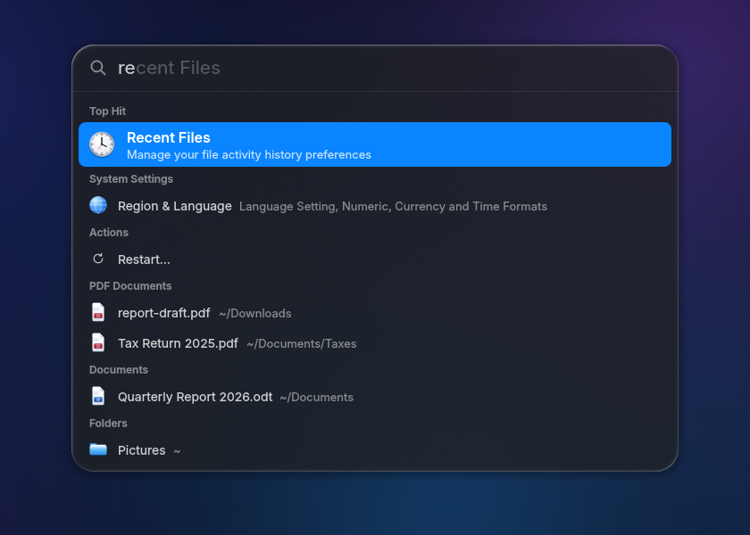
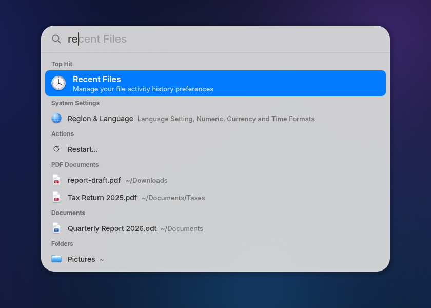

# The KwickOS desktop

`apt install kwick-desktop` turns any KwickOS system into a desktop: KDE Plasma 6 with three layouts, [Kwick Effects](EFFECTS.md),
a settings app, an icon theme per layout, per-layout fonts, native Steam and automatic GPU driver setup. The desktop live ISO boots
straight into it. Installation is covered in [INSTALL.md](INSTALL.md), and all screenshots are in [SCREENSHOTS.md](SCREENSHOTS.md).

## Layouts

`kwick-layout macos|windows|linux` switches the whole look at once: window buttons, panel or dock position, fonts, icons, wallpaper
and Files sidebar. It applies to **KDE Plasma** (default), **GNOME** and **Hyprland** (the `kwick-hyprland` package). Every layout
is dark by default; `kwick-layout appearance light|dark` (or Settings, Appearance) switches all of them, the desktop, Qt and GTK
apps and the KwickOS apps between light and dark. The choice is kept in `~/.config/kwick/appearance`. In light mode the macOS
layout on Plasma also switches to the light KwickGlassLight wallpaper so the transparent menu bar keeps dark text readable.

* **macOS** (default): a full-width menu bar flush to the screen edges with a white KwickOS mark and a one-line clock
  ("Sun Nov 15  9:41 AM", the `org.kwickos.clock` applet with a calendar popup), a floating dock with 48 px icons, and
  traffic-light buttons at the top left of windows with 10 px corners, a hairline edge and a large soft shadow, and
  macOS menus from the `KwickMac` widget style. The KwickOS mark opens the KwickOS menu (`org.kwickos.applemenu`: About This
  Computer, System Settings, App Store, Force Quit, Sleep, Restart, Shut Down, Lock Screen, Log Out). Next to the clock sits
  Control Center (`org.kwickos.controlcenter`): Wi-Fi, Bluetooth with a device list, network, Focus (Do Not Disturb), Night
  Light, display brightness, sound and now playing; volume and brightness leave the menu bar for it. Every Qt menu (app menus
  in the menu bar, context menus, dock and tray menus) is drawn like macOS 27: 12 px rounded translucent panels with a soft
  shadow, 24 px rows with an inset accent highlight, glyph shortcuts (⌃⌥⇧⌘) and icons only in menus where every item has
  one. Menu bar titles and open menu bar items get the same inset rounded highlight. GTK 3 menus and GTK 4 popover menus
  follow the same metrics. Firefox ESR ships with `browser.tabs.inTitlebar` off
  (`/usr/lib/firefox-esr/defaults/pref/kwick.js`), so it gets the same title bar, corners and shadow as every other window
  instead of drawing its own tab strip in the title bar. The dock is the `org.kwickos.dock`
  applet: pinned and running apps with a white dot under running ones, no hover or active boxes, a name label in a glass capsule
  above the hovered icon, a gentle magnification (`kwick-dock magnify on|off`, also in Settings), a bounce while an app launches or
  asks for attention, a darker icon while pressed, a thin separator and the Trash (drop files on it, right-click to empty).
* **Windows 11**: a 48 px centered taskbar (24 px icons in 44 px buttons, accent pill under the focused app, grey pill under
  running ones) with Start, Search and Task View. Start (`org.kwickos.start`) has the search box, Pinned (8 columns, Show all),
  Recommended, All apps as Category, Grid or List, and the account and power menus; Meta opens it. Quick Settings
  (`org.kwickos.quicksettings`) groups the network, volume and battery icons and opens Wi-Fi, Bluetooth, VPN, Airplane mode,
  Energy saver and Night light tiles, brightness and volume sliders, media controls and sound output, Wi-Fi, Bluetooth and VPN
  pages. The clock (`org.kwickos.notificationcenter`) opens the notification center with the calendar and a Focus session, and
  its right edge peeks at the desktop. Alt+Tab uses a Windows 11 style card switcher (`kwick_fluent`), flyouts have 8 px corners
  and a soft shadow, and windows have 32 px title bars with 46x32 caption buttons and a red close hover. The shared Fluent QML
  controls live in `/usr/share/kwick/qml/fluent`. Light and dark follow `kwick-layout appearance` (KwickFluent / KwickFluentLight).
* **Linux**: a thin top bar (launcher, centered clock, tray) with a floating dock on the left.

GNOME and Hyprland follow the Plasma layouts. In macOS the 28 px menu bar shows the focused app's name in bold (GNOME adds App,
Window and Help menus; Hyprland has no global menu), and the dock has the same pinned apps in the same order (Files, Firefox,
Terminal, Text Editor, Software, Settings), running dots, a separator and Trash. In Windows the 48 px taskbar has Start, Search,
the same pinned apps plus Steam, an underline under running apps and a two-line clock. The macOS launcher on Hyprland (fuzzel) opens
near the top like Spotlight and the Windows one opens above the taskbar like Start. Running GTK 4 apps pick up the window buttons of
a new layout when they are restarted.

On Hyprland the macOS menu bar is a fully transparent 32 px waybar: the KwickOS logo, the focused app in bold, the workspaces, then
the status icons drawn with the same 22 px white KwickOS tray glyphs as Plasma (network, volume, Bluetooth, VPN, battery levels with
charging), spaced evenly, and the date and time as "Wed Nov 18  1:37 AM". The dock floats centred at the bottom and is always shown.
hyprbars draws a 28 px #323232 title bar with the traffic lights on the left, vertically centred; windows have a 10 px radius, a
1 px light rim and a soft shadow, and stay opaque unless the transparency effect is on. swaylock uses the KwickOS dark palette with
a blue ring (swaylock shows no user picture; SDDM shows the KwickOS avatar).

On GNOME the macOS layout is applied at the first GNOME login (`/usr/lib/kwick/gnome-session-init`), so the session never starts in
the overview. The `kwick-menubar` extension makes the top bar a fully transparent 32 px bar: the KwickOS logo, the focused app in
bold with App, Window and Help menus, then white 22 px KwickOS tray glyphs (GNOME's own battery-level, power-profile, VPN and
power names included), evenly spaced, and "Wed Nov 18  1:37 AM". Dash to Dock sits centred at the bottom, always shown, with
Blur my Shell glass (`pipeline_kwick_dock`, 18 px corners matching the dock). GTK windows get traffic lights on the left, vertically
centred, a #323232 title bar, #1e1e1e content and 10 px corners. GTK 3 windows keep square bottom corners. The live user and new
users get the KwickOS avatar through AccountsService, and `/usr/share/gdm/dconf/90-kwickos-settings` removes the Debian logo if
GDM is installed.

The dock is configured with `kwick-dock` (position, icon size, autohide, floating, magnification, pinned apps). The same options are in the Settings
app. Window decorations (KwickGlass, KwickFluent), three color schemes, the Plasma panel themes (kwick-glass, kwick-fluent),
wallpapers and the Terminal profiles are generated by `desktop/gen-theme.py`. The macOS layout uses Apple's dark-mode colours and
Terminal.app's Basic palette, the Windows layout uses the WinUI dark theme resources and Windows Terminal's Campbell palette; every
value and its source is in [PALETTE.md](PALETTE.md).

Other desktops install with `kwick-desktop install xfce|cinnamon|mate|lxqt` and are chosen with `kwick-desktop switch`.

## KwickOS Settings

`kwick-settings` is a QML app with pages for Appearance (layout and accent color), Dock, Effects, Fonts, Desktop Session, GPU,
Gaming, VPN, Storage and About (name, processor, graphics, memory, startup disk, display, kernel; `kwick-settings about`) and Software Update (updates, automatic updates and kernels; `kwick-settings software-update`, see [UPDATES](UPDATES.md)). The window sets its Wayland app id to `org.kwickos.settings.qml` (`Qt.application.domain` before it maps), which `kwick-settings.desktop` names in `StartupWMClass`, so the dock and taskbar show the Settings icon and other `qml6` apps do not pick it up. It tells you when no GPU compositor is running and offers to install `kwick-gpu`. KDE System Settings uses
the same KwickOS object icons.

## Spotlight Search

 

On Plasma, Cmd+Space (Meta+Space) opens Spotlight Search in every layout, and Win+S does too in the Windows layout (it takes
Win+S from "Stop Current Activity"). Meta on its own keeps its layout's meaning (nothing on macOS, Start on Windows, the launcher
on Linux), and Alt+Space stays KRunner. The Search button on the Windows taskbar and `kwick-search` open it as well; on GNOME
`kwick-search` and Super+Space open the overview search, and on Hyprland Super+Space opens fuzzel.

It is a centered 680 px Liquid Glass bar at a fifth of the screen height that grows into one panel with the results: a Top Hit,
then groups (Applications, System Settings, Actions, Documents, PDF Documents, Images, Folders, Calculator, Windows and more), up
to five per group, with the top hit's name completed in grey as you type. It searches:

* apps, System Settings pages and the KwickOS Settings pages (read from the Settings app, so new pages show up by themselves),
* files and folders in your home folder,
* actions: Lock Screen, Sleep, Restart, Shut Down, Log Out, Light or Dark Mode (`kwick-layout appearance`), Wi-Fi on or off,
  connect or disconnect each VPN profile (`kwick-vpn`) and switching the layout,
* calculations and unit conversions, open windows, paths and shell commands.

There are no web results or suggestions. The four buttons at the right of the bar (Cmd+1 to Cmd+4) browse Applications, Recent
Files, Actions and the clipboard history (when the clipboard applet runs). Up and Down move, Cmd+Up and Cmd+Down jump between
groups, Return opens, Cmd+Return shows a file in Files, Tab or Right takes the completion, Esc clears the text and closes on the
second press, and a click outside closes it. It follows the color scheme (dark or light), the accent color and the window corner
radius, and keeps the last search for the next time.

`kwick-spotlight` is a small Qt Quick program (`src/kwick-spotlight`) that runs from login and uses KRunner's runner plugins as its
backend, so it needs no extra service. Its own runner, `krunner_kwick` (also used by KRunner), adds the KwickOS Settings pages,
the actions and the files. The file index is the names and dates of everything in your home folder except hidden folders,
`node_modules` and `__pycache__`, kept in memory (a few MB for 100,000 files), built in the background the first time you search
and refreshed when it is older than 90 seconds as Spotlight opens; there is no indexing daemon and nothing is written to disk.
Baloo and plocate are not used. The window stays mapped as a 1x1 transparent surface below the desktop while closed, so opening
it is one configure round trip. The runners can be changed with `Runners=` in the `[General]` group of `~/.config/kwickspotlightrc`
(the default is `krunner_kwick, krunner_services, krunner_systemsettings, calculator, windows, locations, krunner_shell`);
`kwick-spotlight --list-runners` lists the installed ones, `--query TEXT` and `--mode apps|files|actions|clipboard` open it with
text or a browse mode, and `KWICK_SPOTLIGHT_TRACE=1` logs open and keystroke timings.

## Icons

Each layout has its own icon theme. All of them are generated as SVG by `tools/icons/gen-icons.py` and set by `kwick-layout` for
Plasma, GNOME and Hyprland:

| layout | theme | style |
|---|---|---|
| macOS | `KwickOS` | squircle apps with layered gradients, light-blue folders with embossed glyphs, accent-blue sidebar glyphs |
| Windows | `KwickOS-Fluent` | white line icons for places, folders, actions, status and file types, flat Fluent app tiles |
| Linux | `KwickOS-Linux` | Tokyo Night squircles |

Menubar status glyphs (volume, network, VPN, battery, brightness, devices, notifications, bluetooth, updates) come from
`tools/icons/gen-tray.py <icon-theme-dir>`, run by `gen-icons.py macos` on `desktop/rootfs/usr/share/icons/KwickOS`. They
are white 22x22 glyphs in one 14 px optical box (battery, hard disk and the expander arrow are optical exceptions). Plasma 6
no longer reads `icons/*.svg` from a Plasma style, so these live in the icon theme.


## Fonts

Each layout has its own UI and monospace fonts, applied by `kwick-layout`:

| layout | UI | monospace |
|---|---|---|
| macOS | Inter / Inter Display | JetBrains Mono |
| Windows | Selawik | Cascadia Code |
| Linux | Ubuntu Sans | Ubuntu Sans Mono |

Fontconfig aliases map the familiar names (Segoe UI, Calibri, Consolas, SF Pro, Helvetica Neue, Ubuntu) to these.
`kwick-fonts msfonts` fetches the real Microsoft core fonts after you accept the EULA.

## Files and Terminal

Apps show neutral names: **Files** (Dolphin), **Terminal** (Konsole), **Text Editor** and **Software** (Discover). This is done with
a private `en_KW` message catalog generated by `desktop/gen-files-l10n.py`. The Files sidebar is titled per layout ("Favorites" on
macOS, "Quick access" on Windows).

## Gaming

`steam` enables the i386 architecture through kpkg multiarch, installs Debian's `steam-installer`, downloads the client and runs it
(the kernel has IA32 emulation). If the native install fails, `steam` falls back to the Flathub build.

`kwick-gaming` is a modular, Bazzite-style setup, also in Settings, Gaming (status plus Install and Remove per module):

```sh
kwick-gaming list | status | install <module...> | remove <module...> | all
```

Modules: `steam`, `gamescope-session` (Gaming Mode: Steam in Gamescope like SteamOS, on the login screen, as a boot target and with
passwordless Switch to Desktop and Return to Gaming Mode; see [GAMING.md](GAMING.md#gaming-mode)),
`proton` (ProtonUp-Qt and pinned GE-Proton), `launchers` (Lutris, Heroic, Bottles), `overlay` (MangoHud, GameMode, vkBasalt),
`controllers`, `handheld` (HHD), `waydroid`, `decky`, `streaming` (Sunshine and Moonlight), `rgb` (OpenRGB) and `tweaks` (zram,
sysctl, ntsync, I/O schedulers). x86-only modules say so on arm64 and riscv64. Details and the comparison with Bazzite:
[GAMING.md](GAMING.md).

## VPN

WireGuard is built into every kernel flavor. The desktop ships NetworkManager plugins for OpenVPN, OpenConnect (AnyConnect,
GlobalProtect, Fortinet, Pulse), vpnc, L2TP/IPsec, strongSwan and SSTP, so VPNs show up in the Plasma network applet, the GNOME
quick settings and the Hyprland bar. Plasma gets its own VPN menu bar item (`org.kwickos.vpn`): a VPN badge in the macOS menu
bar next to the network icon, and a tray icon on Windows and Linux, shown while at least one VPN profile exists, with a switch per
profile, connect time and tunnel address. `kwick-vpn` works on both editions; see [VPN.md](VPN.md).

## Bluetooth

`kwick-bluetooth` is the shared Bluetooth backend on top of `bluetoothctl`, independent of the layout and the desktop:
`status`, `list` (address, name, connected, battery, icon), `json`, `power on|off|toggle`, `connect|disconnect|toggle
<address>`, `menu` (a fuzzel menu with the paired devices) and `settings` (the Bluetooth settings of the running desktop).
Plasma gets the Bluetooth agent, pairing and settings from `bluedevil` and the device list in Control Center; the Hyprland and
sway bars open `kwick-bluetooth menu` on click and the settings on right-click; GNOME uses its own Quick Settings.

## GPUs

`apt install kwick-gpu` (or `kwick-gpu install`) detects the GPUs and installs the matching drivers and firmware. It also runs after
`apt install kwick-desktop`. `kwick-gpu` alone shows the plan.

| hardware | driver path |
|---|---|
| AMD, Intel | in-kernel amdgpu / i915 / xe with Mesa (RADV, radeonsi, iris, ANV) and firmware |
| NVIDIA Turing and newer | NVIDIA open kernel modules (pinned release) plus userspace from NVIDIA's Debian 13 repository |
| NVIDIA older | nouveau with Mesa NVK |
| Apple Silicon | Asahi kernel variant (`kwick-kernel-asahi`), Mesa asahi and honeykrisp |
| NVIDIA DGX Spark (GB10) | `gb10` kernel flavor with NVIDIA open modules for arm64 |
| virtio, QXL, Bochs, VMware, Hyper-V | in-tree DRM drivers with Mesa virgl or llvmpipe |

What was run on real or virtual hardware and what was only built is listed per entry in [HARDWARE.md](HARDWARE.md). Every kernel
flavor ships a matching headers package for DKMS.

## Darling: macOS command-line binaries

`apt install kwick-darling` adds [Darling](https://github.com/darlinghq/darling), which runs macOS command-line programs on Linux.
It is optional, amd64 only, aimed at CLI tools (GUI support is limited), and does not run arm64 Mach-O binaries. Usage, limits and
what was verified: [DARLING.md](DARLING.md).
