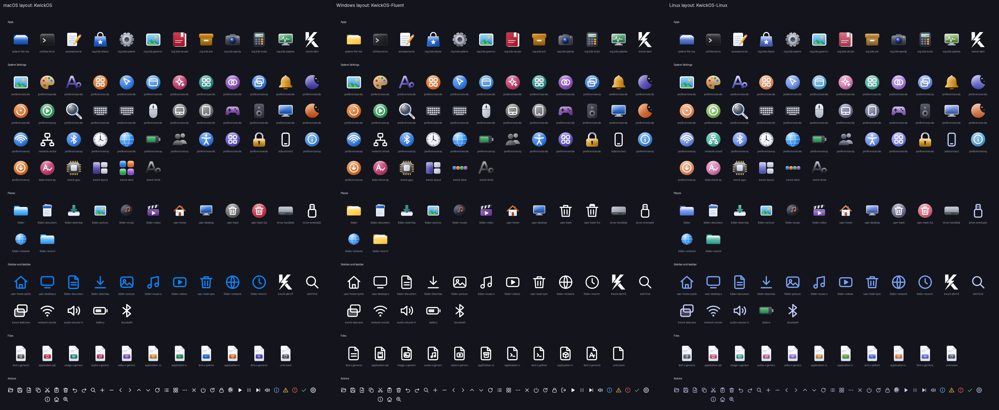

# The KwickOS desktop

`apt install kwick-desktop` turns any KwickOS system into a desktop: KDE Plasma 6 with three layouts, [Kwick Effects](EFFECTS.md),
a settings app, an icon theme per layout, per-layout fonts, native Steam and automatic GPU driver setup. The desktop live ISO boots
straight into it. Installation is covered in [INSTALL.md](INSTALL.md), and all screenshots are in [SCREENSHOTS.md](SCREENSHOTS.md).

## Layouts

`kwick-layout macos|windows|linux` switches the whole look at once: window buttons, panel or dock position, fonts, icons, wallpaper
and Files sidebar. It applies to **KDE Plasma** (default), **GNOME** and **Hyprland** (the `kwick-hyprland` package). Every layout
is dark.

* **macOS** (default): a full-width menu bar flush to the screen edges with a white KwickOS mark and a one-line clock
  ("Sun Nov 15  9:41 AM", the `org.kwickos.clock` applet with a calendar popup), a floating dock with 48 px icons, and
  traffic-light buttons at the top left of windows with 10 px corners, a hairline edge and a large soft shadow, and
  macOS menus from the `KwickMac` widget style. Firefox ESR ships with `browser.tabs.inTitlebar` off
  (`/usr/lib/firefox-esr/defaults/pref/kwick.js`), so it gets the same title bar, corners and shadow as every other window
  instead of drawing its own tab strip in the title bar. The dock is the `org.kwickos.dock`
  applet: pinned and running apps with a white dot under running ones, no hover or active boxes, a name label in a glass capsule
  above the hovered icon, a gentle magnification (`kwick-dock magnify on|off`, also in Settings), a bounce while an app launches or
  asks for attention, a darker icon while pressed, a thin separator and the Trash (drop files on it, right-click to empty).
* **Windows 11**: a 48 px centered taskbar with the KwickOS start icon, a small padded clock and Fluent caption buttons on the right.
* **Linux**: a thin top bar (launcher, centered clock, tray) with a floating dock on the left.

GNOME and Hyprland follow the Plasma layouts. In macOS the 28 px menu bar shows the focused app's name in bold (GNOME adds App,
Window and Help menus; Hyprland has no global menu), and the dock has the same pinned apps in the same order (Files, Firefox,
Terminal, Text Editor, Software, Settings), running dots, a separator and Trash. In Windows the 48 px taskbar has Start, Search,
the same pinned apps plus Steam, an underline under running apps and a two-line clock. The macOS launcher on Hyprland (fuzzel) opens
near the top like Spotlight and the Windows one opens above the taskbar like Start. Running GTK 4 apps pick up the window buttons of
a new layout when they are restarted.

On Hyprland the macOS menu bar is a fully transparent 32 px waybar: the KwickOS logo, the focused app in bold, the workspaces, then
the status icons drawn with the same 22 px white KwickOS tray glyphs as Plasma (network, volume, Bluetooth, VPN, battery levels with
charging), spaced evenly, and the date and time as "Wed Nov 18  1:37 AM". The dock floats centred at the bottom and is always shown.
hyprbars draws a 28 px #323232 title bar with the traffic lights on the left, vertically centred; windows have a 10 px radius, a
1 px light rim and a soft shadow, and stay opaque unless the transparency effect is on. swaylock uses the KwickOS dark palette with
a blue ring (swaylock shows no user picture; SDDM shows the KwickOS avatar).

On GNOME the macOS layout is applied at the first GNOME login (`/usr/lib/kwick/gnome-session-init`), so the session never starts in
the overview. The `kwick-menubar` extension makes the top bar a fully transparent 32 px bar: the KwickOS logo, the focused app in
bold with App, Window and Help menus, then white 22 px KwickOS tray glyphs (GNOME's own battery-level, power-profile, VPN and
power names included), evenly spaced, and "Wed Nov 18  1:37 AM". Dash to Dock sits centred at the bottom, always shown, with
Blur my Shell glass (`pipeline_kwick_dock`, 18 px corners matching the dock). GTK windows get traffic lights on the left, vertically
centred, a #323232 title bar, #1e1e1e content and 10 px corners. GTK 3 windows keep square bottom corners. The live user and new
users get the KwickOS avatar through AccountsService, and `/usr/share/gdm/dconf/90-kwickos-settings` removes the Debian logo if
GDM is installed.

The dock is configured with `kwick-dock` (position, icon size, autohide, floating, magnification, pinned apps). The same options are in the Settings
app. Window decorations (KwickGlass, KwickFluent), three color schemes, the Plasma panel themes (kwick-glass, kwick-fluent),
wallpapers and the Terminal profiles are generated by `desktop/gen-theme.py`. The macOS layout uses Apple's dark-mode colours and
Terminal.app's Basic palette, the Windows layout uses the WinUI dark theme resources and Windows Terminal's Campbell palette; every
value and its source is in [PALETTE.md](PALETTE.md).

Other desktops install with `kwick-desktop install xfce|cinnamon|mate|lxqt` and are chosen with `kwick-desktop switch`.

## KwickOS Settings

`kwick-settings` is a QML app with pages for Appearance (layout and accent color), Dock, Effects, Fonts, Desktop Session, GPU,
Gaming, VPN and Storage. It tells you when no GPU compositor is running and offers to install `kwick-gpu`. KDE System Settings uses
the same KwickOS object icons.

## Icons

Each layout has its own icon theme. All of them are generated as SVG by `tools/icons/gen-icons.py` and set by `kwick-layout` for
Plasma, GNOME and Hyprland:

| layout | theme | style |
|---|---|---|
| macOS | `KwickOS` | squircle apps with layered gradients, light-blue folders with embossed glyphs, accent-blue sidebar glyphs |
| Windows | `KwickOS-Fluent` | white line icons for places, folders, actions, status and file types, flat Fluent app tiles |
| Linux | `KwickOS-Linux` | Tokyo Night squircles |

Menubar status glyphs (volume, network, battery, brightness, devices, notifications, bluetooth, updates) come from
`tools/icons/gen-tray.py <icon-theme-dir>`, run after `gen-icons.py macos` on `desktop/rootfs/usr/share/icons/KwickOS`. They
are white 22x22 glyphs in one 14 px optical box (battery, hard disk and the expander arrow are optical exceptions). Plasma 6
no longer reads `icons/*.svg` from a Plasma style, so these live in the icon theme.



## Fonts

Each layout has its own UI and monospace fonts, applied by `kwick-layout`:

| layout | UI | monospace |
|---|---|---|
| macOS | Inter / Inter Display | JetBrains Mono |
| Windows | Selawik | Cascadia Code |
| Linux | Ubuntu Sans | Ubuntu Sans Mono |

Fontconfig aliases map the familiar names (Segoe UI, Calibri, Consolas, SF Pro, Helvetica Neue, Ubuntu) to these.
`kwick-fonts msfonts` fetches the real Microsoft core fonts after you accept the EULA.

## Files and Terminal

Apps show neutral names: **Files** (Dolphin), **Terminal** (Konsole), **Text Editor** and **Software** (Discover). This is done with
a private `en_KW` message catalog generated by `desktop/gen-files-l10n.py`. The Files sidebar is titled per layout ("Favorites" on
macOS, "Quick access" on Windows).

## Gaming

`steam` enables the i386 architecture through kpkg multiarch, installs Debian's `steam-installer`, downloads the client and runs it
(the kernel has IA32 emulation). If the native install fails, `steam` falls back to the Flathub build.

`kwick-gaming` is a modular, Bazzite-style setup, also in Settings, Gaming (status plus Install and Remove per module):

```sh
kwick-gaming list | status | install <module...> | remove <module...> | all
```

Modules: `steam`, `gamescope-session` (Steam Game Mode on the login screen; `kwick-gaming session boot-on` boots straight into it),
`proton` (ProtonUp-Qt and pinned GE-Proton), `launchers` (Lutris, Heroic, Bottles), `overlay` (MangoHud, GameMode, vkBasalt),
`controllers`, `handheld` (HHD), `waydroid`, `decky`, `streaming` (Sunshine and Moonlight), `rgb` (OpenRGB) and `tweaks` (zram,
sysctl, ntsync, I/O schedulers). x86-only modules say so on arm64 and riscv64. Details and the comparison with Bazzite:
[GAMING.md](GAMING.md).

## VPN

WireGuard is built into every kernel flavor. The desktop ships NetworkManager plugins for OpenVPN, OpenConnect (AnyConnect,
GlobalProtect, Fortinet, Pulse), vpnc, L2TP/IPsec, strongSwan and SSTP, so VPNs show up in the Plasma network applet, the GNOME
quick settings and the Hyprland bar (a lock appears while a tunnel is up). `kwick-vpn` works on both editions; see [VPN.md](VPN.md).

## GPUs

`apt install kwick-gpu` (or `kwick-gpu install`) detects the GPUs and installs the matching drivers and firmware. It also runs after
`apt install kwick-desktop`. `kwick-gpu` alone shows the plan.

| hardware | driver path |
|---|---|
| AMD, Intel | in-kernel amdgpu / i915 / xe with Mesa (RADV, radeonsi, iris, ANV) and firmware |
| NVIDIA Turing and newer | NVIDIA open kernel modules (pinned release) plus userspace from NVIDIA's Debian 13 repository |
| NVIDIA older | nouveau with Mesa NVK |
| Apple Silicon | Asahi kernel variant (`kwick-kernel-asahi`), Mesa asahi and honeykrisp |
| NVIDIA DGX Spark (GB10) | `gb10` kernel flavor with NVIDIA open modules for arm64 |
| virtio, QXL, Bochs, VMware, Hyper-V | in-tree DRM drivers with Mesa virgl or llvmpipe |

What was run on real or virtual hardware and what was only built is listed per entry in [HARDWARE.md](HARDWARE.md). Every kernel
flavor ships a matching headers package for DKMS.

## Darling: macOS command-line binaries

`apt install kwick-darling` adds [Darling](https://github.com/darlinghq/darling), which runs macOS command-line programs on Linux.
It is optional, amd64 only, aimed at CLI tools (GUI support is limited), and does not run arm64 Mach-O binaries. Usage, limits and
what was verified: [DARLING.md](DARLING.md).
