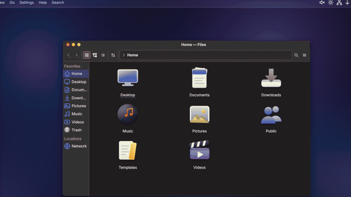
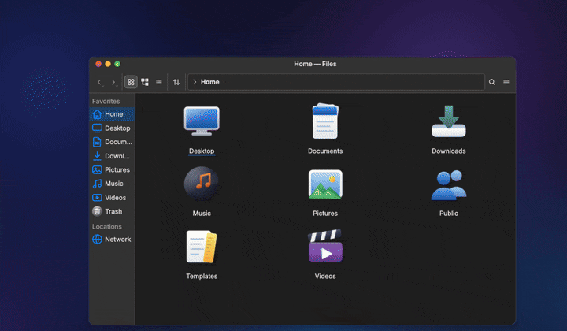

# Kwick Effects

Kwick Effects are native desktop effects. They run as KWin effects on KDE Plasma, GNOME Shell extensions on GNOME and
Hyprland animations on Hyprland. They need a GPU compositor. On a software compositor `kwick-effects` writes the config and
tells you so.

## Presets

```sh
kwick-effects off|subtle|fluid|full
```

| preset | what you get |
|---|---|
| off | no animations |
| subtle | fades, blur, sliding popups, magic lamp |
| fluid | plus curvy wobbly windows, sheets and the 3D flip open/close |
| full | plus flame open/close, translucency, dimmed inactive windows, the lit 3D desktop cube and Cover Flow Alt+Tab |

## Single effects

Switch effects one at a time with `kwick-effects set NAME on|off` (for example `kwick-effects set wobbly on`), or with the toggles
on the Effects page of KwickOS Settings.

| name | what it does |
|---|---|
| `wobbly` | windows stretch like jelly while you drag them |
| `lamp` | magic lamp minimize into the dock |
| `flame` | windows ignite and burn away, with tongues of fire licking just above the title bar |
| `flip` | windows swing in and out in 3D perspective with lighting (styles flip, door, tilt) |
| `dissolve` | closing windows crumble into glowing dust |
| `glide`, `fallapart` | the stock Glide and Fall Apart open/close effects |
| `cube` | Meta+C shows the desktops as a cube; the desktop switch animation can be a cube too (`kwick-effects switch cube`, Meta+Ctrl+Left/Right) |
| `blur`, `transparency`, `sheet`, `dim`, `overview` | frosted glass, translucency, dropping dialogs, dimmed inactive windows, overview |
| `liquidglass` | Liquid Glass: the dock, menu bar, menus, popups, notifications and OSDs refract and frost what is behind them (see below) |

Only one open/close effect is active at a time. `flame`, `flip`, `dissolve`, `glide` and `fallapart` replace each other.

## Options

* `kwick-effects wobbly AMOUNT SWAY` takes two numbers from 1 to 10 (`kwick-effects param wobbly` prints them). Amount is how far
  the window stretches. Sway is how curvy and fluid it is (softer springs and a finer mesh). The defaults are 6 and 7. In Settings
  they are the "Wobble" and "Sway" sliders.
* `kwick-effects flame-style classic|inferno|ember|blue|legacy` and `kwick-effects flame-height 50-200`:
  * Classic: orange fire along the burn line, with tongues rising about a fifth of the window height above the title bar.
  * Inferno: denser and a little wider, flares out slightly at the sides.
  * Ember: a subtle burn edge with drifting sparks.
  * Blue: a hot gas flame.
  * Legacy: a particle-system burn. Many additive flame particles along a line sweep up the window, yellow-white to orange to
    deep red, in about one second.

  Every style keeps the fire mostly inside the window footprint: at the default height of 100 the flames reach 15 to 25 percent of
  the window height above the top edge and flare only a little at the sides. `flame-height` scales that overflow (and the height of
  the flames inside the window), so 200 gives taller flames.
* `kwick-effects param flip flip|door|tilt` picks the 3D open/close style.
* `kwick-effects param depth 0-10` sets how far windows float off the cube faces while it turns (the "Window depth" slider; default 5).
* `kwick-effects switch slide|fade|cube|none` sets the desktop switch animation.
* `kwick-effects tabbox windows|cover|flip|grid` sets the Alt+Tab style.

## Liquid Glass

Liquid Glass is a native KWin effect (`kwick_liquidglass`, source in `src/kwin-liquidglass`) modelled on the material Apple
introduced with macOS 26 and iOS 26. It is drawn under the dock, the menu bar, menus and popups, applet popups, notifications,
tooltips and OSDs, and optionally under window title bars.


How it is drawn, per glass surface:

* The shape is the surface's blur region (the mask Plasma and Breeze already send to KWin), turned into a rounded rectangle with
  a signed distance field. The corner radius follows the rounded-corners setting: the dock uses 1.5x the window radius, menus
  and popups the window radius, tooltips two thirds of it.
* The screen behind the surface is copied once and blurred with a dual-Kawase pyramid (3 or 4 levels at half resolution and below).
* A fragment shader treats the rim as a convex glass bevel: the SDF gives the edge normal, a quarter-circle height profile gives the
  surface slope, and `refract()` with an index of 1.5 bends the view inward, so the content behind is pulled and magnified along the
  edges. Red and blue are refracted a little less and a little more than green for a slight chromatic fringe at the rim.
* The frosted (blurred) and sharp images are mixed: the rim stays sharper, the middle frostier. Saturation is boosted by about a
  third.
* Adaptive tint: the average brightness behind the glass sets how dark it gets. Over bright content the glass darkens so white
  text stays readable, over dark content it lifts a little and reads as lighter glass.
* A thin luminous stroke runs round the edge, with a specular rim from a light at the top left, a softer reflection on the opposite
  edge, a Fresnel brightening on the bevel and a faint inner glow.
* Moving the pointer over the glass swings the light toward it and adds a soft glow under the pointer.

Performance: the blurred backdrop is cached per surface and output and is only recomputed when something under the glass changes;
a repaint of the panel itself (a clock tick, hovering an icon) only re-runs the final pass inside the damaged region.

It needs GPU rendering. `kwick-effects auto` runs at login: it turns Liquid Glass on when KWin renders on a GPU (unless you
switched it off), and always off on llvmpipe or other software OpenGL. The plugin also refuses to load on a software renderer. The
fluid and full presets switch it on, off and subtle switch it off, and `kwick-effects set liquidglass on|off` or the Settings
toggle switch it by hand.

While it is on, `kwick-effects` switches Plasma to a small generated desktop theme, `kwick-liquidglass` in
`~/.local/share/plasma/desktoptheme`, that makes the panel, dialog and tooltip backgrounds nearly clear, falls back to your
previous Plasma theme for everything else and turns the background contrast filter off. Breeze menus get `MenuOpacity=45` so the
glass shows through them. Switching Liquid Glass off restores the previous theme and menu opacity.

Tuning lives in `kwinrc`, group `[Effect-kwick_liquidglass]`, values in percent: `Refraction` (60), `Blur` (50), `Dispersion` (35),
`Specular` (70), `Tint` (100), `Style` (0 adaptive dark, 1 light, 2 clear), `TitleBars` (false, glass under translucent title
bars), `Interactive` (true) and `Profile` (false; logs frame interval and glass GPU time every 600 frames to the KWin log). Apply
changes with `qdbus6 org.kde.KWin /Effects org.kde.kwin.Effects.reconfigureEffect kwick_liquidglass`.

## GNOME and Hyprland

On GNOME the presets drive the extensions that are installed (wobbly, lamp, burn, cube, blur), and the wobble sliders map to the
wobbly extension. On Hyprland they write bezier-curve animations (an overshoot curve for wobbly, a 3D-ish pop-in and fading slide for
flip and the cube setting), blur and dimming.

## Gallery

All GIFs were captured in a KVM guest with a virgl GPU (KWin on OpenGL) on the macOS layout, see [VERIFICATION.md](VERIFICATION.md).
The window effects were slowed down so every frame is a real render, the cube is sampled at fixed points of its animation
(`Scrub`, `ScrubFrom` and `ScrubTo` in `[Effect-kwick_cubeslide]` hold it at one point, for capture only), and the frames are
played back at a steady rate, so the real effects run faster and smoother. Frame sheets are next to them in `docs/img`
(`effects-*-frames.png`, and `effects-cube-before-frames.png` and `effects-3dopen*-before-frames.png` for the previous look).

| Wobbly windows (6/7) | Dissolve close | 3D desktop cube |
|---|---|---|
|  |  |  |

| 3D open/close: flip | door | tilt |
|---|---|---|
|  |  |  |

| Flame: classic | Flame: inferno | Flame: ember |
|---|---|---|
|  |  |  |

| Flame: blue | Flame: legacy | Magic lamp |
|---|---|---|
|  |  |  |

The Terminal glass profile, with blur and translucency:


