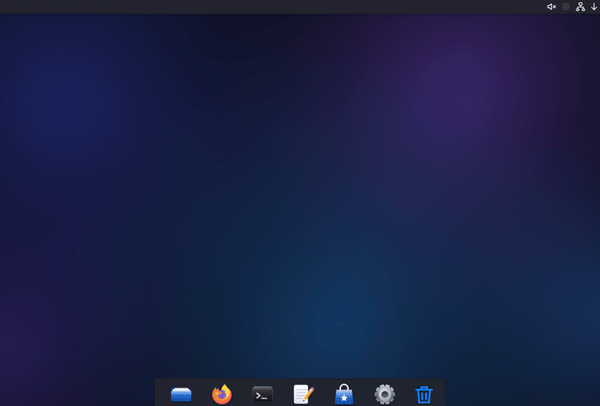
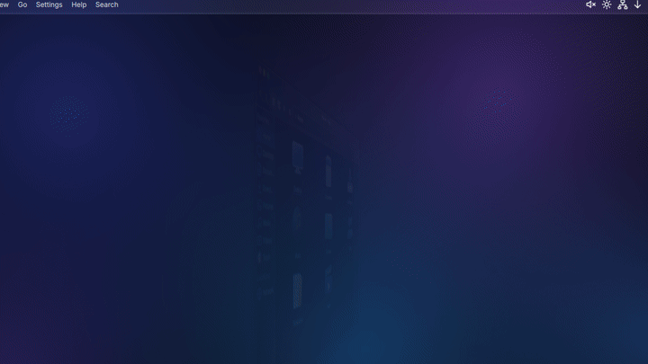
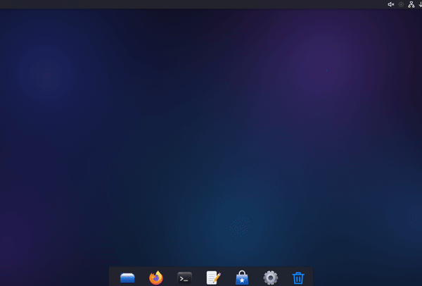
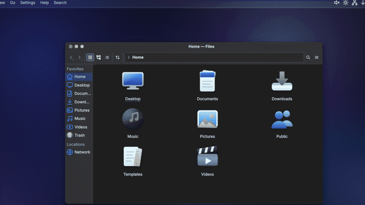
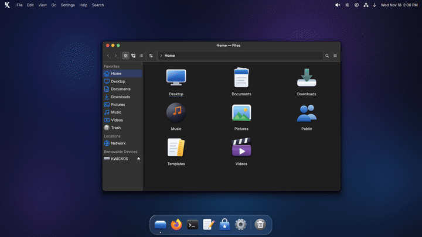
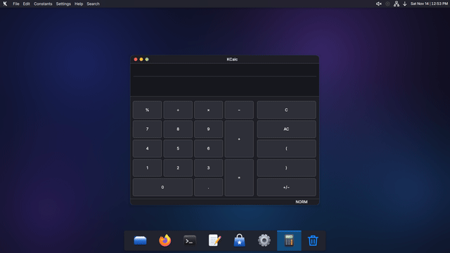
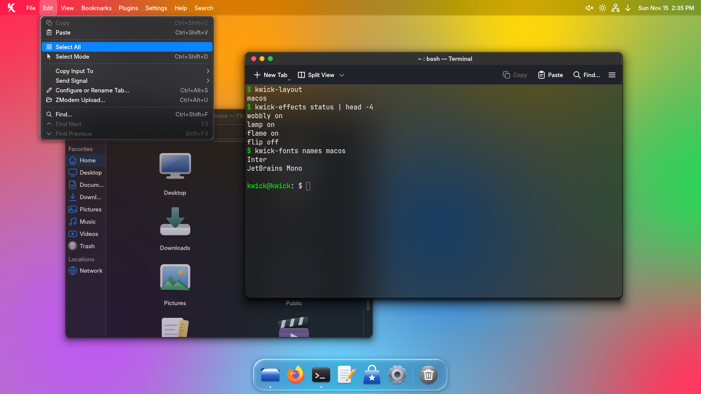

# Kwick Effects

Kwick Effects are native desktop effects. They run as KWin effects on KDE Plasma, GNOME Shell extensions on GNOME and
Hyprland animations on Hyprland. They need a GPU compositor. On a software compositor `kwick-effects` writes the config and
tells you so.

## Presets

```sh
kwick-effects off|subtle|fluid|full
```

| preset | what you get |
|---|---|
| off | no animations |
| subtle | fades, blur, sliding popups, magic lamp |
| fluid | plus curvy wobbly windows, sheets and the 3D flip open/close |
| full | plus flame open/close, translucency, dimmed inactive windows, the lit 3D desktop cube and Cover Flow Alt+Tab |

## Single effects

Switch effects one at a time with `kwick-effects set NAME on|off` (for example `kwick-effects set wobbly on`), or with the toggles
on the Effects page of KwickOS Settings.

| name | what it does |
|---|---|
| `wobbly` | windows stretch like jelly while you drag them |
| `lamp` | magic lamp minimize into the dock |
| `flame` | windows ignite and burn away, with flames that rise past the window edges |
| `flip` | windows swing in and out in 3D perspective with lighting (styles flip, door, tilt) |
| `dissolve` | closing windows crumble into glowing dust |
| `glide`, `fallapart` | the stock Glide and Fall Apart open/close effects |
| `cube` | Meta+C shows the desktops as a cube; the desktop switch animation can be a cube too (`kwick-effects switch cube`, Meta+Ctrl+Left/Right) |
| `blur`, `transparency`, `sheet`, `dim`, `overview` | frosted glass, translucency, dropping dialogs, dimmed inactive windows, overview |

Only one open/close effect is active at a time. `flame`, `flip`, `dissolve`, `glide` and `fallapart` replace each other.

## Options

* `kwick-effects wobbly AMOUNT SWAY` takes two numbers from 1 to 10 (`kwick-effects param wobbly` prints them). Amount is how far
  the window stretches. Sway is how curvy and fluid it is (softer springs and a finer mesh). The defaults are 6 and 7. In Settings
  they are the "Wobble" and "Sway" sliders.
* `kwick-effects flame-style classic|inferno|ember|blue|legacy` and `kwick-effects flame-height 50-200`:
  * Classic: tall orange fire rising above the window.
  * Inferno: wide, flares out at the sides.
  * Ember: a subtle burn edge with drifting sparks.
  * Blue: a hot gas flame.
  * Legacy: a particle-system burn. Many additive flame particles along a line sweep up the window, yellow-white to orange to
    deep red, in about one second.
* `kwick-effects param flip flip|door|tilt` picks the 3D open/close style.
* `kwick-effects param depth 0-10` sets how far windows float off the cube faces while it turns (the "Window depth" slider; default 5).
* `kwick-effects switch slide|fade|cube|none` sets the desktop switch animation.
* `kwick-effects tabbox windows|cover|flip|grid` sets the Alt+Tab style.

## GNOME and Hyprland

On GNOME the presets drive the extensions that are installed (wobbly, lamp, burn, cube, blur), and the wobble sliders map to the
wobbly extension. On Hyprland they write bezier-curve animations (an overshoot curve for wobbly, a 3D-ish pop-in and fading slide for
flip and the cube setting), blur and dimming.

## Gallery

All GIFs were captured in a KVM guest with a virgl GPU (KWin on OpenGL) on the macOS layout, see [VERIFICATION.md](VERIFICATION.md).
The capture path drops frames, so the GIFs are jumpier than the real thing. Frame sheets are next to them in `docs/img`
(`effects-*-frames.png`).

| Wobbly windows (6/7) | Dissolve close | 3D desktop cube |
|---|---|---|
|  |  |  |

| 3D open/close: flip | door | tilt |
|---|---|---|
|  |  |  |

| Flame: classic | Flame: inferno | Flame: ember |
|---|---|---|
|  |  |  |

| Flame: blue | Flame: legacy | Magic lamp |
|---|---|---|
|  |  |  |

The Terminal glass profile, with blur and translucency:


