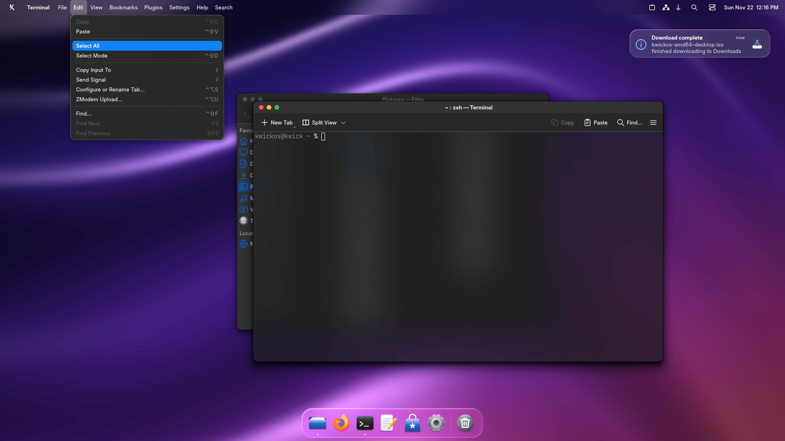
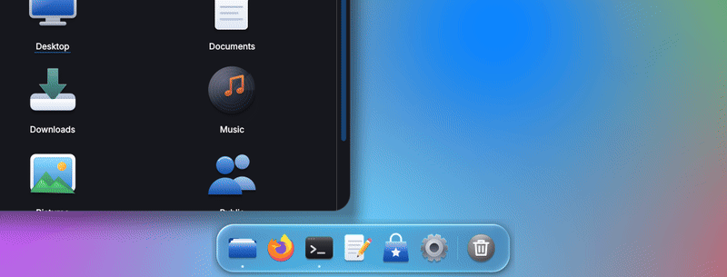
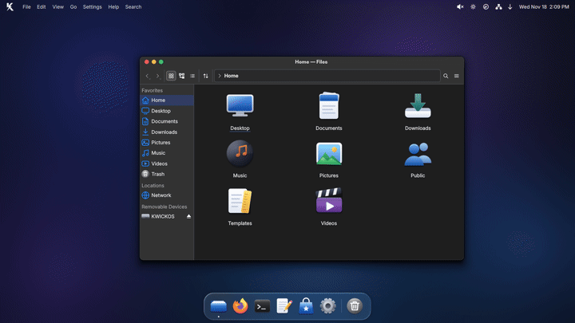
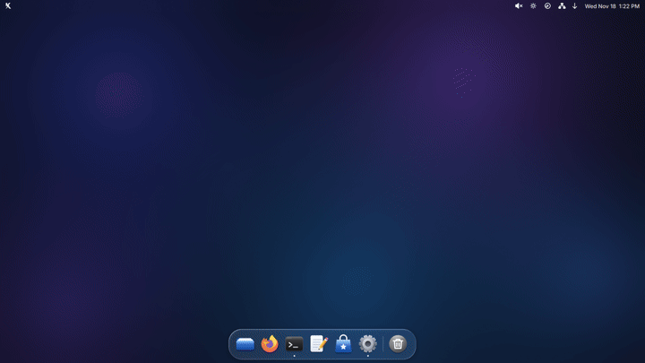
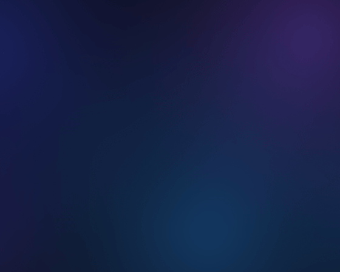

# Kwick Effects

Kwick Effects are native desktop effects. They run as KWin effects on KDE Plasma, GNOME Shell extensions on GNOME and
Hyprland animations on Hyprland. They need a GPU compositor. On a software compositor `kwick-effects` writes the config and
tells you so.

## Presets

```sh
kwick-effects off|subtle|fluid|full
```

| preset | what you get |
|---|---|
| off | no animations |
| subtle | fades, blur, sliding popups, magic lamp |
| fluid | plus curvy wobbly windows, sheets and the 3D flip open/close |
| full | plus flame open/close, translucency, dimmed inactive windows, the lit 3D desktop cube and Cover Flow Alt+Tab |

## Single effects

Switch effects one at a time with `kwick-effects set NAME on|off` (for example `kwick-effects set wobbly on`), or with the toggles
on the Effects page of KwickOS Settings.

| name | what it does |
|---|---|
| `wobbly` | windows stretch like jelly while you drag them |
| `lamp` | magic lamp minimize into the dock |
| `flame` | windows ignite and burn away, with tongues of fire licking just above the title bar |
| `flip` | windows swing in and out in 3D perspective with lighting (styles flip, door, tilt) |
| `dissolve` | closing windows crumble into glowing dust |
| `glide`, `fallapart` | the stock Glide and Fall Apart open/close effects |
| `cube` | Meta+C shows the desktops as a cube; the desktop switch animation can be a cube too (`kwick-effects switch cube`, Meta+Ctrl+Left/Right) |
| `blur`, `transparency`, `sheet`, `dim`, `overview` | frosted glass, translucency, dropping dialogs, dimmed inactive windows, overview |
| `liquidglass` | Liquid Glass: the dock, menu bar, menus, popups, notifications and OSDs refract and frost what is behind them (see below) |

Only one open/close effect is active at a time. `flame`, `flip`, `dissolve`, `glide` and `fallapart` replace each other.

All Kwick effects follow the global animation speed (`AnimationDurationFactor`, the slider in System Settings). At
"Instant" the flip, flame and dissolve effects are skipped. The desktop cube does not follow the slider yet.

## Options

* `kwick-effects wobbly AMOUNT SWAY` takes two numbers from 1 to 10 (`kwick-effects param wobbly` prints them). Amount is how far
  the window stretches. Sway is how curvy and fluid it is (softer springs and a finer mesh). The defaults are 6 and 7. In Settings
  they are the "Wobble" and "Sway" sliders.
* `kwick-effects flame-style classic|inferno|ember|blue|legacy` and `kwick-effects flame-height 50-200`:
  * Classic: orange fire along the burn line, with tongues rising about a fifth of the window height above the title bar.
  * Inferno: denser and a little wider, flares out slightly at the sides.
  * Ember: a subtle burn edge with drifting sparks.
  * Blue: a hot gas flame.
  * Legacy: a particle-system burn. Many additive flame particles along a line sweep up the window, yellow-white to orange to
    deep red, in about one second.

  Every style keeps the fire mostly inside the window footprint: at the default height of 100 the flames reach 15 to 25 percent of
  the window height above the top edge and flare only a little at the sides. `flame-height` scales that overflow (and the height of
  the flames inside the window), so 200 gives taller flames.
* `kwick-effects param flip flip|door|tilt` picks the 3D open/close style. Opening swings in on a damped spring (about 4%
  overshoot, settled by the end), closing accelerates away. The window is lit by a key and a fill light (Blinn-Phong
  highlight, Schlick Fresnel sheen, rim), the lighting stays on the window body and never on its shadow, and the texture is
  mipmapped with anisotropic filtering so text does not shimmer at steep angles. While it turns, the decoration's own
  shadow fades out and a soft shadow computed from the projected window outline (a Gaussian falloff of its signed distance,
  in logical pixels, so it is the same size on HiDPI) takes over below it.
* `kwick-effects param depth 0-10` sets how far windows float off the cube faces while it turns (the "Window depth" slider; default 5).
* `kwick-effects switch slide|fade|cube|none` sets the desktop switch animation.
* `kwick-effects tabbox windows|cover|flip|grid` sets the Alt+Tab style.

## Liquid Glass

Liquid Glass is a native KWin effect (`kwick_liquidglass`, source in `src/kwin-liquidglass`) modelled on the material Apple
introduced with macOS 26 and iOS 26. It is drawn under the dock, the menu bar, menus and popups, applet popups, notifications,
tooltips and OSDs, and optionally under window title bars.





How it is drawn, per glass surface:

* The shape is the bounding box of the surface's blur region (the mask Plasma and Breeze already send to KWin), drawn as a
  rounded rectangle with a signed distance field. The dock is 0.36 of its height (26 px on the 72 px dock), menus 10.5 px,
  applet popups 16 px, notifications 20 px, OSDs and the dock's name labels are capsules; they scale a little with the window
  corner radius setting. A bar that spans the screen, like the menu bar, only gets a bevel on its free edge and a fainter rim.
* Menus, popups and tooltips use a neutral dark frost: the colours behind are almost fully desaturated and darkened toward a
  neutral grey, so a red or orange wallpaper does not turn the menu brown. Notification banners adapt to what is behind them:
  the shader takes the average luminance of the blurred backdrop, and above about 0.55 the card becomes a light, bright frost
  (a 40% white veil over the saturated backdrop, no darkening) with dark text; below it, a darker frost that keeps the hue (a
  faint veil, then a multiply that darkens without greying) with white text. The two blend smoothly across the threshold. The text
  colour is switched in the same composite pass, from the same luminance, so it can never disagree with the material or flicker:
  near-white text right of the icon becomes black at 85% for the title and 50% for the body and timestamp, while the icon and
  anything coloured are left alone. The dock keeps the more saturated, clearer look.
* Menus, popups, notifications, labels and OSDs are drawn offscreen and cut to that rounded shape with an anti-aliased mask, so
  the app's own square or small-radius background corners never show outside the glass.
* Floating surfaces get a soft contact shadow drawn by the same pass, faded out when the window has no margin around the glass
  for it, so it is never cut off square at the window edge.
* Ordinary windows are rounded by the same offscreen pass (it replaces the rounded-corners effect while Liquid Glass is on): the
  window is cut to the corner radius from Settings (10 px by default in the macOS layout) with an analytic one-pixel coverage
  edge, gets exactly one device pixel of white hairline inside the shape (9% on the active window, 5% on others) and one pixel of
  dark contact line outside it, and a soft drop shadow computed from the same rounded-rectangle distance field (offset 14 px with
  a 17 px falloff on the active window, 8 and 12 px on others, plus a short ambient falloff), so it stays concentric with the
  corner at any radius and still shows on a dark wallpaper. The Aurorae edge and shadow are covered by this pass. The window
  corners are taken out of its opaque region so whatever is behind shows through. Windows with a blur region, like a translucent
  Konsole, get their blur from the glass pass, cut to the same shape. Client-side decorated windows (GTK and libadwaita apps) get
  the same corners and shadow in place of their own. While a window is scaled or rotated (open and close animations, minimize)
  the cut follows the transform; while another effect deforms it (wobbly windows, the flame), KWin draws it normally with the
  decoration's own shadow, whose corners are concentric with the same radius. Maximized and full-screen windows are left square.
* The screen behind the surface is copied once and blurred with a dual-Kawase pyramid (3 or 4 levels at half resolution and below).
* A fragment shader treats the rim as a convex glass bevel: the SDF gives the edge normal, a quarter-circle height profile gives the
  surface slope, and `refract()` with an index of 1.5 bends the view inward, so the content behind is pulled and magnified along the
  edges. Red and blue are refracted a little less and a little more than green for a slight chromatic fringe at the rim.
* The frosted (blurred) and sharp images are mixed: the rim stays sharper, the middle frostier. Saturation is boosted by about a
  third.
* Adaptive tint: the average brightness behind the glass sets how dark it gets. Over bright content the glass darkens so white
  text stays readable, over dark content it lifts a little and reads as lighter glass.
* A thin luminous stroke runs round the edge, with a specular rim from a light at the top left, a softer reflection on the opposite
  edge, a Fresnel brightening on the bevel and a faint inner glow.
* Moving the pointer over the glass swings the light toward it and adds a soft glow under the pointer.

Performance: the blurred backdrop is cached per surface and output and is only recomputed when something under the glass changes;
a repaint of the panel itself (a clock tick, hovering an icon) only re-runs the final pass inside the damaged region. In the virgl
lab VM, dragging a window behind the dock ran at 35 to 36 fps with Liquid Glass against 33 to 35 fps with the plain blur effect
(the VM tops out there), so the glass costs no measurable frame time over KWin's own blur. GPU timer queries are not usable under
virgl, so there is no per-pass GPU time from real hardware yet.

It needs GPU rendering. `kwick-effects auto` runs at login: it turns Liquid Glass on when KWin renders on a GPU (unless you
switched it off), and always off on llvmpipe or other software OpenGL. The plugin also refuses to load on a software renderer. The
fluid and full presets switch it on, off and subtle switch it off, and `kwick-effects set liquidglass on|off` or the Settings
toggle switch it by hand.

While it is on, `kwick-effects` switches Plasma to a small generated desktop theme, `kwick-liquidglass` in
`~/.local/share/plasma/desktoptheme`, that makes the panel, dialog and tooltip backgrounds nearly clear, falls back to your
previous Plasma theme for everything else and turns the background contrast filter off. It also draws the menu bar item
highlight as a translucent white rounded pill. Breeze menus get `MenuOpacity=25` so the glass shows through them, and the
translucency effect keeps menus opaque. Switching Liquid Glass off restores the previous theme and menu opacity.

Menus are drawn by `KwickMac`, a small Qt widget style (`src/kwick-macstyle`, built by `scripts/mkmacstylepkg.sh`) that the macOS
layout selects. It is a proxy over Breeze, so everything else keeps the Breeze look and the dark palette; it only replaces menu
items: 22 px rows, a 5 px rounded accent highlight inset 5 px from the menu edge with white text and icons, 1 px separators
inset 10 px at 12% white, right-aligned shortcuts in the secondary label colour, disabled items at 25%, 5 px top and bottom
padding, checkmarks and submenu chevrons drawn as thin strokes. Kvantum was considered; a full Kvantum theme would restyle every
widget and fight the palette, while the proxy changes menus only.

Notification popups use a Tahoe-style card from `/usr/local/share/plasma/plasmoids/org.kde.plasma.notifications` (Plasma 6.3.6's
notifications applet with a new popup delegate): 344 px wide with a 20 px radius, a 32 px app icon on the left, the title in
semibold, the body at 80% (black at 50% on the light material) clamped to two lines, a "now" / "5m ago" timestamp at the top right, and a round
close button that appears over the icon's corner on hover.

Tuning lives in `kwinrc`, group `[Effect-kwick_liquidglass]`, values in percent: `Refraction` (60), `Blur` (50), `Dispersion` (35),
`Specular` (70), `Tint` (100), `Style` (0 adaptive dark, 1 light, 2 clear), `TitleBars` (false, glass under translucent title
bars), `Interactive` (true), `Windows` (true, round and shadow ordinary windows) and `Profile` (0; 1 logs the animated frame interval and the glass GPU time every 600 frames to the
KWin log, 2 does the same with the glass skipped so the plain blur effect draws instead, for a baseline). Apply
changes with `qdbus6 org.kde.KWin /Effects org.kde.kwin.Effects.reconfigureEffect kwick_liquidglass`.

## GNOME and Hyprland

On GNOME the presets drive the extensions that are installed (wobbly, lamp, burn, cube, blur), and the wobble sliders map to the
wobbly extension. On Hyprland they write bezier-curve animations,
blur and dimming. Durations scale with the preset like the KDE animation speed (0.7 subtle, 0.8 fluid, 1 full). With flip on,
windows pop in from 60% on a spring curve with the same small overshoot as the KDE flip and close with an ease-in that fades
late; the cube setting becomes a horizontal slide-fade on an overshooting curve. The layout keeps its own corner radius and
shadow size; the effects file only switches the shadow on or off. The defaults in `hyprland.conf` come before the
`source` lines, so the effects file overrides them.

## Gallery

All GIFs were captured in a KVM guest with a virgl GPU (KWin on OpenGL) on the macOS layout, see [VERIFICATION.md](VERIFICATION.md).
The window effects were slowed down so every frame is a real render, the cube is sampled at fixed points of its animation
(`Scrub`, `ScrubFrom` and `ScrubTo` in `[Effect-kwick_cubeslide]` hold it at one point, for capture only), and the frames are
played back at a steady rate, so the real effects run faster and smoother. Frame sheets are next to them in `docs/img`
(`effects-*-frames.png`, and `effects-cube-before-frames.png` and `effects-3dopen*-before-frames.png` for the previous look).

| Wobbly windows (6/7) | Dissolve close | 3D desktop cube |
|---|---|---|
|  |  |  |

| 3D open/close: flip | door | tilt |
|---|---|---|
|  |  |  |

| Flame: classic | Flame: inferno | Flame: ember |
|---|---|---|
|  |  |  |

| Flame: blue | Flame: legacy | Magic lamp |
|---|---|---|
|  |  |  |

The Terminal glass profile, with blur and translucency:


