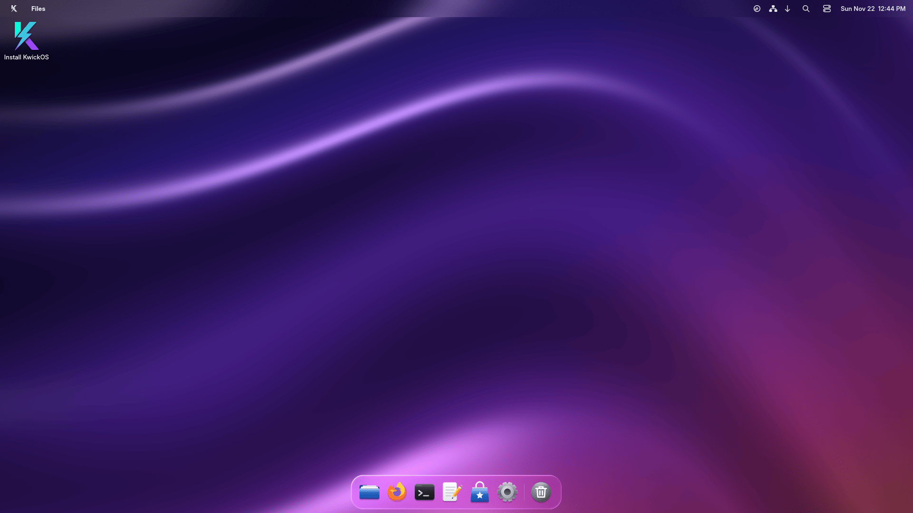
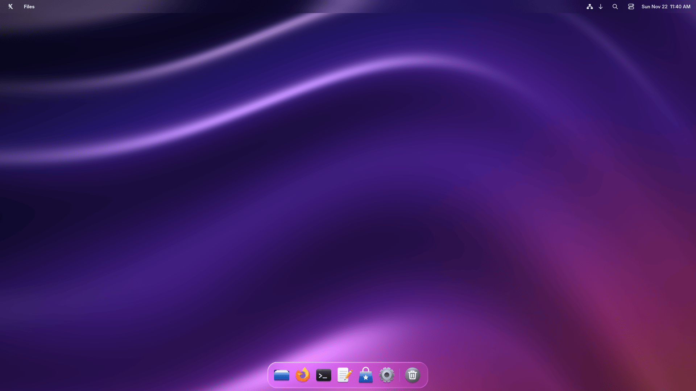
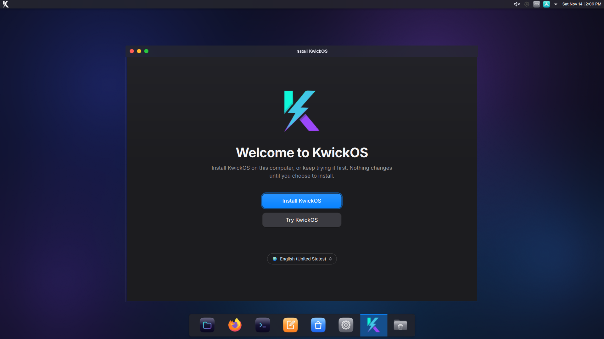
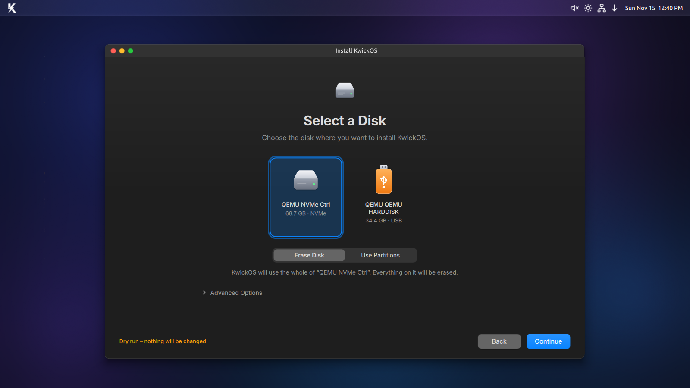
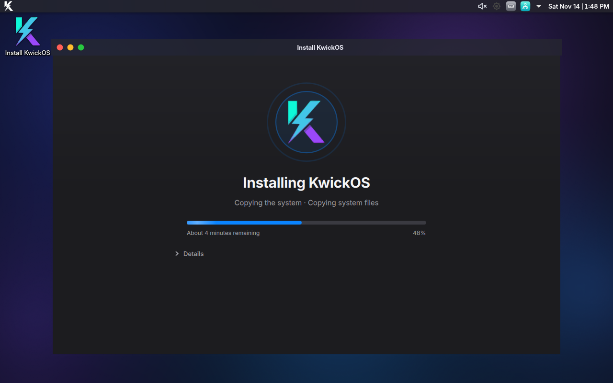
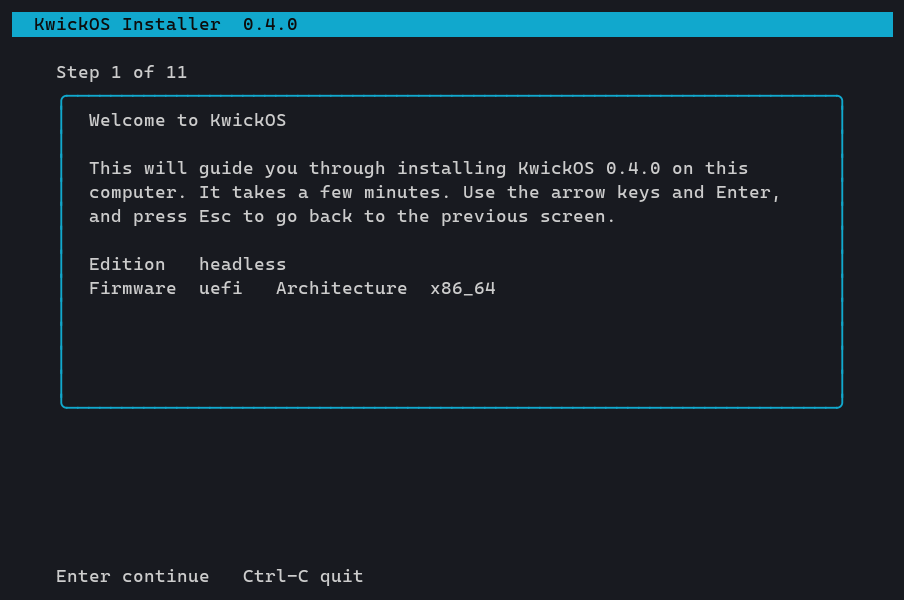
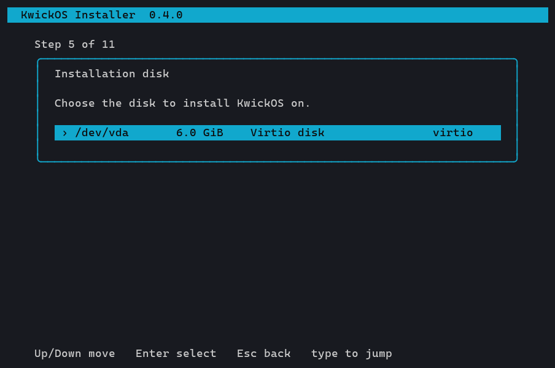
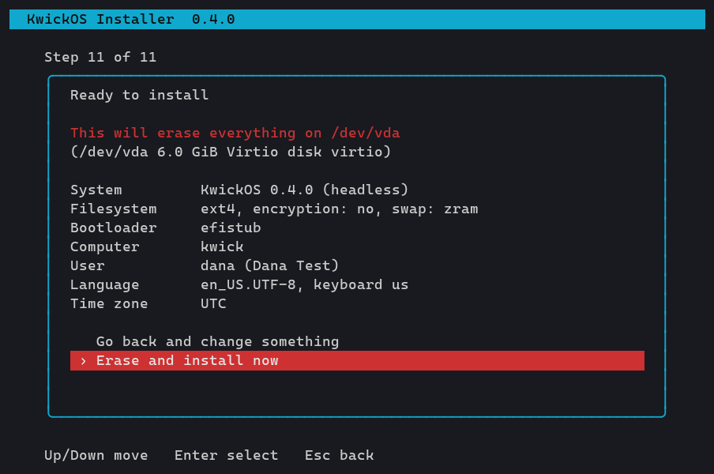
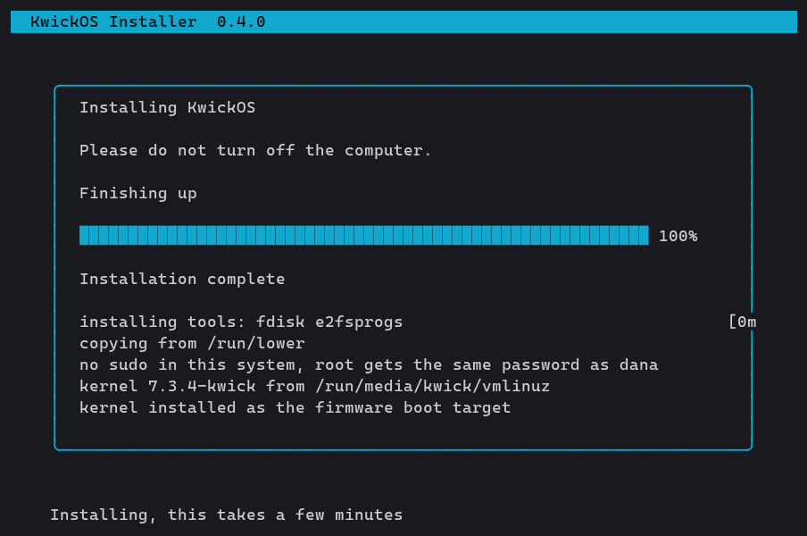

# Installing KwickOS

## Downloads

Every file is on the [latest release](https://github.com/metaspartan/kwickos/releases/latest). Replace `amd64` with `arm64` or
`riscv64` where published. CI builds, boot-tests and publishes them for every release.

| file | what |
|---|---|
| `kwickos-amd64-desktop.iso` | KDE Plasma 6 desktop live ISO, boots in **UEFI and BIOS** (also `arm64`, UEFI) |
| `kwickos-amd64.iso` | headless live ISO (UEFI, generic kernel, broad hardware), runs from RAM |
| `kwickos-amd64-headless.iso` | headless live and installer ISO, boots in **UEFI and BIOS** (`make headless-iso`) |
| `kwickos-amd64.qcow2` / `.img.zst` | VM/cloud disk: ESP (kernel) + ext4 root, 1 GiB |
| `kwickos-amd64.efi` | the kernel itself (virt flavor), a UEFI app and `-kernel` image for QEMU/Firecracker |
| `kwickos-amd64-initramfs.cpio.zst` | the whole OS as an initramfs (microVMs, CI sandboxes) |
| `kwickos-rootfs-amd64.tar.gz` | rootfs tarball (containers, chroots, WSL) |
| `kwickos-arm64-rpi.img.zst` | Raspberry Pi 4, 400, 5 and 500 (and CM4/CM5) SD card or USB image: FAT boot partition with the Pi firmware + ext4 root that grows on first boot |
| `ghcr.io/metaspartan/kwickos` | multi-arch container image |
| `SHA256SUMS` | checksums for the release files |

## The desktop, two ways

1. Boot `kwickos-amd64-desktop.iso` (UEFI or BIOS) and you land in Plasma.
2. Upgrade any headless install in place:

```sh
apt update && apt install kwick-desktop      # resolves to about 1,330 packages
reboot
```

The reboot into the upgraded desktop, the BIOS and UEFI ISO boots and a clean install are covered in
[VERIFICATION.md](VERIFICATION.md).

| Desktop ISO, UEFI | Desktop ISO, BIOS (SeaBIOS) | After `apt install kwick-desktop` on a headless image |
|---|---|---|
|  |  |  |

## The apt repository

The KwickOS repository (kernels, the desktop edition and the `kwick-*` packages) is preconfigured on every image. It is signed and
served from the project site. To add it by hand:

```sh
curl -fsSL https://metaspartan.github.io/kwickos/kwickos-archive-keyring.asc -o /usr/share/keyrings/kwickos-archive-keyring.asc
printf 'Types: deb\nURIs: https://metaspartan.github.io/kwickos\nSuites: stable\nComponents: main\nSigned-By: /usr/share/keyrings/kwickos-archive-keyring.asc\n' > /etc/apt/sources.list.d/kwickos.sources
```

Kernel updates arrive with `apt update && apt upgrade`. `kwick-kernel` lists, installs, switches, trials and rolls back
kernels ([KERNELS](KERNELS.md)); `kwick-kernel-install --list | --rollback` still works.

## Graphical installer

The live desktop opens **Install KwickOS** once at login and keeps it on the desktop and in the dock or panel. It walks through one
decision per screen:

1. language
2. keyboard (with a test field)
3. time zone
4. look (macOS, Windows or Linux layout)
5. disk: erase or existing partitions, with file system, encryption, swap and the boot loaders this machine supports under
   Advanced Options
6. account
7. a summary that ends in an **Erase and Install** confirmation

It follows the system's light or dark appearance and works entirely from the keyboard (Return continues, Alt+Left goes back).
`kwick-installer-gui --dry-run` runs every step without writing to disk. The work is done by `kwick-install`, which can also be
scripted directly.

| Welcome | Select a disk | Installing |
|---|---|---|
|  |  |  |

## Text installer

`kwick-installer` opens the graphical installer in a desktop session and the terminal installer (`kwick-installer-tui`, plain ANSI,
no extra packages) everywhere else. The headless live ISO prints `Run kwick-installer to install KwickOS` at login, and a
`kwick.install` kernel argument starts it on the console.

| Welcome | Disk | Summary | Installing |
|---|---|---|---|
|  |  |  |  |

## Scripted installs with kwick-install

Both front ends call `kwick-install`, which also scripts the whole thing. Secrets are only ever read from files:

```sh
kwick-install disks --json                     # path, size, model, transport, removable, is_live_medium
kwick-install bootloaders --json --fs btrfs    # what this machine can boot, and the default
kwick-install plan --disk /dev/vda --user alice --password-file /root/pw
kwick-install run --yes --disk /dev/vda --fs btrfs --encrypt --passphrase-file /root/luks --bootloader grub \
  --user alice --fullname "Alice" --password-file /root/pw --hostname box --timezone Europe/Berlin --swap zram
```

* `run` prints only `PROGRESS <0-100> <text>`, `STEP <id> <title>`, `LOG <text>`, `ERROR <text>` (then exits non-zero) and `DONE`.
* `--mode manual --root-part P --efi-part P [--home-part P]` uses existing partitions.
* `--dry-run` walks the steps without touching the disk.
* The disk holding the live medium is always refused.
* Installer tools (`fdisk`, `e2fsprogs`, `dosfstools`, `grub`, ...) that the live system lacks are fetched with `apt` first, so the
  headless ISO needs a network for that step.

## Boot loaders

| boot loader | firmware | notes |
|---|---|---|
| EFI stub | UEFI | default on UEFI with an unencrypted ext4 root, the kernel is the boot entry |
| GRUB | UEFI, BIOS (amd64) | any filesystem, LUKS2, kernel and menu on the ESP (UEFI) or `/boot` (BIOS) |
| systemd-boot | UEFI | kernel and initramfs on the ESP |

* Limine is not packaged in Debian 13 and is not offered.
* btrfs, xfs and LUKS roots get a small generated initramfs. ext4 does not need one.
* GRUB and systemd-boot installs pin `root=UUID=`.
* `make headless-iso ARCH=amd64` builds `kwickos-amd64-headless.iso` (UEFI and BIOS). `make headless-iso-grub` adds a GRUB menu
  with live, safe graphics (`nomodeset`) and install entries. The default boot path stays the EFI stub.
* Every live boot path (EFI image, isolinux, GRUB) passes `kwick.live`, which makes kinit mount the live medium before any installed
  KwickOS. Without it kinit prefers the `kwick-root` partition, so a live USB left plugged in never hijacks an installed machine.

## ZFS root

`kwick-install --fs zfs` installs onto a ZFS root (pool `kwickpool`, optionally inside LUKS with `--encrypt`). The kernel and
initramfs live on the ESP (UEFI) or an ext4 `/boot` (BIOS), so GRUB and systemd-boot never need to read ZFS. The EFI stub is not
offered for ZFS. The installer fetches OpenZFS when it is missing, so it needs the network. Details:
[STORAGE.md](STORAGE.md#zfs-root).

## Headless examples

```sh
qemu-system-x86_64 -M q35,accel=kvm -cpu host -m 512 -bios /usr/share/OVMF/OVMF_CODE.fd \
  -drive file=kwickos-amd64.qcow2,if=virtio -nic user,model=virtio-net-pci -nographic

qemu-system-x86_64 -M microvm,accel=kvm -cpu host -m 256 -nodefaults -nographic -serial stdio \
  -kernel kwickos-amd64.efi -initrd kwickos-amd64-initramfs.cpio.zst -append "console=ttyS0"

  ... -append "console=ttyS0 kwick.run=apt+update;apt+install+-y+jq"
```

## Apple Silicon

Use the arm64 qcow2 or ISO with UTM, Lima, Parallels or any Virtualization.framework VM. Bare-metal Asahi support is built but not
yet booted on a Mac; see [HARDWARE.md](HARDWARE.md#apple-silicon).

## Raspberry Pi

Write `kwickos-arm64-rpi.img.zst` to a microSD card or USB drive (decompress it with `unzstd` and use Raspberry Pi Imager's "Use custom" or balenaEtcher with the `.img`,
or run `zstd -dc kwickos-arm64-rpi.img.zst | sudo dd of=/dev/sdX bs=4M conv=fsync`). On first boot the root partition
and filesystem grow to fill the card (`kwick-growroot.service`). Login, autologin on the console and DHCP on `eth0` are the
same as on every other KwickOS image. The boot partition is mounted at `/boot/firmware`; `config.txt` and `cmdline.txt`
there are yours to edit and are never overwritten. Kernel updates arrive with `apt upgrade` (`linux-image-kwick-rpi`), and
`kwick-kernel` and `kwick-rpi-boot` manage them. For the desktop run `apt install kwick-desktop`. Details and what has and
has not been verified are in [HARDWARE.md](HARDWARE.md#raspberry-pi-4-and-5).

## Limitations

* The headless live ISO (`kwickos-amd64.iso`) and the disk images boot through UEFI only. The desktop ISO and the
  `kwickos-amd64-headless.iso` also boot in BIOS mode on amd64. Direct `-kernel` boot works everywhere.
