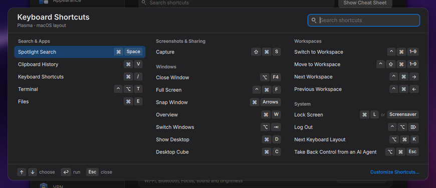
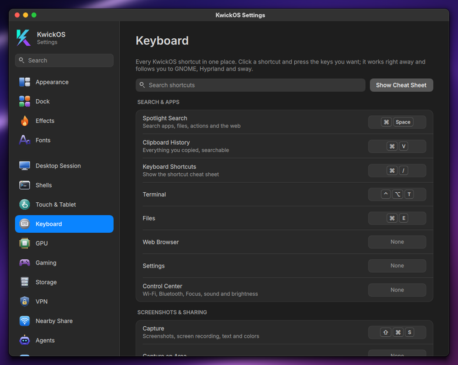

# Keyboard shortcuts

Every KwickOS shortcut lives in one keymap. Change one in **Settings > Keyboard**, with `kwick-keys set`, or by importing a
file, and it works right away in Plasma, GNOME, Hyprland and sway, in each session's own shortcut system. **Meta+K** (Super+K,
Win+K) opens a searchable cheat sheet on Linux, Windows and the tiling sessions, and **Cmd+/** opens it in the macOS layout.

| Cheat sheet (Plasma, macOS layout) | Settings > Keyboard |
|---|---|
|  |  |

## The keymap

The defaults are in `/usr/share/kwick/keys/defaults.json` and your changes in `~/.config/kwick/keys.json`. An action has an id,
a title, a category, a shell command or a native target per session, and default chords that can differ per session and layout.
Lookups go from the most specific key to the least: `kde/windows`, `tiling/macos`, `kde`, `tiling` (Hyprland and sway), `macos`,
then `*`. Your file only holds what you changed, and a change applies in every session and layout:

```json
{
  "version": 1,
  "bindings": {
    "spotlight": ["Meta+Ctrl+Space"],
    "osk": []
  }
}
```

An empty list removes the shortcut. Numbered and directional actions (switch to workspace 1 to 9, move focus, snap windows) take
one chord with `#` in place of the key: `Meta+Ctrl+#` binds Meta+Ctrl+1 to Meta+Ctrl+9.

## Default shortcuts

Meta is Cmd (⌘) in the macOS layout, Win in the Windows layout and Super on Linux. "Tiling" is Hyprland and sway.

| Action | macOS (Plasma, GNOME) | Windows (Plasma, GNOME) | Linux (Plasma, GNOME) | Tiling, every layout |
|---|---|---|---|---|
| Spotlight Search | Meta+Space | Meta+S or Meta+Space (Plasma), Meta+Space (GNOME) | Meta+Space | Meta+Space |
| Clipboard History | Meta+V | Meta+V | Meta+V | Meta+V |
| Keyboard Shortcuts (cheat sheet) | Meta+/ | Meta+K | Meta+K | Meta+K or Meta+/ |
| App Launcher (fuzzel) | | | | Meta+D |
| Terminal | Ctrl+Alt+T | Ctrl+Alt+T | Ctrl+Alt+T | Meta+Return |
| Files | Meta+E | Meta+E | Meta+E | Meta+E |
| Web Browser | | | | Meta+B |
| Capture | Meta+Shift+S | Meta+Shift+S | Meta+Shift+S | Meta+Shift+S |
| Capture an area / the screen | | | | Print / Shift+Print |
| Close Window | Alt+F4 | Alt+F4 | Alt+F4 | Meta+W or Meta+Q |
| Full Screen | Meta+Ctrl+F | | | Meta+F |
| Snap Window (Plasma, GNOME) | Meta+arrows | Meta+arrows | Meta+arrows | |
| Snap Layouts (Plasma) | | Meta+Z | | |
| Move focus / Move window | | | | Meta+arrows / Meta+Shift+arrows |
| Toggle floating, split, pseudo-tile | | | | Meta+Shift+V, Meta+J, Meta+P (Hyprland) |
| Shrink / Grow window | | | | Meta+- / Meta+= |
| Overview | Meta+W | same | same | |
| Switch Windows | Alt+Tab (GNOME also Meta+Tab) | same | same | |
| Show Desktop, Desktop Cube (Plasma) | Meta+D, Meta+C | same | same | |
| Switch to Workspace 1-9 | Meta+Ctrl+1..9 (Plasma) | same | same | Meta+1..9 |
| Move to Workspace 1-9 | Meta+Ctrl+Shift+1..9 (Plasma) | same | same | Meta+Shift+1..9 |
| Next / Previous Workspace | Meta+Ctrl+Right / Left (Plasma), Meta+PgDown / PgUp, Meta+Alt+arrows, Ctrl+Alt+arrows (GNOME) | same | same | Meta+Tab / Meta+Shift+Tab |
| Lock Screen | Meta+L (Plasma also the Screensaver key) | same | same | Meta+L |
| Log Out | Ctrl+Alt+Del | Ctrl+Alt+Del | Ctrl+Alt+Del | Meta+Shift+E |
| Next Keyboard Layout (Plasma) | Meta+Alt+K | Meta+Alt+K | Meta+Alt+K | |
| On-Screen Keyboard | | Meta+Ctrl+O | | |
| Reload sway | | | | Meta+Shift+C (sway) |
| Take Back Control from an AI Agent | Meta+Alt+Esc (reserved) | same | same | Meta+Alt+Esc |

Settings, Control Center (Plasma), Nearby Share, Web Browser outside the tiling sessions, the On-Screen Keyboard outside the
Windows layout and Next Desktop Layout (macOS, Windows and Linux in turn) have no default and can be given one. The defaults never
clash with each other in any session or layout (the unit test checks all twelve), and in the lab VM `kwick-keys conflicts` found
nothing in Plasma (all three layouts) or Hyprland. On GNOME it reports one older clash: KwickOS gives Super+S to the overview,
and GNOME also uses Super+S for quick settings.
Media, volume and brightness keys and the mouse bindings of the tiling sessions are not part of the keymap.

## Settings > Keyboard

The page lists every action by category with its shortcut as keycaps (⌘ ⌥ ⌃ ⇧ in the macOS layout, Ctrl, Alt, Shift and Win in
the Windows layout, Super on Linux) and has a search field. Click a shortcut and press the new keys: while it records, the
desktop's own shortcuts are paused (kglobalaccel is blocked on Plasma, an empty Hyprland submap or sway mode on the tiling
sessions) so the keys reach the page, the modifiers you hold show up as you press them, Esc cancels and Backspace removes the
shortcut. If the keys are taken, by another KwickOS action or by a Plasma or GNOME shortcut, the page says by what and offers
**Use Anyway**, which moves the keys over; resetting gives them back. Actions you changed have a **Reset** button,
**Reset All** brings back every default, and **Import** and **Export** read and write a small JSON file. A banner lists shortcuts
that clash with something else in the running session.

## The cheat sheet

`kwick-keys show` (or `kwick-keys` on its own) opens a centered sheet over a dimmed screen, grouped by category in up to three
balanced columns. Typing filters by name, category, keywords or keys, the arrows choose, Return runs the chosen action (so it is
also a launcher for actions you have no shortcut for), Esc or a click outside closes it, and **Customize Shortcuts…** opens the
Settings page. The same shortcut closes it again. It follows the layout (fonts, keycaps, corner radius, title case), light and
dark, and the accent color. On Plasma, Hyprland and sway it is a layer-shell overlay (`overlay.qml`); GNOME has no layer shell,
so there it is a borderless window over the work area (`overlay-window.qml`). Without `qml6` or Wayland it falls back to fuzzel
in the tiling sessions, and prints the list in a terminal.

## kwick-keys

```
kwick-keys [show]                   the cheat sheet (again to close it)
kwick-keys list [--json]            every action and its shortcuts
kwick-keys set ACTION CHORD [CHORD...]   change a shortcut; none removes it, --force takes it from others
kwick-keys reset [ACTION...]        back to the default (all with no ACTION)
kwick-keys conflicts [--all] [--json]    shortcuts used twice, here or by Plasma, GNOME, Hyprland or sway
kwick-keys apply                    write the shortcuts into this desktop and reload them
kwick-keys export [FILE]            your changes as JSON
kwick-keys import FILE [--merge]    load an export (replaces your changes unless --merge)
kwick-keys run ACTION[:VALUE]       do what a shortcut does (run workspace:3)
kwick-keys check ACTION CHORD       validate without saving
```

`--session kde|gnome|hyprland|sway` and `--layout macos|windows|linux` override the detected session and layout.

Chords are modifiers and one key joined by `+`. Meta, Super, Win, Cmd and ⌘ are the same modifier, as are Alt, Option and ⌥,
and Ctrl, Control and ⌃. Keys are letters, digits, F1 to F24, Space, Return, Esc, Tab, Backspace, Ins, Del, Home, End, PgUp,
PgDown, the arrows, Print, the punctuation keys (`/` `,` `.` `;` `'` `[` `]` `\` `-` `=` and the backtick), the media keys
and ScreenSaver. A chord is refused when it has no key or two,
repeats a modifier, has no modifier on a key that types (only function, Print and media keys may stand alone), uses Shift as the
only modifier on a key that types, puts Shift on a symbol (it gives a different character on other keyboard layouts), or is
Ctrl+Alt+F1 to F12 or Ctrl+Alt+Backspace.

## How each session gets the shortcuts

* **Plasma.** Actions KWin, ksmserver, Spotlight or another app already own are changed in place through kglobalaccel's D-Bus
  interface (`setForeignShortcut`), which takes effect at once and is saved in `kglobalshortcutsrc`. Command actions become small
  hidden `kwick-keys-*.desktop` files in `~/.local/share/applications`, registered with kglobalaccel as service shortcuts
  (`doRegister`, `setShortcut` with the present flag), the same way Plasma's own custom commands work. Konsole, Dolphin and
  Capture keep their own desktop files. Conflicts come from `kglobalshortcutsrc` and from a live `getGlobalShortcutsByKey` query.
* **GNOME.** Shell and mutter keys (close, full screen, snap, workspaces, overview, lock, log out, Spotlight's extension key) are
  set with gsettings; commands become custom keybindings under `/org/gnome/settings-daemon/plugins/media-keys/custom-keybindings/kwick-keys-*`;
  Clipboard History and Capture are grabbed by the `kwick-clipboard` extension, which watches `~/.config/kwick/keys/gnome.json`.
* **Hyprland and sway.** `~/.config/hypr/kwick-keys.conf` and `~/.config/sway/kwick-keys.conf` are generated and included from the
  session config, then `hyprctl reload` or `swaymsg reload` loads them. Conflicts come from `hyprctl binds -j` and from the sway
  config files.

**Your own shortcuts stay yours.** kwick-keys only touches the actions in the keymap, the `kwick-keys-*` desktop files and
custom keybindings it created and its two include files. A stock shortcut is written once when its KwickOS default is missing; if
you then change it in KDE or GNOME settings, kwick-keys leaves it alone until you change that action in KwickOS. Keys taken with
**Use Anyway** or `--force` are recorded in `~/.local/state/kwick/keys-applied.json` and handed back on reset. `kwick-layout`
runs `kwick-keys apply` on every layout switch, so the per-layout defaults follow it.

## Compared with Omarchy

Omarchy lists Hyprland's binds with Super+K and lets you edit `~/.config/hypr/bindings.lua` by hand. KwickOS keeps that idea (one
key for a searchable list you can run actions from) and adds a settings page that records shortcuts, conflict detection across
KwickOS and the desktop's own shortcuts, validation, import and export, per-layout defaults, and the same keymap on Plasma,
GNOME, Hyprland and sway.

## Files

| path | what |
|---|---|
| `/usr/bin/kwick-keys` | the CLI (Python 3, standard library only) |
| `/usr/share/kwick/keys/defaults.json` | actions, targets and default chords |
| `/usr/share/kwick/keys/overlay.qml`, `overlay-window.qml`, `Sheet.qml`, `Cap.qml` | the cheat sheet |
| `/usr/share/kwick/settings/PageKeyboard.qml`, `helpers/keys.sh` | the Settings page |
| `~/.config/kwick/keys.json` | your changes |
| `~/.config/hypr/kwick-keys.conf`, `~/.config/sway/kwick-keys.conf`, `~/.config/kwick/keys/gnome.json` | generated |
| `~/.local/state/kwick/keys-applied.json` | what kwick-keys last wrote, and keys it took from other actions |
| `tests/kwick-keys-test.py` | chord parsing, validation and conflict tests (`python3 tests/kwick-keys-test.py`) |
