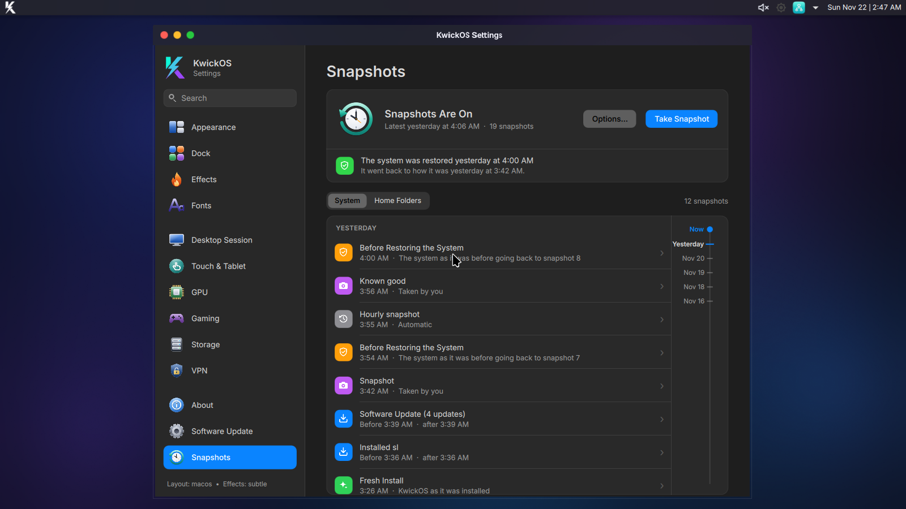
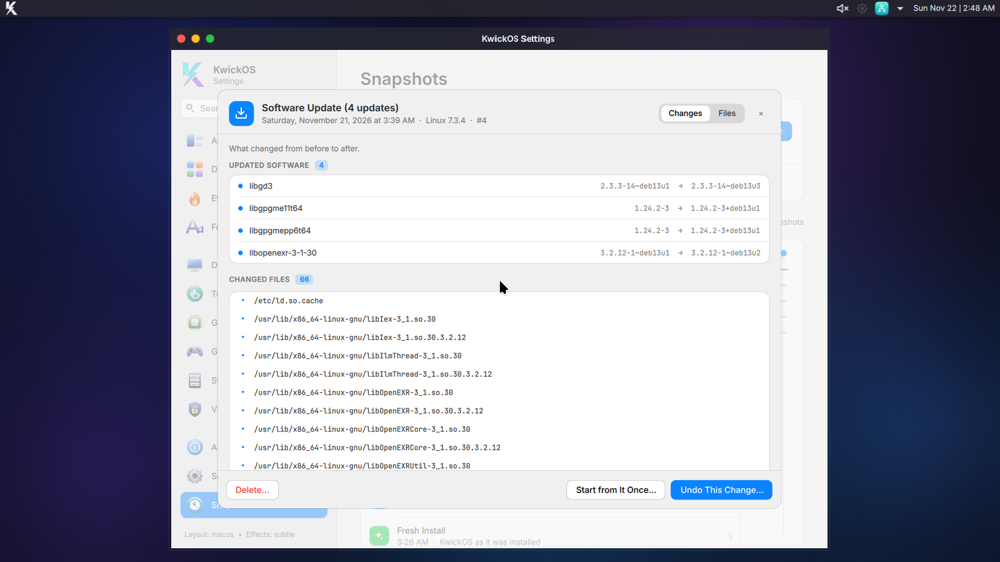
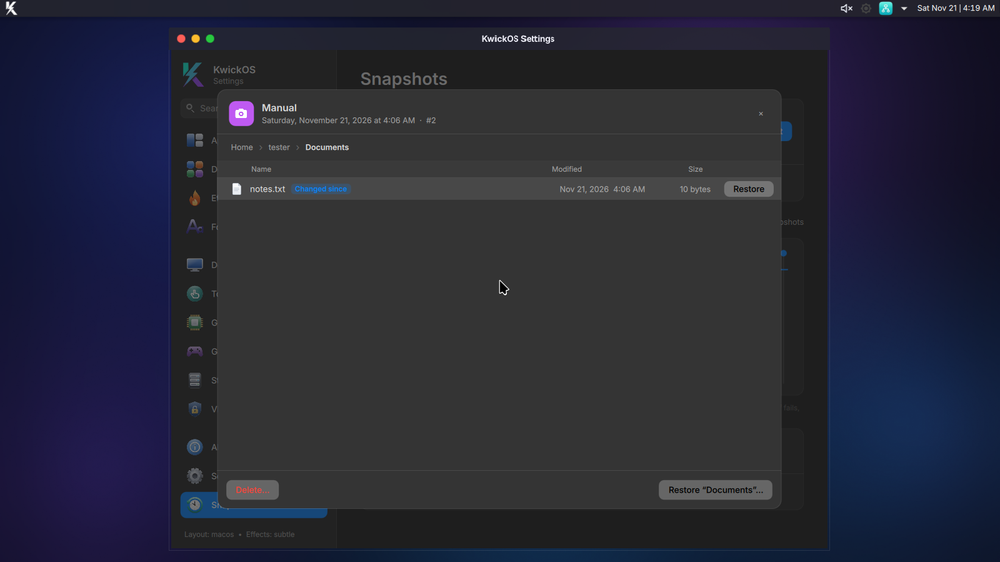
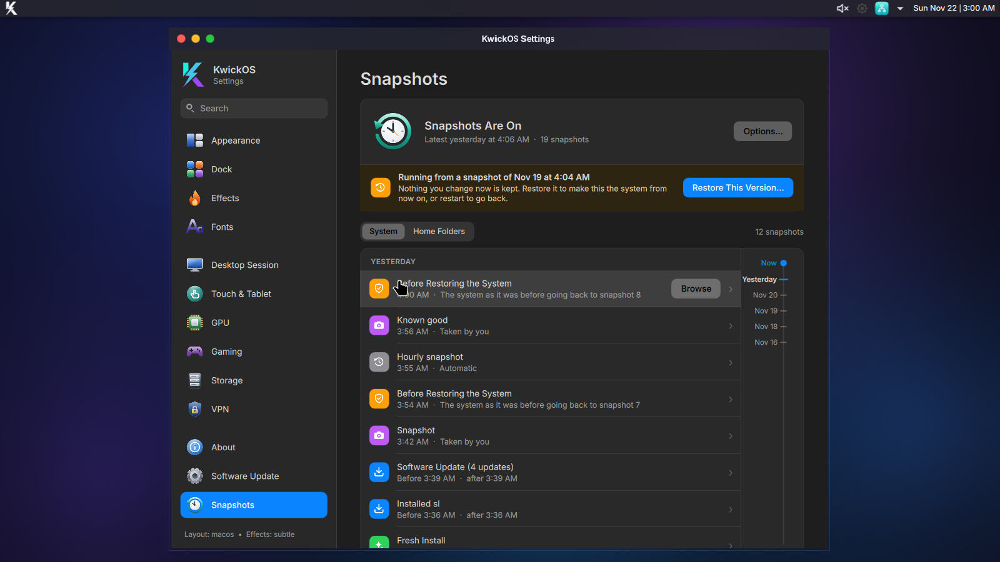
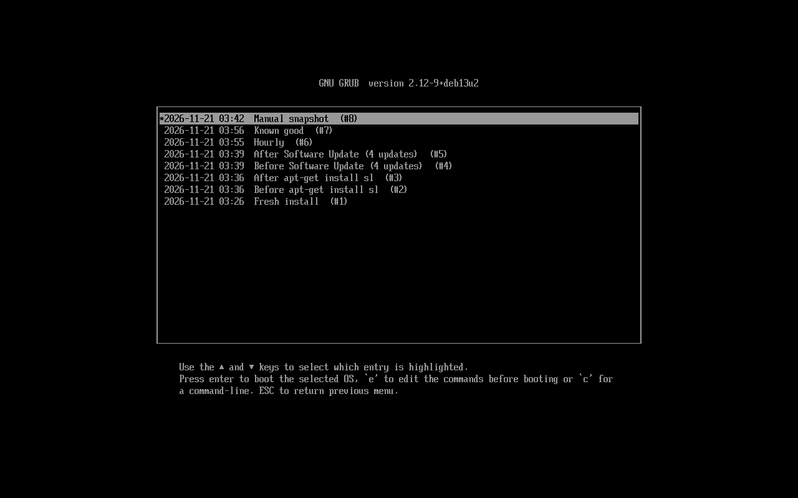
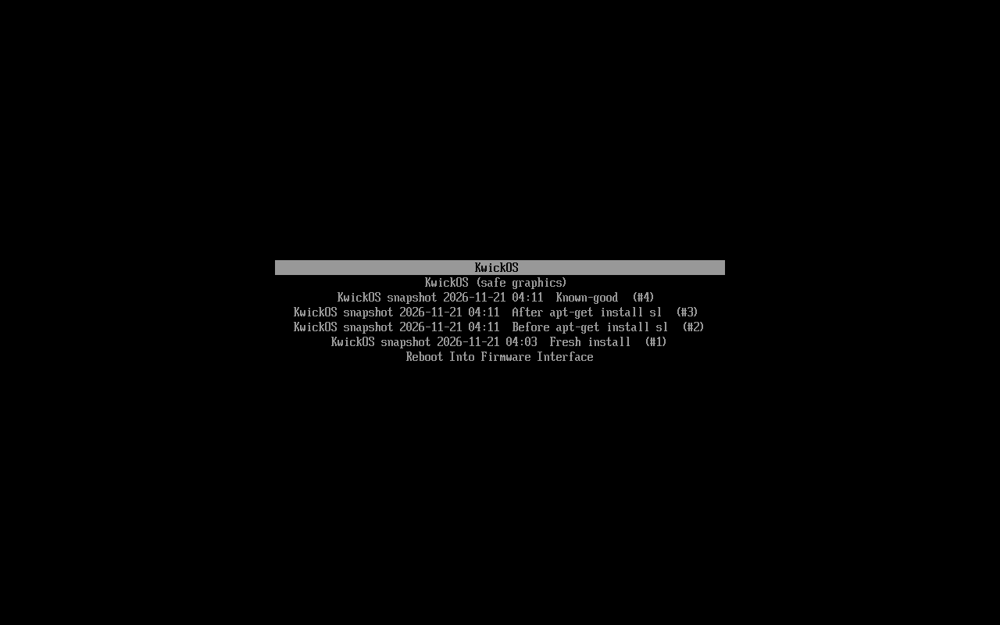

# System snapshots

KwickOS takes Btrfs snapshots of the system before and after every software change, and every hour, so an update that goes
wrong can be undone, a deleted or overwritten file can be brought back, and a system that no longer starts can be started from
an earlier snapshot. `kwick-snapshot` is the one command behind it, and the **Snapshots** page of KwickOS Settings (also its own
launcher entry, **Snapshots**) is a window onto that command.

| Timeline (dark) | A software change (light) | Browsing a home snapshot |
|---|---|---|
|  |  |  |

| Running from a snapshot | GRUB: KwickOS snapshots | systemd-boot |
|---|---|---|
|  |  |  |

```
kwick-snapshot status [--json]                 what this system supports, settings, disk space
kwick-snapshot list [-c root|home|all] [--json]
kwick-snapshot create [-c root|home] [-d TEXT] [--important]
kwick-snapshot delete [-c CFG] N [N-M ...]
kwick-snapshot diff [-c CFG] A [B]             files changed from A to B (B: the running system)
kwick-snapshot packages A [B]                  packages installed, removed or updated from A to B
kwick-snapshot restore [-c CFG] N PATH... [--to DIR] [--keep-both]
kwick-snapshot rollback N [--yes] [--reboot]   make snapshot N the system from the next start
kwick-snapshot boot-once N                     start snapshot N read-only at the next restart only
kwick-snapshot cleanup                         apply the retention policy now
kwick-snapshot config [set KEY VALUE ...]      timeline|home|apt on|off, hourly|daily|weekly|monthly|number|free|boot-entries N
kwick-snapshot quota on|off                    btrfs quotas, for per-snapshot sizes
kwick-snapshot setup                           turn snapshots on for a Btrfs system installed without them
kwick-snapshot boot-sync                       rewrite the snapshot entries of the boot menu
kwick-snapshot --device DEV|auto ...           work on an installed disk from the live ISO or a rescue shell
```

`status`, `list`, `packages` and `diff` of a pair that already has its changes recorded work as any user; everything else needs
root (the Settings page asks through polkit, see [Permissions](#permissions)).

### Machine-readable output

`kwick-snapshot create "DESCRIPTION"` (the description may also be given with `-d`) prints the new number, or
`{"ok":true,"id":N,"config":"root"}` with `--json`. `kwick-snapshot list --json` prints one array, oldest first, of objects with:

| field | meaning |
|---|---|
| `config` | `root` (the system) or `home` |
| `id` | snapshot number within its config |
| `type` | `single`, `pre` or `post` |
| `pre`, `post` | the other half of a pre/post pair, 0 when none |
| `date` | Unix time it was taken |
| `desc` | description (`apt-get install vim`, `Software Update (3 updates)`, `Hourly`, ...) |
| `cleanup` | `number`, `timeline` or empty (kept until deleted) |
| `important` | kept longer by the cleanup |
| `kernel` | kernel release that was running (system snapshots) |
| `changes` | the list of changed files is recorded (post snapshots) |
| `size` | exclusive bytes when quotas are on, otherwise 0 |
| `booted` | the system is running from this snapshot now |

Errors, including "Snapshots need a Btrfs system disk" on ext4, come as `{"ok":false,"error":"..."}` with exit status 1.
The kwick-agents MCP server (`kwick-mcp`) uses exactly `list --json` and `create "DESCRIPTION"`.

## The disk layout

Snapshots need Btrfs. The installer (`kwick-install`, the graphical installer and the text installer) now uses Btrfs by
default whenever the running kernel can mount it (the generic kernel of the ISOs can; the `virt` kernel of the small VM images
cannot, and there the default stays ext4). ext4 and XFS remain one click away, and both installers say plainly that they come
without snapshots.

A Btrfs install is a flat set of subvolumes at the top of the volume:

| Subvolume | Mounted at | Rolled back with the system |
|---|---|---|
| `@` | `/` | yes, this is the system |
| `@home` | `/home` | no, your files stay as they are |
| `@root` | `/root` | no |
| `@srv` | `/srv` | no |
| `@var_log` | `/var/log` | no, so the logs of what went wrong survive a rollback |
| `@var_cache` | `/var/cache` | no, downloaded packages are not thrown away |
| `@var_tmp` | `/var/tmp` | no |
| `@snapshots` | `/.snapshots` | no, the snapshots themselves |
| `@swap` | `/swap` | only with `--swap file:SIZE`; a swap file cannot live in a subvolume that is snapshotted |

The rest of `/var` (the package database in `/var/lib/dpkg`, `/var/lib/flatpak`, the kernel state) is part of `@`, because
it has to match the programs in `/usr`. All subvolumes are mounted with `noatime,compress=zstd:1`, `/.snapshots` with
`nosuid,nodev` (an old snapshot may hold a set-uid program that was fixed since). The kernel command line carries
`rootflags=subvol=@`, and `/etc/kwick/install.conf` records `ROOT_SUBVOL=@`, which `kwick-kernel` uses for every boot entry it
writes.

On BIOS computers a Btrfs install now gets a 1 GiB ext4 `/boot`, like encrypted and ZFS installs: GRUB cannot write its
environment block on Btrfs, and that block is what makes one-shot kernel trials ([KERNELS](KERNELS.md)) and starting a snapshot
once possible. On UEFI the kernels and the GRUB environment already live on the EFI System Partition.

The installer takes snapshot 1, "Fresh install", at the end, marks it important, enables `kwick-snapshot-boot.service` and
`crond`, writes the hourly timeline line into root's crontab and installs `btrfs-progs` into the new system when the live
system did not have it.

## What is snapshotted, and when

There are two sets ("configs"): **root**, snapshots of `@` stored in `/.snapshots/root/N/snapshot`, and **home**, snapshots
of `@home` in `/.snapshots/home/N/snapshot`. Each snapshot is a read-only Btrfs snapshot; it costs nothing when it is made and
then only the space of what changes afterwards. Next to it, `info` holds the type (`single`, `pre`, `post`), the time, a
description, the cleanup class (`number`, `timeline`, or none), whether it is important, and for system snapshots the running
kernel and the default kernel id. For a `post` snapshot, `changes` holds the list of files that changed since its `pre`.

* **Every package change.** `/etc/apt/apt.conf.d/80kwick-snapshot` adds `DPkg::Pre-Invoke` and `DPkg::Post-Invoke` hooks.
  kpkg (KwickOS's apt and dpkg) now runs these hooks around every `apt-get`/`apt` transaction that installs, upgrades or
  removes something, exactly as Debian's apt does, so the same file also works with real apt. The pre hook takes a `pre`
  snapshot described by the command that ran (`apt-get install vim`), the post hook a `post` snapshot linked to it, then
  records the changed files in the background and applies the retention policy. A dry run, `--download-only` and a transaction
  with nothing to do take no snapshot. `dpkg -i` on its own takes none either (as on Debian).
* **Every Software Update.** `kwick-update upgrade` wraps the whole update (system packages and Flatpak apps) in one pair,
  "Software Update (N updates)", and tells the apt hooks to stay quiet so there is one pair, not two.
* **Every hour.** BusyBox `crond` runs `kwick-snapshot timeline` at a random minute of every hour (`KWICK_JOB=snapshot` in
  root's crontab, the same convention as `kwick-update`). It takes a system snapshot and, when `/home` is a subvolume, a home
  snapshot, skips a set that already has one from the last 50 minutes, and then cleans up. The job is cheap: two
  `btrfs subvolume snapshot` calls and a few `stat`s.
* **By hand.** `kwick-snapshot create`, or **Take Snapshot** in Settings. These have no cleanup class and stay until deleted.
* **Before a restore or a rollback.** `restore` first snapshots the current state, and `rollback` saves the running system
  as an important snapshot, so both can be undone.

Nothing is snapshotted while the system runs from a snapshot (see below), from the installer, or in a chroot.

## Retention

`kwick-snapshot cleanup` (run after every timeline and every post snapshot, and after a settings change) keeps:

* timeline snapshots: the newest per hour for `HOURLY` hours (10), per day for `DAILY` days (7), per week for `WEEKLY` weeks (4)
  and per month for `MONTHLY` months (3), like snapper's timeline cleanup;
* software-change snapshots: the newest `NUMBER` (10) pairs, and of those marked important the newest `IMPORTANT` (10); a pair
  is always kept or deleted as a whole;
* manual snapshots and snapshot 1 ("Fresh install") are never deleted automatically.

Then, while less than `FREE` percent (20) of the volume is free, the oldest timeline or software-change snapshot goes, one at a
time. Settings live in `/etc/kwick/snapshot.conf`:

```
TIMELINE=1
TIMELINE_HOME=1
APT=1
HOURLY=10
DAILY=7
WEEKLY=4
MONTHLY=3
NUMBER=10
IMPORTANT=10
FREE=20
BOOT_ENTRIES=10
```

### Quotas

Btrfs quota groups are off. With quotas on, every write is accounted to every snapshot that shares the data, which makes
deleting snapshots and heavy writes noticeably slower once there are dozens of snapshots (the reason snapper and openSUSE moved
away from relying on them). Retention therefore works on the free space of the volume, which is cheap and always correct.
`kwick-snapshot quota on` turns quotas on for people who want the exclusive size of each snapshot; `list --json` then reports
it in `size`.

## Browsing, comparing and restoring files

Snapshots are plain read-only directory trees under `/.snapshots`, readable with the permissions the files had when the
snapshot was taken: everyone can look at system snapshots, and each user can read their own home folder in home snapshots.

* `kwick-snapshot restore N /etc/fstab` copies the file back (atomically, through a temporary name) after taking a snapshot of
  the current state. `--keep-both` writes `fstab (restored 2026-11-20 14.02.11)` next to it instead, `--to DIR` copies into
  another directory, and `-c home` restores from home snapshots (`kwick-snapshot restore -c home 12 /home/alice/Documents`).
* `kwick-snapshot diff A B` lists the files that changed (`+` new, `-` deleted, `c` changed) from `btrfs send --no-data`, which
  reads only metadata and is fast even for a large update. Without `B` it compares with the running system. For a pre/post pair
  the list is recorded when the post snapshot is taken, so it needs no root later.
* `kwick-snapshot packages A B` compares the package database (`/var/lib/dpkg/status`) of the two, which is the readable way
  to see what an update did. It needs no root.

## Rolling the whole system back

`kwick-snapshot rollback N`:

1. saves the running system as a new important snapshot, "Before rollback to N";
2. mounts the top of the Btrfs volume, renames `@` to `@.rollback-DATE` and creates a new writable `@` from snapshot N (if `@`
   was also the volume's default subvolume, the default moves to the new `@`);
3. copies over what the boot partition needs from the replaced system: kernel modules and kernel files the restored system
   does not have and the kernel state (`/var/lib/kwick/kernel-state`), because kernels live on the EFI System Partition (or
   `/boot`), which a rollback does not touch, so the kernel that starts next must find its modules;
4. writes `/var/lib/kwick/snapshot/rollback` in the new `@`, which Settings shows as "The system was restored";
5. refreshes the boot menu.

The restore takes effect at the next start. `kwick-snapshot-boot.service` then deletes the old `@.rollback-*`. `/home`, `/root`,
the logs, the caches and the snapshots are separate subvolumes and are not touched. To undo the rollback, roll back to the
"Before rollback" snapshot.

## Starting from a snapshot

Snapshot boot entries are written by `kwick-snapshot boot-sync` after every snapshot change and every kernel change
(`kwick-kernel` calls it), for the newest `BOOT_ENTRIES` system snapshots. Each entry starts the kernel the snapshot was taken
with when it is still installed, or the default kernel, with `rootflags=subvol=@snapshots/root/N/snapshot kwick.snapshot=N`.

The initramfs that `kwick-install` builds for Btrfs, XFS, ZFS and encrypted roots understands `kwick.snapshot=N`: it mounts the
snapshot read-only and puts a tmpfs overlay over it, so KwickOS starts normally, everything works, and every change is in memory
and gone at the next restart (the same approach as grub-btrfs with its overlayfs hook, and openSUSE's read-only snapshot
boot). `/home`, the logs and the snapshots are mounted as usual. While running from a snapshot, Settings shows **Running from a
snapshot** with **Restore This Version…**, and `kwick-snapshot rollback N` from that system makes it permanent.

Initramfs images built before this change do not have the overlay; `kwick-snapshot boot-sync` detects that (the new image
contains a `kwick-snapshot` marker) and runs `kwick-kernel sync` once to rebuild them.

| Boot path | Snapshot entries in the boot menu | Start a snapshot once (`boot-once`, Settings **Start from It Once…**) | Rollback |
|---|---|---|---|
| GRUB (UEFI) | submenu **KwickOS snapshots** (`$prefix/kwick-snapshots.cfg`, sourced by `grub.cfg`); press Esc while KwickOS starts | `next_entry=kwick-snapshots>kwick-snap-N` in `grubenv` on the ESP | running system, live ISO |
| GRUB (BIOS) | the same; `grub.cfg` and `grubenv` are on the ext4 `/boot` of new installs | the same | running system, live ISO |
| systemd-boot | one `loader/entries/ksnap-NNNNNN.conf` per snapshot, listed after the kernels; press Space while KwickOS starts | `LoaderEntryOneShot` (through `bootctl` or the EFI variable directly) | running system, live ISO |
| EFI stub | none: the EFI stub boots ext4 roots only, so there are no snapshots | | not applicable |
| U-Boot (BPI-F3), Raspberry Pi, Apple | none: these boot paths have no menu; their images are ext4 | | on a Btrfs root set up by hand: running system and `--device` from a rescue system |
| containers, direct kernel boot | none | | not applicable |

GRUB menus are hidden (`timeout_style=hidden`, one second): Esc or Shift shows them. systemd-boot shows its menu when Space is
held. Both are written with `panic=10` like every other entry, so a snapshot whose kernel cannot start reboots into the default.

## Recovering a system that does not start

1. **The boot menu.** Press Esc (GRUB) or Space (systemd-boot) while the computer starts, open **KwickOS snapshots**, pick the
   last snapshot before the problem. KwickOS starts read-only from it.
2. **Make it permanent.** In Settings, Snapshots, **Restore This Version…**, or `sudo kwick-snapshot rollback N`, then restart.
3. **Without a boot menu, or if the boot partition itself is broken**, start the KwickOS live ISO and run

   ```sh
   sudo kwick-snapshot --device auto list             # finds the btrfs partition labelled kwick-root
   sudo kwick-snapshot --device auto rollback N --yes
   ```

   For an encrypted disk unlock it first (`cryptsetup open /dev/nvme0n1p2 kwick-root`) and pass
   `--device /dev/mapper/kwick-root`. `--device` also works with `restore N PATH --to DIR`, to copy files out of a snapshot onto
   a USB stick. The live ISO fetches `btrfs-progs` with apt when it lacks it (as the installer does). Running the installer is
   never needed to recover.

## Systems that cannot take snapshots

* **ext4 and XFS installs** (all installs before 0.7, the VM images, Raspberry Pi and BPI-F3 images): `kwick-snapshot status`
  says "Snapshots need a Btrfs system disk. This system was installed on ext4, which cannot take snapshots. Nothing was
  changed." Every command that would change something stops with that message; the apt hooks, the hourly job and
  `kwick-update` skip snapshots silently, so nothing about these systems changes. The Settings page shows **Snapshots Need
  Btrfs** with the same explanation.
* **ZFS installs** are pointed at `kwick-storage pool snapshot`.
* **Btrfs installs made before 0.7** have their root at the top of the volume and no `@snapshots`. `kwick-snapshot setup`
  (or **Turn On…** in Settings) creates `@snapshots`, mounts it at `/.snapshots` through `/etc/fstab`, enables the service and
  the hourly job and takes a first snapshot. Snapshots, comparing and restoring files then work; rolling the whole system back
  does not, because the running root cannot be swapped out from under the top of the volume, and `status` says so.

## Settings: Snapshots

KwickOS Settings, **Snapshots** (`kwick-settings snapshots`; the **Snapshots** launcher entry runs `kwick-snapshots`):

* At the top, whether snapshots are on, the latest one, how many there are and the free space, with **Options…** and **Take
  Snapshot**. **Options…** has the switches for software-change, hourly system and hourly home snapshots, how many hourly, daily,
  weekly, monthly and software-change snapshots to keep, and how much of the disk to leave free.
* **System** and **Home Folders**, each a timeline grouped by day (Today, Yesterday, weekday, date) with a time ruler on the right
  that jumps to a day, like Time Machine's. A software change is one row ("Installed vim", "Updated software", "Software Update
  (3 updates)") with the time before and after.
* Opening a row shows the snapshot: **Changes** lists the software that was updated, installed or removed and the changed files
  (for a single snapshot, compared with now; comparing files with now asks for a password), **Files** browses the snapshot with
  the files that changed since or no longer exist marked, and restores a file or a folder with **Keep Both** or **Replace** (the
  current version goes to the Trash). Files in your own home folder are restored as you, without a password; system files go
  through `kwick-snapshot restore`. **Undo This Change…** or **Restore System…** rolls back after a clear confirmation and
  restarts; **Start from It Once…** restarts into the snapshot read-only; **Delete…** removes it.
* While running from a snapshot, an orange banner says so, with **Restore This Version…**. After a rollback, a green line says
  when the system was restored and to which point.
* On ext4 the page explains why there are no snapshots instead.

Dolphin gets **Restore Previous Versions…** in the context menu of every file and folder
(`/usr/share/kio/servicemenus/kwick-snapshots.desktop`); it opens the page at the newest snapshot of that folder with the file
selected.

## Permissions

`desktop/rootfs/usr/share/polkit-1/actions/org.kwickos.snapshot.policy` defines `org.kwickos.snapshot` for
`pkexec /usr/sbin/kwick-snapshot` (administrator, kept for a few minutes). `rules.d/50-kwickos-snapshot.rules` lets local,
active members of `sudo` or `wheel` take a manual snapshot, compare snapshots and refresh the boot menu without a password;
restoring, rolling back, deleting and changing settings always ask.

## Systems installed from an older image

`kwick-snapshot`, `kwick-snapshot-boot.service` and the apt hook file are in the base image and in the `kwick-update` package
(`scripts/mkupdatepkg.sh`), so an older install that is upgraded gets them; the postinst enables the service when
`/.snapshots` is mounted. On ext4, which every older install is, they do nothing.

## Where the ideas come from

| Tool | What was taken |
|---|---|
| openSUSE snapper and `snapper-zypp-plugin` | pre/post pairs around every package transaction, number and timeline cleanup, `info` next to each snapshot, `undochange`-style file restore |
| snapper's apt hook (`DPkg::Pre-Invoke`/`Post-Invoke`) | the apt hook point, which kpkg now implements |
| grub-btrfs | snapshot entries in a GRUB submenu sourced from a separate file, the overlayfs initramfs hook for read-only snapshot boot |
| Timeshift (btrfs mode) | the `@`/`@home` layout and rollback by renaming `@` and creating a new one from the snapshot |
| macOS Time Machine | the timeline with a date ruler, browse-and-restore with Keep Both or Replace, "Restore from Time Machine" from the recovery system |
| Fedora/openSUSE defaults | `compress=zstd:1`, separate `/var/log` so logs survive a rollback, free-space based cleanup instead of quotas |

## Testing

The end-to-end run (fresh Btrfs installs with GRUB and systemd-boot, snapshots around updates, a broken system rolled back,
starting snapshots from both boot menus, rescue from the live ISO, ext4 behaviour, the Settings page in dark and light) is in
[VERIFICATION](VERIFICATION.md#system-snapshots-end-to-end).
