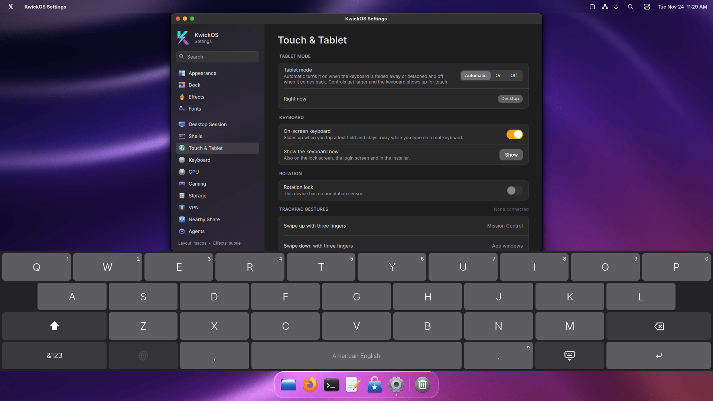
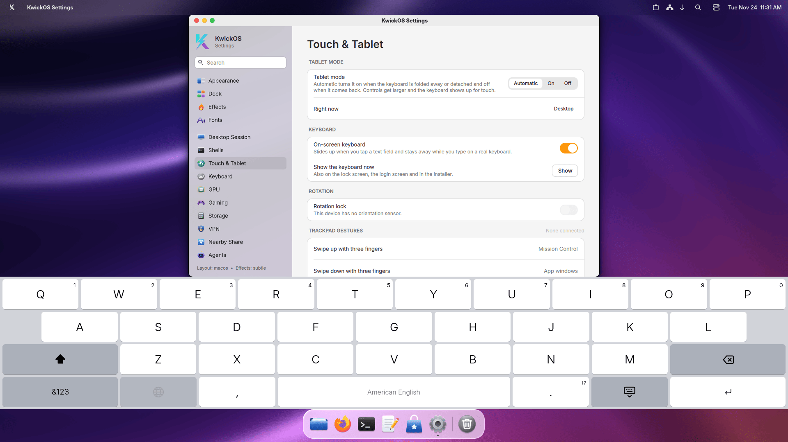
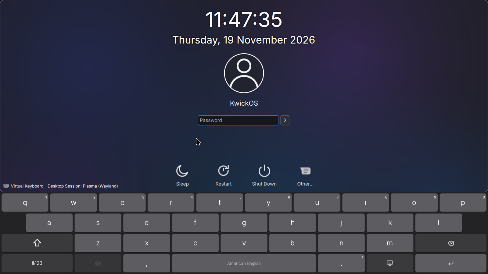
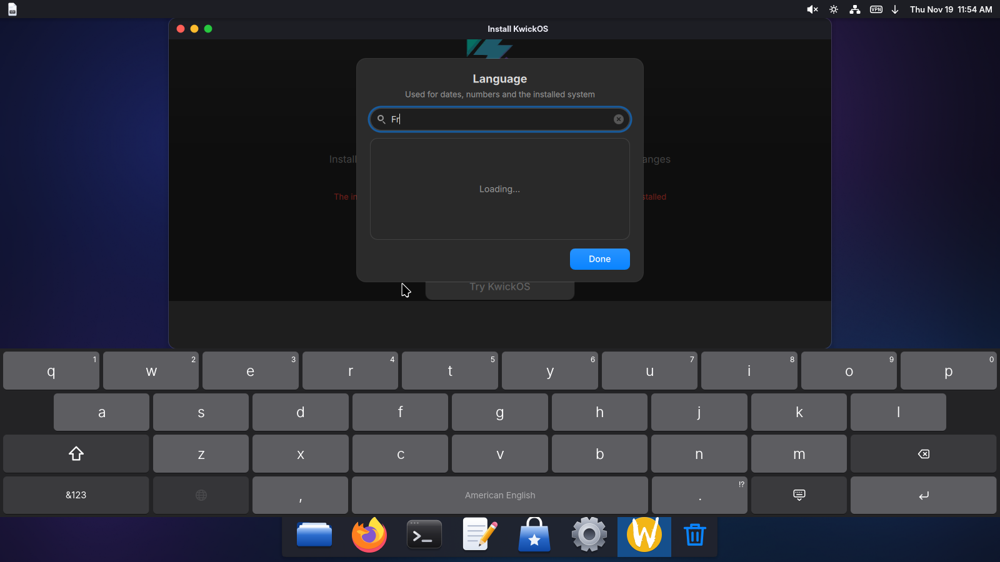
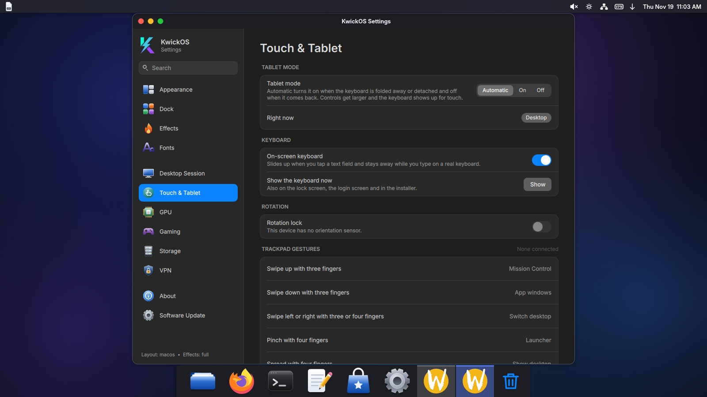
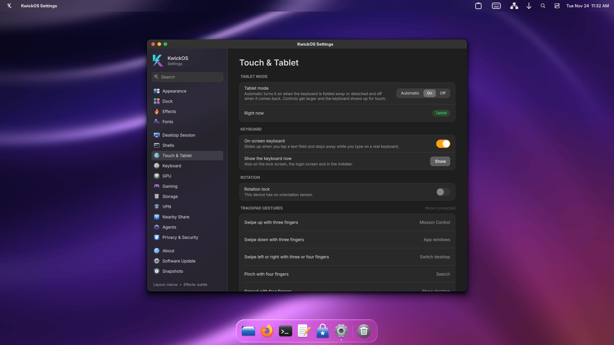
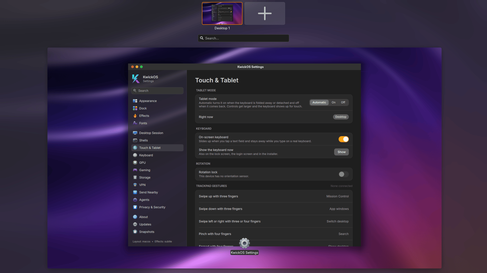
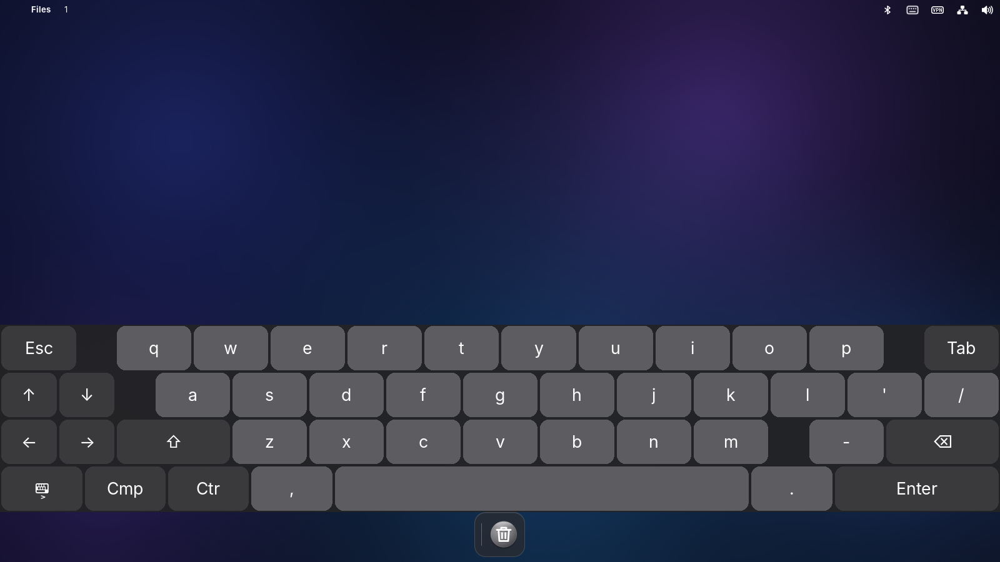

# Touch, tablet and pen

KwickOS works on touchscreens, 2-in-1s and tablets in all three sessions. An on-screen keyboard slides up when you tap a text
field, touchpad and touchscreen gestures follow the active layout, tablet mode switches itself on when the keyboard goes away,
and Settings has a **Touch & Tablet** page. Light and dark both work: the keyboard and the page follow the system palette.

## What you get per session

| | KDE Plasma (default) | GNOME | Hyprland |
| --- | --- | --- | --- |
| On-screen keyboard | `plasma-keyboard`, appears when a text field is focused by touch or pen, hides while a hardware keyboard is used | GNOME Shell's keyboard (built in) | `wvkbd`, toggled with the keyboard button in the bar |
| Login screen and lock screen | the same keyboard; tap the password field or the Virtual Keyboard button | GDM's keyboard | n/a |
| Installer | the same keyboard (the installer runs in the live Plasma session) | n/a | n/a |
| Tablet mode | KWin `TabletMode` = auto, on or off | automatic | n/a |
| Rotation | KWin auto-rotation through `iio-sensor-proxy` (in tablet mode), lock in Settings | GNOME auto-rotation, lock in Settings | `kwick-touch` follows the accelerometer, lock in Settings |
| Gestures | per layout, below | GNOME's own | workspace swipe, 3 fingers (4 in the Windows layout), touchscreen edge swipe |

## On-screen keyboard

Debian 13 does not package `plasma-keyboard` (it ships with Plasma 6.6, Debian 13 has 6.3), and `maliit-keyboard` in Debian 13 is
a Qt 5 build that drags in Qt 5, `fonts-noto` and the Chinese input engines (about 105 MB for the keyboard alone). KwickOS therefore
builds `plasma-keyboard` 6.6.0 itself: `scripts/mkkeyboardpkg.sh` downloads the KDE release tarball, checks its sha256, lowers the
minimum Qt and Frameworks versions to Debian 13's (6.8 and 6.13, nothing else needed changing), drops the KCM and translations, and
restyles the keys, and makes every key commit at once (no word prediction, so search and filter fields update while you type). It is built like the KWin plugins: as its own stage in `desktop/Dockerfile` and through `kwin_plugin keyboard` in
`scripts/mkdesktoppkg.sh`. Installed size is 1.6 MB; Qt Virtual Keyboard itself was already on the desktop image.

The look is the iPad keyboard: letter keys in a lighter tone, the shift, delete, return and mode keys a step darker, 7 px gaps,
rounded keys with a one-pixel shadow and the system font. In dark mode the panel is `#232325` with
`#5d5d61` letter keys; in light mode it is `#d1d3d9` with white letter keys. The palette switches on the brightness of the current
Plasma color scheme. The shift, caps lock, delete, return, hide and globe glyphs are drawn by the build script
(`/usr/share/plasma/keyboard/icons`) and tinted with the key text color, so they do not depend on the icon theme.

KWin starts the keyboard from `/etc/xdg/kwinrc` (`[Wayland] InputMethod`, `VirtualKeyboardEnabled`), which also covers SDDM's
KWin; `/etc/sddm.conf.d/10-kwickos.conf` passes `--inputmethod plasma-keyboard` to the greeter's KWin and empties SDDM's
`InputMethod` so the greeter talks Wayland text-input instead of loading Qt's in-process keyboard. `QT_QPA_PLATFORMTHEME=kde` in the greeter environment makes the greeter and its keyboard read the system color scheme from `/etc/xdg/kdeglobals` (without it they fall back to light Breeze). KWin only shows it when the
text field was focused by touch or pen, so mouse and keyboard users never see it. Vibration and key clicks are off
(`/etc/xdg/plasmakeyboardrc`).

## Tablet mode

KDE: `kwick-touch tablet auto|on|off` writes `[Input] TabletMode` in `kwinrc` (the system default in `/etc/xdg/kwinrc` is `auto`).
Automatic follows the hardware tablet-mode switch of 2-in-1s and turns tablet mode off when a touchpad or keyboard is attached. In
tablet mode Plasma and Kirigami apps use larger controls and spacing and KWin rotates the screen.

Larger hit targets that cost nothing: the switches, segmented controls and buttons in Settings and the installer accept taps up to
44 px tall without changing how they look.

## Gestures

KWin already handles: 3- and 4-finger left/right on the touchpad (switch desktop), 4-finger up (Overview) and down (desktop grid),
and on the touchscreen 3-finger up/down and left/right. KwickOS adds the rest per layout:

| Layout | Touchpad (added by `kwick-touch`) | Touchscreen edge swipes (KWin `TouchEdges`) |
| --- | --- | --- |
| macOS | 3 fingers up: Mission Control (Overview); 3 down: App windows; 4-finger pinch: Search; 4-finger spread: show desktop | up from the bottom: Mission Control; down from the top: Search |
| Windows | 3 fingers up: Task view; 3 down: show desktop | in from the left: Task view; up from the bottom: Start |
| Linux | KWin defaults only | down from the top: Overview; in from the left: launcher |

The extra touchpad gestures come from a small watcher, `kwick-touch gestured`: `libinput debug-events` filtered by `grep` and read by
one `awk`, started at login by `/etc/xdg/autostart/kwick-touch.desktop` when the layout needs it and `/dev/input` is readable (the
desktop user is in the `input` group). It keeps running so touchpads plugged in later work too, and exits when the compositor's
Wayland socket goes away. It fires the KWin shortcuts `Overview`, `ExposeClass` and `Show Desktop` through `kglobalaccel`, or
Search, 0.3 s after the gesture ends (KWin's own 3-finger release would otherwise close the Overview again). Unlike KWin's
4-finger gestures these do not follow the fingers.

GNOME keeps its own gestures (3 fingers up for Activities, left/right for workspaces, swipe up from the bottom edge of a
touchscreen). Hyprland gets `gestures:workspace_swipe_fingers` 3 (4 in the Windows layout) and `workspace_swipe_touch` for edge
swipes in `~/.config/hypr/kwick-touch.conf`, sourced by the Hyprland config. The bar's keyboard button (shown when a
touchscreen is present or tablet mode is on) toggles `wvkbd`, which starts hidden with the same key colors as the Plasma keyboard
and picks light or dark from `org.gnome.desktop.interface color-scheme`.

Touch and hold opens context menus in Qt Quick, Kirigami and GTK apps; a pen's lower barrel button right-clicks. There is no
system-wide long-press for Qt Widgets apps on Plasma 6.3.

## Rotation

`iio-sensor-proxy` (138 KB) provides the accelerometer. KwickOS runs without systemd, so the upstream udev rule that pulls in the
systemd unit does nothing. Instead kinit starts the daemon at boot (it exits at once when the machine has no sensor), and
`/usr/lib/udev/rules.d/90-kwick-sensor-proxy.rules` starts it through D-Bus activation
(`/usr/share/dbus-1/system-services/net.hadess.SensorProxy.service`) when a sensor appears later. `monitor-sensor` and KWin only
watch for the service, they do not start it.

* KDE: KWin rotates in tablet mode. KWin 6.3 has no command line for its per-output rotation policy, so the lock rewrites
  `autoRotation` in `~/.config/kwinoutputconfig.json` and applies from the next login.
* GNOME: `org.gnome.settings-daemon.peripherals.touchscreen orientation-lock`.
* Hyprland: `kwick-touch rotated` asks D-Bus for the sensor (which starts the daemon), follows `monitor-sensor` and turns the
  built-in panel, the touchscreen and the pen with `hyprctl`.

## `kwick-touch`

```
kwick-touch [status]                   current settings, devices and gestures (Settings reads this)
kwick-touch tablet auto|on|off
kwick-touch osk on|off
kwick-touch rotation auto|locked
kwick-touch keyboard show|hide|toggle
kwick-touch apply                      apply to the running session
```

Settings live in `~/.config/kwick/touch`. `kwick-layout` calls `kwick-touch apply` on every layout switch, so gestures and edges
follow the layout. Devices are detected from udev's database (`ID_INPUT_TOUCHSCREEN`, `ID_INPUT_TOUCHPAD`, `ID_INPUT_TABLET`) and
`/sys/bus/iio`.

## Packages added

| Package | Installed size | Why |
| --- | --- | --- |
| `plasma-keyboard` 6.6.0 (built by KwickOS, inside `kwick-desktop`) | 1.6 MB | Plasma on-screen keyboard |
| `qt6-virtualkeyboard-plugin` | 35 KB | Qt input context plugin the keyboard needs; without it no key reaches the app (QML module and library were already installed) |
| `qml6-module-org-kde-layershell` | 55 KB | language popup of the keyboard (library was already installed) |
| `iio-sensor-proxy` | 138 KB | accelerometer for rotation |
| `wvkbd` | 801 KB | Hyprland on-screen keyboard |
| `libinput-tools` | 953 KB, plus `python3-libevdev` and `python3-pyudev` (about 0.4 MB) | `libinput debug-events` for the gesture watcher |

Total: about 4 MB installed.

## Testing in the VM lab

`tools/vmlab/qmp.py` gained `tap x y w h [hold]` and `swipe x0 y0 x1 y1 w h [fingers] [steps]`, which drive a QEMU
`virtio-multitouch-pci` device (start the VM with `EXTRA='-device virtio-multitouch-pci'`). `tools/vmlab/touchpad.py` runs inside
the guest and creates a uinput touchpad with `python3-libevdev` to play 3- and 4-finger swipes and pinches
(`python3 touchpad.py up 3`, `pinch 4`, `spread 4`).

Results are in [VERIFICATION.md](VERIFICATION.md#touch-and-tablet).

## Screenshots

| | |
| --- | --- |
|  |  |
|  |  |
|  |  |
|  |  |
